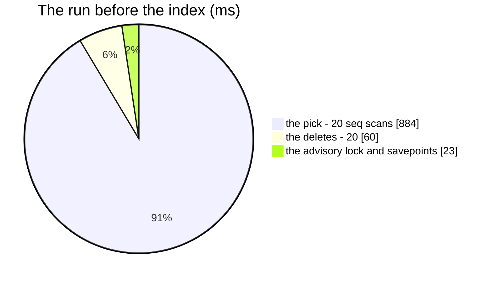

# SweepGeneratedFiles — performance audit

**Verdict:** 🔴 → ✅ **fixed by a pure index** ([a-pure-index-is-added-without-asking](../../../../docs/technical/architecture/context_decision.md#a-pure-index-is-added-without-asking)).
Without an index the sweep's pick — the oldest generated downloads made before the cutoff — scanned the WHOLE `documents`
table once per batch of 100: 44 ms a pick, **1.03 s** for one day's 2 000 files at 316 000 documents, growing with every
receipt, statement and photo ever uploaded (none of which is ever swept). A partial index on `(created_at, id)` over the
three generated types — **`documents_generated_created_idx`, document `00012`, ✅ applied 2026-11-11** — makes the pick
0.9 ms and the run **0.14 s**; it holds only about a week of rows however large the table grows.
**Measured:** 2026-11-11 · `document_service/document_v1/generated_file_sweep.go` (not an RPC: the daily ticker and
`san document sweep-generated` call it) · seed 300 000 uploads over a year (`order_receipt`, `general`, `payment_proof`,
`product_image`, `settlement_statement`) + 16 000 generated downloads over the last 8 days (2 000 a day — the steady state
of a daily sweep), 5 000 shares · one run of the default shape (oldest first, 100 per transaction) over the 1 999 files
past the cutoff, in a rolled-back savepoint so both runs sweep the same rows · `TestPerf_SweepGeneratedFiles`
(`-tags perfaudit`)

| | before (no index) | after (`00012`) |
| --- | --- | --- |
| the pick, one batch (EXPLAIN ANALYZE) | 43.1 ms — Seq Scan on `documents`, Sort | **0.72 ms** — Index Scan on `documents_generated_created_idx` |
| dry run (`--dry-run`: count up to the limit) | 37.7 ms | **4.9 ms** |
| the run, 1 999 files, 20 transactions | 1.03 s wall · 0.97 s db | **0.14 s** wall · 0.08 s db |
| queries | 82 | 82 |

---

## Queries (one batch; the run repeats it until the limit or nothing is left)

| # | What | Rows | Before | After | Verdict |
| --- | --- | --- | --- | --- | --- |
| 1 | `SAVEPOINT` (BEGIN in production) | | | | ok |
| 2 | `SELECT pg_try_advisory_xact_lock(hashtext('document_service'), hashtext('generated-file-sweep'))` | 1 | 0.6 ms | 0.4 ms | ok |
| 3 | `SELECT id FROM documents WHERE resource_type IN (the three) AND created_at < ? AND NOT EXISTS (a share) ORDER BY created_at, id LIMIT 100 FOR UPDATE SKIP LOCKED` | 100 | **44 ms** — Seq Scan + Sort over every row | **0.9 ms** — Index Scan, the share an index probe on `document_shares_unique` | 🔴 → ✅ [finding 1](#1-the-pick-scanned-the-whole-table--fixed) |
| 4 | `DELETE FROM documents d WHERE d.id IN (100 ids) AND NOT EXISTS (a share) RETURNING …` | 100 | 3.0 ms | 2.3 ms | ok — by primary key |
| — | *the store: one delete per object and thumbnail — the local filesystem here, a bucket in production* | | | | |
| 5 | `RELEASE SAVEPOINT` (COMMIT) | | | | ok |

After the last full batch, when the run stopped at its limit, one `SELECT EXISTS (… the same predicate …)` says whether
more are left — the same index.

---

## Findings

### 1. The pick scanned the whole table — fixed

`documents` keeps every upload forever and only the generated downloads are swept, so with no index on the sweep's
predicate every batch read the whole table and sorted what matched: cost grows with every receipt ever stored, and a run
pays it once per 100 files.

- **Fix applied** (pure index, `a-pure-index-is-added-without-asking`): `00012_generated_files_created_index.sql` —
  `CREATE INDEX documents_generated_created_idx ON documents (created_at, id) WHERE resource_type IN ('order_labels',
  'table_export', 'order_export')`. Partial, so it holds only the generated rows (about a week's worth once the daily
  sweep runs); `(created_at, id)` is the pick's own `ORDER BY`, so the `LIMIT` stops after 100 index entries with no sort.
- ⚠ The type list is written into the sweep's SQL as **literals** (`generatedResourceTypes`), not bound parameters: the
  planner matches a partial index's predicate only against constants it can see, and a cached generic plan with
  `IN ($1, $2, $3)` would fall back to the seq scan. The migration's comment and the constant's comment point at each other.
- No query changed; nothing else reads the index.

## Scale

At 3 million uploads the before-plan would be ~10× the 44 ms per batch (a seq scan is linear in the table); the
after-plan stays at the size of a week of generated files. The store's deletes, not the database, are the run's cost in
production — 2 000 object deletes against a bucket, sequential inside each 100-file transaction.
