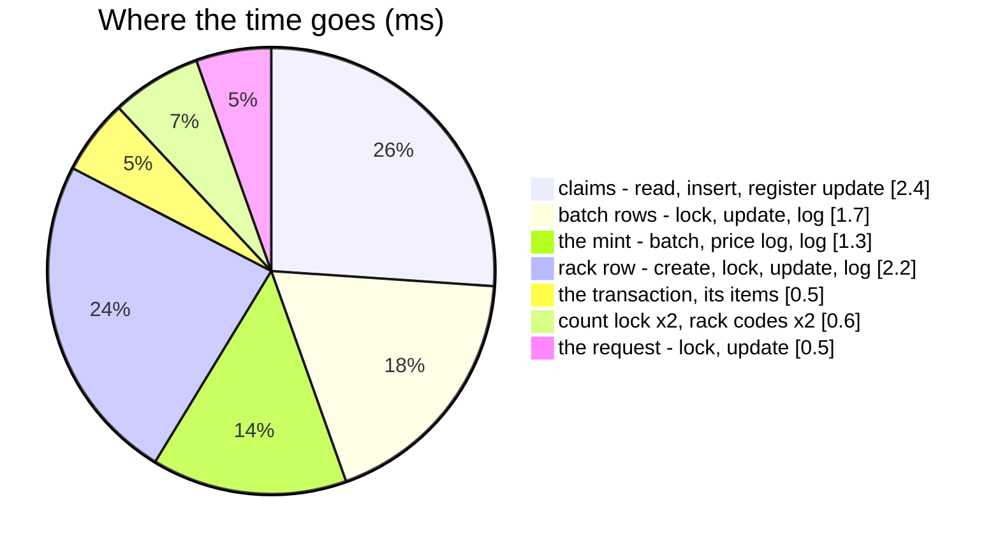

# FoundRequestApprove — performance audit

**Verdict:** 🟢 ok — **26 statements, 9.2 ms** for an approval that claims two losses and mints the third unit — the
stock count's own finalize over one product and one row, plus the request's lock and its update.
**Measured:** 2026-11-03 · `inventory_service/inventory_v1/found_request_approve.go` →
`inventory_mutations.PostFoundApproval` → `PostCountFinalize` · the ledgers' background volume ([OrderTransactionCreate](OrderTransactionCreate.md)) and the stock count's
([OpnameSessionFinalize](OpnameSessionFinalize.md)) plus **50 000 found requests** (one in ten waiting) · warm, 5 runs
(`found_request_perf_test.go`, `-tags perfaudit`) · six products, each with two open
single-unit losses and a waiting request of 3

| case | median wall | statements |
| --- | --- | --- |
| 2 claims + a mint | 9.2 ms | 26 |

---

## Statements

| # | What | ×N | Time | Verdict |
| --- | --- | --- | --- | --- |
| 1 | the request `FOR UPDATE` | 1 | < 0.5 ms | ok — the primary key |
| 2 | the rack is live; the count lock — the early refusal | 2 | < 0.5 ms | ok |
| 3 | the open losses `FOR UPDATE` · the newest price · the batches `FOR UPDATE` | 3 | 1.5 ms | ok — the count's own reads |
| 4 | the rack row: create if missing, `FOR UPDATE`, the count lock again (`Guard`), update, log | 5 | 2.5 ms | ok — the second lock read is the one that counts |
| 5 | the `found` transaction, its items | 2 | 0.5 ms | ok |
| 6 | batch rows update + logs; the minted batch, its price log, its log | 5 | 2.8 ms | ok |
| 7 | claims: `problem_claimed_transactions`, the register's `claimed_stock_count`, the claim read-back | 3 | 2.4 ms | ok |
| 8 | the request approved; its answer's batch and rack reads | 3 | 1 ms | ok |

---

## Findings

### the-count-lock-is-read-twice 🟢 (by design)

Once before any lock, so a counted rack is refused without touching the register; once under the rack row's lock, in a
statement of its own (`CountFinalize.Guard` → `RefuseCounted`) — the read that is correct under a racing plan. ~0.3 ms.

### the-rack-codes-are-read-twice 🟡

`PostCountFinalize` reads the rack's code for the transaction's description, and the answer's mapping reads it again.
One primary-key probe.

**→ Recommend:** leave it — the shared finalize must not grow a parameter for one caller's response.

---

## Not measured

- the real liability poster — nil in the audit; one `PostStockDamage` per approval with a claim, liability_service's
- concurrency — [FoundRequest.md](../concurrency/FoundRequest.md)

---

## History

| Date | Median | Statements | Change |
| --- | --- | --- | --- |
| 2026-11-03 | 9.2 ms | 26 | first audit, at the build |
