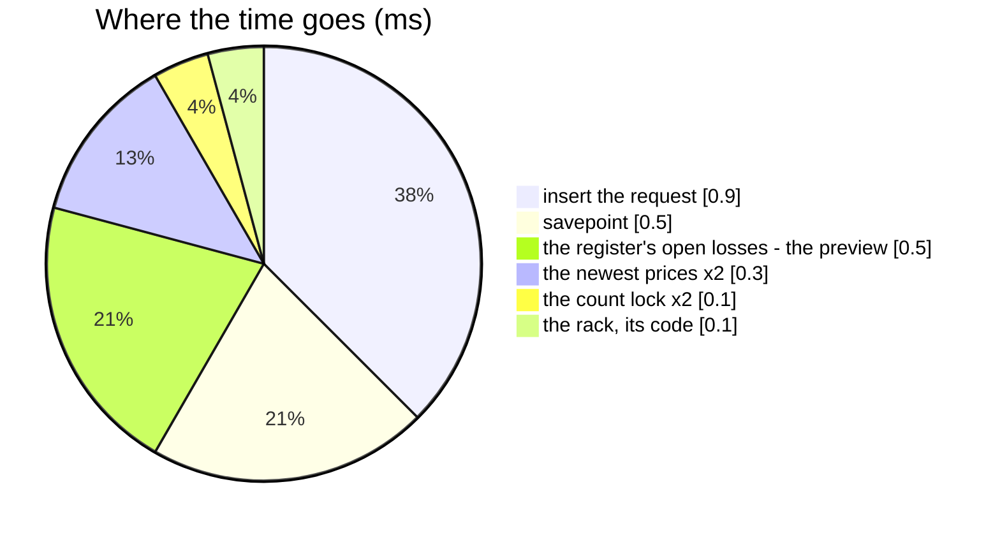

# FoundRequestCreate — performance audit

**Verdict:** 🟢 fast — **9 statements, 3.2 ms**, one row written, flat in everything (one product, one rack).
**Measured:** 2026-11-03 · `inventory_service/inventory_v1/found_request_create.go` · the ledgers' background volume ([OrderTransactionCreate](OrderTransactionCreate.md)) and the stock count's
([OpnameSessionFinalize](OpnameSessionFinalize.md)) plus **50 000 found requests** (one in ten waiting) · warm, 5 runs
(`found_request_perf_test.go`, `-tags perfaudit`)

| case | median wall | statements |
| --- | --- | --- |
| a staff report of 2 units, nothing to claim | 3.2 ms | 9 |

---

## Statements

| # | What | ×N | Time | Verdict |
| --- | --- | --- | --- | --- |
| 1 | the rack is this warehouse's and not deleted (`count(*)`) | 1 | < 0.1 ms | ok — the primary key |
| 2 | the count lock on (product, rack) — `RefuseCounted` | 1 | < 0.1 ms | ok — `opname_session_snapshots_open_lock` |
| 3 | stocked here? — the newest price (`StockedHere`) | 1 | 0.15 ms | ok — `batches_last_price_idx` |
| 4 | `INSERT INTO found_requests` | 1 | 0.9 ms | ok |
| 5 | the answer's would-post: open losses, the newest price, the count lock, the rack code | 4 | 0.7 ms | 🟡 two of them repeat #2 and #3 |

---

## Findings

### the-answer-repeats-the-guards 🟡

The response is mapped by the list's own `foundRequestsProto`, which reads the count lock and the newest price again —
statements 2 and 3 ran a moment earlier in the same transaction. Two indexed point reads, ~0.2 ms.

**→ Recommend:** leave it. One mapping for every answer keeps the create's response identical to the list's row; the
cost is two index probes on a write a person makes by hand.

---

## Not measured

- the product read for the snapshot (`ProductFacts`, product_service) — a fake in the audit; one RPC per report
- concurrency — [FoundRequest.md](../concurrency/FoundRequest.md)

---

## History

| Date | Median | Statements | Change |
| --- | --- | --- | --- |
| 2026-11-03 | 3.2 ms | 9 | first audit, at the build |
