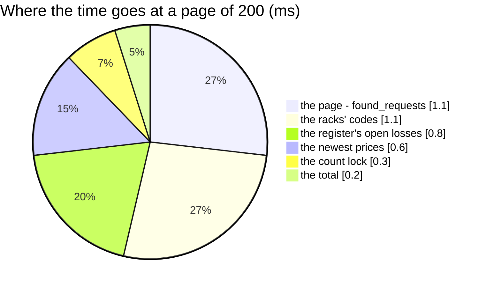

# FoundRequestList — performance audit

**Verdict:** 🟢 fast — **6 statements at a page of 20 and at a page of 200** (no N+1), ≈ 4 ms either way, against 50 000
other requests. The would-post of every request on the page is one plain read of the register and one of the prices.
**Measured:** 2026-11-03 · `inventory_service/inventory_v1/found_request_list.go` → `inventory_mutations.PreviewFound` ·
the ledgers' background volume ([OrderTransactionCreate](OrderTransactionCreate.md)) and the stock count's
([OpnameSessionFinalize](OpnameSessionFinalize.md)) plus **50 000 found requests** (one in ten waiting) · warm, 5 runs
(`found_request_perf_test.go`, `-tags perfaudit`) · 200 waiting requests of the target warehouse over 20 products, each to claim or mint

| page | median wall | statements |
| --- | --- | --- |
| 20 | 4.2 ms | 6 |
| 200 | 4.1 ms | **6** |

---

## Statements (page 200)

| # | What | ×N | Time | Verdict |
| --- | --- | --- | --- | --- |
| 1 | `count(*)` of the filter | 1 | < 0.5 ms | ok — `found_requests_status_idx` |
| 2 | the page, `ORDER BY id DESC LIMIT` | 1 | 1.1 ms | ok — `found_requests_status_idx` (`found_requests_list_idx` for All) |
| 3 | the racks' codes, one `IN` | 1 | 1.1 ms | ok |
| 4 | the register's open losses of the page's products, one `IN` of (team, product) pairs | 1 | 0.8 ms | ok — `warehouse_stock_problems_open_idx` |
| 5 | the newest batch price of each, `DISTINCT ON` | 1 | 0.6 ms | ok — `batches_last_price_idx` |
| 6 | the count locks of the page's (product, rack) pairs | 1 | 0.3 ms | ok — the open-lock index |

---

## Findings

### the-book-is-read-once-per-product 🟢

A page of 200 requests over 20 products reads the register and the prices for **20** pairs, not 200 — `PreviewFound`
passes each owner's product to `LoadCountBook` once. Before that the `IN` list carried every request (12.5 ms at 200);
fixed in the build, measured after.

### one-cold-count-lock-read 🟡

One warm-up-adjacent run read the count lock in 23 ms (the median is unaffected): a cold plan on
`opname_session_snapshots` with 50 000 released rows. The open-lock index is partial (`released_at IS NULL`), so it stays
small; the outlier is the planner's first look.

**→ Recommend:** nothing now; re-measure if the snapshot table grows past a few hundred thousand released rows.

---

## Not measured

- `GENERAL` only — the menu's count (`page 1, limit 1`): statements 1–2 alone, no preview
- `fetchActors` on the screen (user_service) — one call per page

---

## History

| Date | Median @200 | Statements @20 / @200 | Change |
| --- | --- | --- | --- |
| 2026-11-03 | 4.1 ms | 6 / 6 | first audit, at the build (12.5 ms before the per-product book) |
