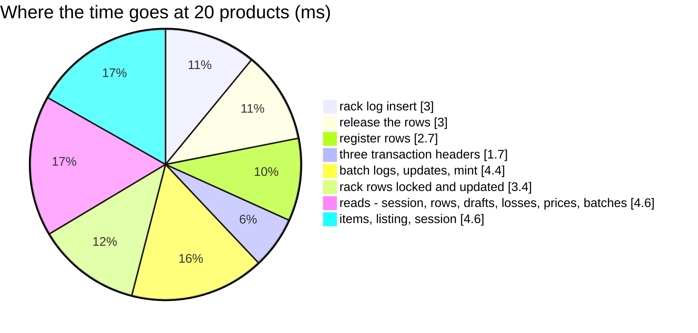

# OpnameSessionFinalize — performance audit

**Verdict:** 🟡 heavy by the statement count only — **26 statements at 1 product, 28 at 20**, flat in the products (no
N+1), 27 ms at 20 products. A finalize writes ten tables in one database transaction; what still grows is the per-TEAM
work: a transaction header and an items insert per team per type, and — outside this measurement — liability's postings.
**Measured:** 2026-11-02 · `inventory_service/inventory_v1/opname_session_finalize.go` → `inventory_mutations.PostCountFinalize`
· the ledgers' background volume ([OrderTransactionCreate](OrderTransactionCreate.md)) plus 1 000 finished counts, 50 000
released snapshot rows, 50 000 register rows (half open losses) · each target product on three racks: short with one torn
on the first, over on the second, exact on the third — even products net lost 1, odd ones found 2 · warm, 5 runs, a fresh
count each (`opname_perf_test.go`, `-tags perfaudit`)

| products | median wall | statements |
| --- | --- | --- |
| 1 | 11.2 ms | 26 |
| 20 | 27.4 ms | **28** |

---

## Statements (20 products, 60 rows, two teams' worth of types)

| # | What | ×N | Time | Verdict |
| --- | --- | --- | --- | --- |
| 1 | the session `FOR UPDATE`, its rows, its problem drafts, their racks' codes | 4 | 1.9 ms | ok — one each |
| 2 | the open losses `FOR UPDATE` · the newest prices · the batches `FOR UPDATE` (one statement, the claimed ones with them) | 3 | 2.4 ms | ok — `warehouse_stock_problems_open_idx`, `batches_take_idx` |
| 3 | `INSERT INTO inventory_transactions` | **3** | 1.7 ms | 🟡 one per transaction — grows with teams × {problem, found, move} |
| 4 | rack rows: create missing, lock, update, log | 4 | 6.4 ms | ok — set-based |
| 5 | batch rows: update, log; mint: batches, logs, prices | 5 | 4.9 ms | ok — set-based |
| 6 | `INSERT INTO warehouse_stock_problems` (30 rows) · claims (none here) | 1–3 | 2.7 ms | ok |
| 7 | `INSERT INTO inventory_transaction_items` | **3** | 2.4 ms | 🟡 one per transaction |
| 8 | the listing · the session `finish` · release every row | 3 | 3.5 ms | ok |
| 9 | *(2026-11-03)* the WAITING found requests it settles `FOR UPDATE` · their update when any | 1–2 | 1.0 ms | ok — `found_requests_status_idx` + the snapshot `EXISTS` ([a-count-settles-the-found-it-counted](../../../../docs/business/inventory/opname_decision.md#a-count-settles-the-found-it-counted)) |

---

## Findings

### one-statement-per-transaction 🟡

`inventory_ledgers.CreateTransaction` and `AddItems` run once per transaction: a count over **T** owning teams writes up to
3T headers and 3T item inserts — 6T statements, the only part that grows. A warehouse holding 20 sellers' goods would
spend ~120 statements there for an `all` count.

**→ Recommend:** a set-based `CreateTransactions` and `AddItems` over several transactions (one `INSERT … RETURNING id` for
the headers, one for every item) — the same move [ledger-writes-are-set-based](../../../../docs/technical/stock/design_decision.md#ledger-writes-are-set-based)
made for the log rows. It touches the shared ledger primitive every mutation calls, so it is the owner's call; I would
take it, since an `all` count is the one write here whose team count is unbounded.

### liability-posts-per-team 🟡 (not measured — the audit ran with no poster)

Inside the transaction the handler calls `LiabilityPoster.PostStockDamage` once per team per kind — broken, lost, and a
claim's found — each a liability insert or more. That is another ~3T statements, and liability_service's, not this one's.

**→ Recommend:** leave it until a count of many teams is measured with the real poster. A batch posting call would have to
come from liability_service; inventory only calls it.

---

## Not measured

- the real liability poster (nil in the audit) — see above
- concurrency: two finalizes at once, a finalize racing order takes — covered for correctness by `opname_race_test.go`
  (`TestRace_OpnameSessionFinalize_PostsOnce`, `…_RacingTakes`), which pass
- an `all` count of a whole warehouse with hundreds of products to post: statements stay flat, but the batch and rack
  locks then cover the warehouse's whole shelf book for the length of the finalize — every order take there waits
- planning inflated by the harness's single long transaction — see [OrderTransactionCreate § Not measured](OrderTransactionCreate.md#not-measured)

---

## Open questions

- [ ] Set-based headers and items for every multi-transaction mutation (`RackMove`, `RackSample` and the count all write one
  per owning team)? Recommended — see [one-statement-per-transaction](#one-statement-per-transaction).

---

## History

| Date | Median @20 products | Statements @1 / @20 | Change |
| --- | --- | --- | --- |
| 2026-11-02 | 27.4 ms | 26 / 28 | first audit, at the build |
| 2026-11-03 | 27.1 ms | 27 / 29 | the settle of the found requests it counted — one read (and an update when any wait); the found requests table was empty in this probe |
