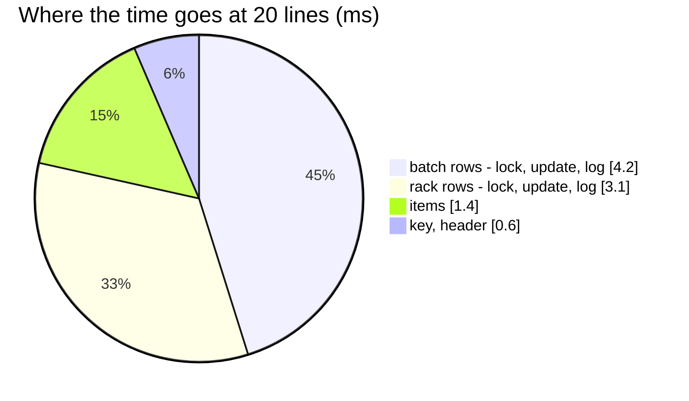

# OrderTransactionCreate — performance audit

**Verdict:** ✅ the N+1 is fixed (2026-10-17, [ledger-writes-are-set-based](../../../../docs/technical/stock/design_decision.md#ledger-writes-are-set-based)) —
**11 statements for one line and for twenty**, 10.2 ms at twenty (was 145 and 46.2 ms). Still over the 5-statement line:
a take writes two ledgers, their logs, the transaction, its items and the key, and that floor does not move with lines.
**Measured:** 2026-10-17 · `inventory_service/inventory_v1/order_transaction_create.go` → `inventory_mutations.PostOrder` ·
background volume below · each target product 10 batches × 100 units over 3 racks in Gudang 5 · warm, 5 runs

| lines | median wall | queries | before (2026-10-17, first audit) |
| --- | --- | --- | --- |
| 1 | 4.5 ms | 11 | 4.6 ms · 12 |
| 20 | 10.2 ms | **11** | 46.2 ms · 145 |

Background (one test transaction, `ANALYZE`d): `placements` 10 000 · `inventory_transactions` 50 000 · `inventory_transaction_items`
50 000 · `batches` 50 000 · `batch_logs` 50 000 · `product_placements` 10 000 · `product_placement_logs` 50 000 ·
`idempotency_order_check` 50 000 — spread over 20 warehouses, Gudang 5 among them.

---

## Queries (20 lines)

| # | What | ×N | Time | Plan | Verdict |
| --- | --- | --- | --- | --- | --- |
| 1 | `SELECT count(*) FROM idempotency_order_check WHERE idempotency_key = ?` | 1 | 0.5 ms | unique index | ok |
| 2 | `SELECT * FROM batches WHERE warehouse_id = ? AND (team_id, product_id) IN (…) AND stock_count > 0 ORDER BY id FOR UPDATE` | 1 | 1.4 ms, 200 rows | Bitmap Index Scans `batches_last_price_idx` | ok — every line at once |
| 3 | `UPDATE batches AS b … FROM unnest(…)` · `INSERT INTO batch_logs …` (20 rows) | 1 + 1 | 0.5 + 2.3 ms | pkey | ok |
| 4 | `SELECT * FROM product_placements WHERE warehouse_id = ? AND (team_id, product_id) IN (…) ORDER BY id FOR UPDATE` | 1 | 0.9 ms, 60 rows | `product_placements_take_idx` | ok |
| 5 | `UPDATE product_placements AS p … FROM unnest(…)` · `INSERT INTO product_placement_logs …` | 1 + 1 | 1.2 + 1.0 ms | pkey | ok |
| 6 | header, items (one multi-row insert), the key claim | 3 | 1.5 ms | — | ok |

---

## Findings

### row-at-a-time-ledger-writes

✅ **Fixed 2026-10-17.** The ledger primitives in `inventory_ledgers` applied one row per statement: each line's batches
read and locked by their own query (twice — the short-line check and the take), its racks by another, and every batch and
rack row an `UPDATE` plus a log `INSERT` of its own — 7 statements a line, and the locks held across all of them.

Now ([ledger-writes-are-set-based](../../../../docs/technical/stock/design_decision.md#ledger-writes-are-set-based)) every
line's batches are locked in ONE statement and counted from it, the take is worked out in memory, and each ledger is
written with one `UPDATE … FROM unnest(…)` and one multi-row log `INSERT`. Two takes still lock batches before racks, each
in id order. The same primitives serve every ledger write, so [OrderTransactionRelease](OrderTransactionRelease.md),
[RackMove](RackMove.md), [RackSample](RackSample.md), [RestockRequestAccept](RestockRequestAccept.md),
[WarehouseTransferCreate](WarehouseTransferCreate.md) and [WarehouseTransferAccept](WarehouseTransferAccept.md) gained
the same.

The fix is pinned by two tests that fail if a line adds a statement:
`TestLedgerWrites_TheStatementsDoNotGrowWithTheLines` (the primitives) and
`TestOrderTransactionCreate_TheStatementsDoNotGrowWithTheLines` (this RPC).

---

## Not measured

- concurrency — single caller; the race tests (`-tags raceaudit`) cover correctness and pass on the new primitives,
  including the opposite-line-order deadlock test
- a production network: here each round trip is ~0.5 ms (Docker on Windows), which is most of the 10 ms; a lower-latency
  link shrinks the time, not the count
- ⚠ **planning cost inflated by the harness**: every seed row lives in one uncommitted test transaction, so nothing can be
  vacuumed and the planner's index probes walk dead tuples — a sibling query measured 17–65 ms of *planning* for 0.05 ms
  of execution ([WarehouseTransferAccept](WarehouseTransferAccept.md#not-measured)). Wall times are upper bounds; the query
  counts and plans are the findings
- line counts in the wild: an order is usually 1–3 lines

---

## Open questions

- None. The set-based primitives were taken before go-live, after the ledger review
  ([ledger-writes-are-set-based](../../../../docs/technical/stock/design_decision.md#ledger-writes-are-set-based)).

---

## History

| Date | Median @20 lines | Queries @1 / @20 | Change |
| --- | --- | --- | --- |
| 2026-10-17 | 46.2 ms | 12 / 145 | first audit |
| 2026-10-17 | 10.2 ms | 11 / 11 | set-based ledger primitives — one lock read per ledger, one update and one log insert each |
