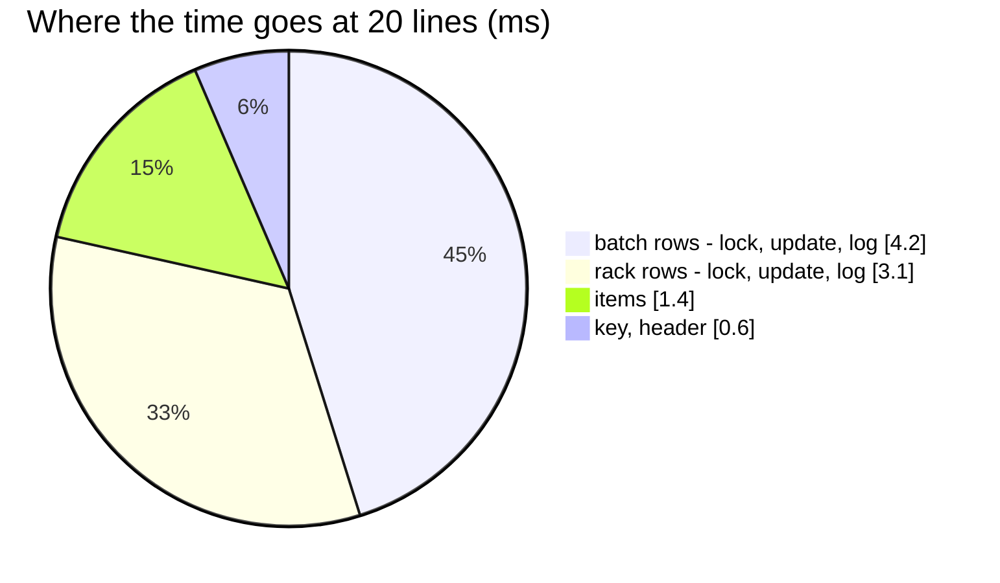

# OrderTransactionCreate — performance audit

**Verdict:** ✅ the N+1 is fixed (2026-10-17, [ledger-writes-are-set-based](../../../../docs/technical/stock/design_decision.md#ledger-writes-are-set-based)) —
**11 statements for one line and for twenty**, 10.2 ms at twenty (was 145 and 46.2 ms). Still over the 5-statement line:
a take writes two ledgers, their logs, the transaction, its items and the key, and that floor does not move with lines.
**2026-11-12:** 13 statements since the Ready fold (one upsert of the day's change rows, last) — committed median
+0.5 ms at one line, +0.9 ms at twenty ([after the Ready fold](#after-the-ready-fold-2026-11-12)).
**Measured:** 2026-10-17 · `inventory_service/inventory_v1/order_transaction_create.go` → `inventory_mutations.PostOrder` ·
background volume below · each target product 10 batches × 100 units over 3 racks in Gudang 5 · warm, 5 runs

| lines | median wall | queries | before (2026-10-17, first audit) |
| --- | --- | --- | --- |
| 1 | 4.5 ms | 11 | 4.6 ms · 12 |
| 20 | 10.2 ms | **11** | 46.2 ms · 145 |

Background (one test transaction, `ANALYZE`d): `placements` 10 000 · `inventory_transactions` 50 000 · `inventory_transaction_items`
50 000 · `batches` 50 000 · `batch_logs` 50 000 · `product_placements` 10 000 · `product_placement_logs` 50 000 ·
`idempotency_order_check` 50 000 — spread over 20 warehouses, Gudang 5 among them.

---

## Queries (20 lines)

| # | What | ×N | Time | Plan | Verdict |
| --- | --- | --- | --- | --- | --- |
| 1 | `SELECT count(*) FROM idempotency_order_check WHERE idempotency_key = ?` | 1 | 0.5 ms | unique index | ok |
| 2 | `SELECT * FROM batches WHERE warehouse_id = ? AND (team_id, product_id) IN (…) AND stock_count > 0 ORDER BY id FOR UPDATE` | 1 | 1.4 ms, 200 rows | Bitmap Index Scans `batches_last_price_idx` | ok — every line at once |
| 3 | `UPDATE batches AS b … FROM unnest(…)` · `INSERT INTO batch_logs …` (20 rows) | 1 + 1 | 0.5 + 2.3 ms | pkey | ok |
| 4 | `SELECT * FROM product_placements WHERE warehouse_id = ? AND (team_id, product_id) IN (…) ORDER BY id FOR UPDATE` | 1 | 0.9 ms, 60 rows | `product_placements_take_idx` | ok |
| 5 | `UPDATE product_placements AS p … FROM unnest(…)` · `INSERT INTO product_placement_logs …` | 1 + 1 | 1.2 + 1.0 ms | pkey | ok |
| 6 | header, items (one multi-row insert), the key claim | 3 | 1.5 ms | — | ok |

---

## Findings

### row-at-a-time-ledger-writes

✅ **Fixed 2026-10-17.** The ledger primitives in `inventory_ledgers` applied one row per statement: each line's batches
read and locked by their own query (twice — the short-line check and the take), its racks by another, and every batch and
rack row an `UPDATE` plus a log `INSERT` of its own — 7 statements a line, and the locks held across all of them.

Now ([ledger-writes-are-set-based](../../../../docs/technical/stock/design_decision.md#ledger-writes-are-set-based)) every
line's batches are locked in ONE statement and counted from it, the take is worked out in memory, and each ledger is
written with one `UPDATE … FROM unnest(…)` and one multi-row log `INSERT`. Two takes still lock batches before racks, each
in id order. The same primitives serve every ledger write, so [OrderTransactionRelease](OrderTransactionRelease.md),
[RackMove](RackMove.md), [RackSample](RackSample.md), [RestockRequestAccept](RestockRequestAccept.md),
[WarehouseTransferCreate](WarehouseTransferCreate.md) and [WarehouseTransferAccept](WarehouseTransferAccept.md) gained
the same.

The fix is pinned by two tests that fail if a line adds a statement:
`TestLedgerWrites_TheStatementsDoNotGrowWithTheLines` (the primitives) and
`TestOrderTransactionCreate_TheStatementsDoNotGrowWithTheLines` (this RPC).

---

## After the Ready fold (2026-11-12)

[ready-stock-is-folded-in-the-stock-changes-own-step](../../../../docs/business/analytic/rpc_provide_decision.md#ready-stock-is-folded-in-the-stock-changes-own-step):
the take now runs in `inventory_ledgers.StockTransaction`, and its LAST statement is one multi-row upsert of the day's
change rows — one row per (warehouse, owner, product, supplier, `order`), keys summed in memory and sorted
(`INSERT INTO inventory_stock_daily_changes … ON CONFLICT … DO UPDATE SET change_count = … + EXCLUDED…`). The take
writes no door row, so it is **one** statement more at any line count: **12 → 13**. The other stock writers gain the same
statement (a restock or return accept also its door upsert just before it); lock order in
[lock-order.md](../concurrency/lock-order.md#the-stock-reports-are-every-stock-transactions-last-locks-2026-11-12).

**Committed probe** — the number this audit records: every take its own committed transaction, as in production
(`TestPerf_OrderTakeLatency_Committed`, `order_take_latency_perf_test.go`, `-tags perfaudit`): 200 one-line takes, then
60 twenty-line takes, each a fresh key, against the ledger background above plus — after — a year of change rows
(≈ 456 000: 2 500 products × 20 warehouses, every product moving about one day in two). BEFORE = HEAD `6c49c708` (no
table, no fold) with the same probe file; three runs each:

| lines | median before | median after | p95 before | p95 after |
| --- | --- | --- | --- | --- |
| 1 | 5.66 / 5.44 / 5.20 ms | 5.54 / 6.13 / 6.00 ms | 7.43 / 6.79 / 6.48 ms | 7.45 / 7.92 / 7.49 ms |
| 20 | 10.27 / 10.55 / 10.35 ms | 10.56 / 11.71 / 11.60 ms | 12.10 / 12.36 / 12.89 ms | 13.75 / 15.18 / 14.30 ms |

So **about +0.5 ms at one line (≈ +8 %) and +0.9 ms at twenty (≈ +9 %)** on the median, +0.7 / +2.0 ms on the p95 —
one round trip here, most of it Docker-on-Windows loopback (see *Not measured*).

| probe (2026-11-12) | before | after |
| --- | --- | --- |
| `TestPerf_OrderTransactionCreate` (5 runs in one test transaction), statements @1 / @20 | 12 / 12 | **13 / 13** |
| its median wall @1 / @20 (two runs each) | 4.74 · 4.79 / 10.66 · 12.24 ms | 4.88 · 5.06 / 13.61 · 14.07 ms |
| the upsert itself @1 / @20 | — | 0.5–1.0 ms / 1.0–1.35 ms (20 rows) |
| the in-transaction latency probe `TestPerf_OrderTakeLatency` @1 / @20, median (p95) | 4.2 (5.1) / 11.6 (14.6) ms | 5.2 (6.6) / 18.7 (23) ms |

⚠ The in-transaction figures over-state a hot row: inside ONE test transaction every take's update of the same report
row keeps the old version alive (its own subtransaction's), so the chain grows with every take — that is why the
in-transaction latency probe reads +7 ms at twenty lines while the committed one reads +0.9 ms.

**Verdict:** ✅ no new finding — one statement, one round trip, the transaction's last lock. Two takes of one product in
one warehouse on one day meet on its report row only after they have already queued on that product's batches
(`TestRace_StockReport_TwelveTakesIntoOneRow`: 12/12 ok, one row, ledger = report). The 12 statements at HEAD (vs 11 in
the 2026-10-17 table) are the `SAVEPOINT` of the nested transaction and the count lock's own read
(`inventory_ledgers/count_lock.go`), both added since; neither grows with lines.

---

## Not measured

- concurrency — single caller; the race tests (`-tags raceaudit`) cover correctness and pass on the new primitives,
  including the opposite-line-order deadlock test
- a production network: here each round trip is ~0.5 ms (Docker on Windows), which is most of the 10 ms; a lower-latency
  link shrinks the time, not the count
- ⚠ **planning cost inflated by the harness**: every seed row lives in one uncommitted test transaction, so nothing can be
  vacuumed and the planner's index probes walk dead tuples — a sibling query measured 17–65 ms of *planning* for 0.05 ms
  of execution ([WarehouseTransferAccept](WarehouseTransferAccept.md#not-measured)). Wall times are upper bounds; the query
  counts and plans are the findings
- line counts in the wild: an order is usually 1–3 lines

---

## Open questions

- None. The set-based primitives were taken before go-live, after the ledger review
  ([ledger-writes-are-set-based](../../../../docs/technical/stock/design_decision.md#ledger-writes-are-set-based)).

---

## History

| Date | Median @20 lines | Queries @1 / @20 | Change |
| --- | --- | --- | --- |
| 2026-10-17 | 46.2 ms | 12 / 145 | first audit |
| 2026-10-17 | 10.2 ms | 11 / 11 | set-based ledger primitives — one lock read per ledger, one update and one log insert each |
| 2026-11-12 | 10.7–12.2 ms | 12 / 12 | re-measured at HEAD `6c49c708`, before the fold — the nested transaction's `SAVEPOINT` and the count lock's read joined since |
| 2026-11-12 | 13.6–14.1 ms (committed: 10.6–11.7 ms, p95 13.8–15.2) | 13 / 13 | the Ready fold — one upsert of the day's change rows, the transaction's last statement ([after the Ready fold](#after-the-ready-fold-2026-11-12)) |
