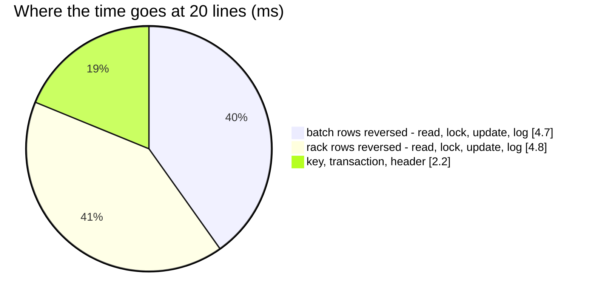

# OrderTransactionRelease — performance audit

**Verdict:** ✅ both findings fixed (2026-10-17) — the placement log is read by its own index, and **13 statements for one
line and for twenty**, 10.8 ms at twenty (was 89 and 41.6 ms, plus a seq scan). Still over the 5-statement line: a release
reads, locks and reverses two ledgers and marks the transaction, whatever its lines.
**Measured:** 2026-10-17 · `inventory_service/inventory_v1/order_transaction_release.go` → `inventory_mutations.RollbackTake` →
`inventory_ledgers.ReverseBatchLogs` / `ReversePlacementLogs` · the background volume of
[OrderTransactionCreate](OrderTransactionCreate.md) · takes of 3 units a line made before the timer · warm, 5 runs

| lines | median wall | queries | before (2026-10-17, first audit) |
| --- | --- | --- | --- |
| 1 | 4.2 ms | 13 | 8.4 ms · 13 |
| 20 | 10.8 ms | **13** | 41.6 ms · 89 |



---

## Queries (20 lines)

| # | What | ×N | Time | Plan | Verdict |
| --- | --- | --- | --- | --- | --- |
| 1 | `SELECT * FROM idempotency_order_check WHERE idempotency_key = ? FOR UPDATE` · the transaction, read and locked | 3 | 1.6 ms | unique index · pkey | ok |
| 2 | `SELECT * FROM batch_logs WHERE transaction_id = ? ORDER BY id` | 1 | 0.5 ms | `batch_logs_transaction_idx` | ok |
| 3 | `SELECT * FROM product_placement_logs WHERE transaction_id = ? ORDER BY id` | 1 | under the probe's 0.5 ms clock (was 4.6 ms) | Index Scan `product_placement_logs_transaction_idx` — the plan measured in [WarehouseTransferCreate](WarehouseTransferCreate.md) | ✅ was a seq scan |
| 4 | `SELECT * FROM batches WHERE id IN (…) FOR UPDATE` · `… product_placements WHERE (product_id, placement_id) IN (…) FOR UPDATE` | 1 + 1 | 1.6 ms | index | ok |
| 5 | `UPDATE batches AS b … FROM unnest(…)` · `INSERT INTO batch_logs …` | 1 + 1 | 1.6 + 2.1 ms | pkey | ok |
| 6 | `UPDATE product_placements AS p … FROM unnest(…)` · `INSERT INTO product_placement_logs …` | 1 + 1 | 1.1 + 2.1 ms | pkey | ok |
| 7 | `UPDATE inventory_transactions SET is_rollback = true` | 1 | 0.7 ms | pkey | ok |

---

## Findings

### the-placement-log-index-misses-its-reads

✅ **Fixed 2026-10-17** by `00031_placement_logs_by_transaction`
([placement-logs-are-indexed-by-transaction](../../../../docs/technical/stock/design_decision.md#placement-logs-are-indexed-by-transaction)).
`ReversePlacementLogs` reads a transaction's rack rows by `transaction_id` alone, and the only index on that column was
`(warehouse_id, transaction_id)` (00025), whose leading column the query never names — so it scanned the whole log
(3.6 ms at 50 000 rows, linear in the log).

```
->  Index Scan using product_placement_logs_transaction_idx on product_placement_logs  (actual time=0.008..0.008 rows=1 loops=1)
Execution Time: 0.026 ms        ← the same read by transaction, in WarehouseTransferCreate after 00031
```

The same read is in five more places — the transfer's leg racks (`loadLegRacks`, see
[WarehouseTransferCreate](WarehouseTransferCreate.md) and [WarehouseTransferAccept](WarehouseTransferAccept.md)), the
restock detail's put-away (`loadPutAway`), the restock labels, the batch's placements (`batch_detail.go`) and the goods
receipt (`batch_receipt.go`). The one migration covers all of them.

### row-at-a-time-ledger-writes

✅ **Fixed 2026-10-17.** Each row the take moved was reversed by an `UPDATE` and a log `INSERT` of its own — 80 of the
89 statements at 20 lines. The reversal is now worked out in memory on the locked rows and written once per table. Same
cause and same fix as [OrderTransactionCreate § row-at-a-time-ledger-writes](OrderTransactionCreate.md#row-at-a-time-ledger-writes).

---

## Proposed migration

Applied as `backend/services/inventory_service/db_migrations/00031_placement_logs_by_transaction.sql`:

```sql
-- +goose Up
DROP INDEX product_placement_logs_transaction_idx;
CREATE INDEX product_placement_logs_transaction_idx ON product_placement_logs (transaction_id);
-- +goose Down
DROP INDEX product_placement_logs_transaction_idx;
CREATE INDEX product_placement_logs_transaction_idx ON product_placement_logs (warehouse_id, transaction_id);
```

Cost: none added — one index replaces another of the same width. Inside the migration's transaction, `CONCURRENTLY` is
unavailable; on a large production table it would be its own non-transactional migration.

---

## Not measured

- concurrency (single caller; `TestRace_OrderTransactionRelease_RacingItsTakeNetsToZero` covers correctness and passes)
- planning inflated by the harness's single long transaction — see [OrderTransactionCreate § Not measured](OrderTransactionCreate.md#not-measured)
- a take spread over many layers or racks per line — measured at one batch row and one rack row per line

---

## Open questions

- None. The index was replaced
  ([placement-logs-are-indexed-by-transaction](../../../../docs/technical/stock/design_decision.md#placement-logs-are-indexed-by-transaction))
  and the writes made set-based
  ([ledger-writes-are-set-based](../../../../docs/technical/stock/design_decision.md#ledger-writes-are-set-based)).

---

## History

| Date | Median @20 lines | Queries @1 / @20 | Change |
| --- | --- | --- | --- |
| 2026-10-17 | 41.6 ms | 13 / 89 | first audit |
| 2026-10-17 | 10.8 ms | 13 / 13 | `00031` index on `(transaction_id)`; set-based reversal |
