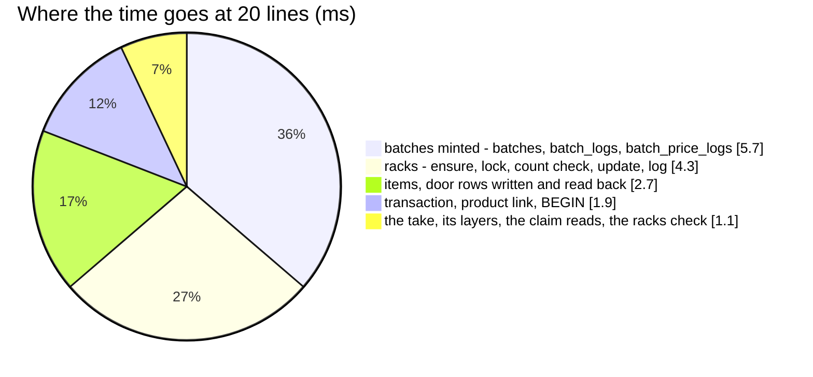

# OrderTransactionReturn — performance audit

**Verdict:** 🟡 over the 5-statement line by the count alone — **20 statements for one line and for twenty** (flat, no
N+1), 7.7 ms median at one line and 15.3 ms at twenty, every read an index scan. A return locks the take, reads its
layers, mints on the batch ledger, puts away on the rack ledger, writes the items, the door rows and the once-only claim,
whatever its lines — the shape of the transfer accept it reuses. No fix proposed.
**Measured:** 2026-11-09 · `inventory_service/inventory_v1/order_transaction_return.go` → `inventory_mutations.PostReturn`
(`post_return.go`) → `inventory_ledgers.MintBatches` / `PutOnPlacements` / `AddItems` · the background volume of
[OrderTransactionCreate](OrderTransactionCreate.md) (`perfLedgerBackground`) · 20 products × 30 batches of 2 at the take's
warehouse, each take of 4 per line drawing from two batches, made before the timer; returned to another warehouse, 3
sound on one rack and 1 broken with a note per line (so the door rows are written too) · warm, 5 runs ·
`TestPerf_OrderTransactionReturn` (`-tags perfaudit`)

| lines | median wall | db | in Go | queries |
| --- | --- | --- | --- | --- |
| 1 | 7.7 ms | 7.7 ms | < 0.6 ms | 20 |
| 20 | 15.3 ms | 15.3 ms | < 0.1 ms | **20** |

An earlier run the same day read 20.0 / 18.0 ms — this host's Docker loopback swings that much between runs; the count did
not move.



---

## Queries (20 lines)

| # | What | Rows | Time | Plan | Verdict |
| --- | --- | --- | --- | --- | --- |
| 1 | `SELECT * FROM order_return_checks WHERE take_transaction_id = ? LIMIT 1` — before the transaction, and again under the take's lock | 0 | 0.27 ms ×2 | primary key | ok — the first is the retry's fast path, the second the check that counts |
| 2 | `SAVEPOINT` (BEGIN in production) | | 0.5 ms | | ok |
| 3 | `SELECT * FROM inventory_transactions WHERE id = ? AND tx_type = 'order' AND team_id = ? AND NOT is_rollback FOR UPDATE` — the take | 1 | under the probe's clock | see below | ok |
| 4 | `SELECT count(*) FROM placements WHERE id IN (…) AND warehouse_id = ? AND deleted_at IS NULL` — the racks are the return warehouse's | 1 | under the probe's clock | primary key | ok |
| 5 | `SELECT l.batch_id, b.product_id, … FROM batch_logs l JOIN batches b … WHERE l.transaction_id = ? AND l.change_count < 0` — the take's layers (`outboundLayers`) | 40 | 0.54 ms | `batch_logs_transaction_idx` | ok |
| 6 | `INSERT INTO inventory_transactions` — the `return` | 1 | 0.52 ms | | ok |
| 7 | `INSERT INTO batches … RETURNING id` — one per sound layer | 40 | 2.6 ms | | ok |
| 8 | `INSERT INTO batch_logs` · `INSERT INTO batch_price_logs` | 40 + 40 | 2.1 + 1.0 ms | | ok |
| 9 | `INSERT INTO product_placements … ON CONFLICT DO NOTHING` · `SELECT … FROM product_placements WHERE (product_id, placement_id) IN (…) ORDER BY id FOR UPDATE` (`EnsureAndLockRacks`) | 0 + 20 | 0.52 + 1.0 ms | `product_placements_placement_idx`, 0.13 ms | ok |
| 10 | `SELECT s.product_id, s.placement_id, … FROM opname_session_snapshots …` (`RefuseCounted`) | 0 | 0.61 ms | | ok |
| 11 | `UPDATE product_placements AS p … FROM unnest(…)` · `INSERT INTO product_placement_logs` | 20 + 20 | 0.52 + 1.6 ms | pkey | ok |
| 12 | `INSERT INTO inventory_transaction_items` | 20 | 1.0 ms | | ok |
| 13 | `INSERT INTO order_return_problem_items` — the door rows | 20 | 0.9 ms | | ok |
| 14 | `INSERT INTO warehouse_products … ON CONFLICT DO NOTHING` — the return warehouse's product links | 0 | 0.84 ms | | ok |
| 15 | `INSERT INTO order_return_checks` — the claim, last | 1 | under the probe's clock | | ok |
| 16 | `SELECT * FROM order_return_problem_items WHERE transaction_id = ? ORDER BY product_id, problem_type` — the answer, after the commit | 20 | 0.70 ms | `order_return_problem_items_one_per_kind` | ok |

---

## Findings

### the-count-is-the-ledgers-shape 🟡

Heavy by the count only: 20 statements against the 5-statement line, flat in the lines (1 and 20 lines both 20), so it is
no N+1. Each statement is one table written once, set-based
([ledger-writes-are-set-based](../../../../docs/technical/stock/design_decision.md#ledger-writes-are-set-based)) — the same
cost [WarehouseTransferAccept](WarehouseTransferAccept.md) pays for its in-leg, plus the claim and the door rows.

**→ Recommend:** no change. Two statements could go, each worth well under a millisecond: the answer could be built from
the door rows just written instead of read back after the commit (row 16 — but the retry path must read them anyway, and
one function serves both), and the plain claim read before the transaction (row 1, first) could be dropped (but then
every retried accept takes the take's row lock to learn it is done). Neither is worth the second code path.

### the-take-lock-plan-under-the-probes-statistics — not a finding

The probe's EXPLAIN of row 3 used `inventory_transactions_team_idx` with the id as a filter (5 rows removed): the rows are
seeded inside the test transaction, with no statistics. With statistics the planner takes the primary key — checked on
`warehouse_test` in a rolled-back transaction, 50 000 order takes of one team, `ANALYZE`:

```
->  Index Scan using inventory_transactions_pkey on inventory_transactions  (cost=0.29..8.31 rows=1 width=64) (actual time=0.435..0.435 rows=1 loops=1)
      Index Cond: (id = (InitPlan 2).col1)
      Filter: ((NOT is_rollback) AND (tx_type = 'order'::text) AND (team_id = 2))
Execution Time: 0.476 ms
```

---

## Not measured

- concurrency — single caller here; `TestInterleave_OrderTransactionReturn_SecondWaitsOnTheTake` and
  `TestRace_OrderTransactionReturn_OnceForEightCallers` cover it ([lock-order](../concurrency/lock-order.md#an-order-comes-back-on-its-return-2026-11-09))
- the selling accept around it — [OrderReturnAccept](../../selling_service/performances/OrderReturnAccept.md) (11 statements,
  with this call faked)
- a line drawn over many layers or put on many racks — measured at two layers and one rack per line
- cache-cold behaviour, and planning inflated by the harness's single long transaction — see
  [OrderTransactionCreate § Not measured](OrderTransactionCreate.md#not-measured)

---

## Open questions

- None.

---

## History

| Date | Median @1 / @20 lines | Queries @1 / @20 | Change |
| --- | --- | --- | --- |
| 2026-11-09 | 7.7 / 15.3 ms (an earlier run 20.0 / 18.0 ms) | 20 / 20 | first audit |
