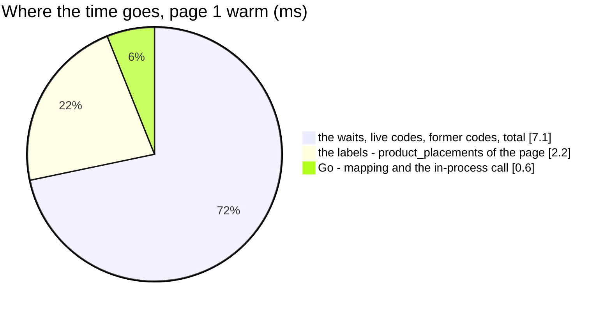

# ProductReprintList — performance audit

**Verdict:** 🟢 fast — **2 statements at any page** (no N+1), ≈ 10 ms warm for a page of 200 products at a warehouse
where **5 000 products wait on 2 shelf spots each** (≈ 32 ms on the first, cold read). The *Cetak ulang kode (N)* count
rides on WarehouseStockList as **one more statement, ≈ 2 ms** at 5 000 waiting.
**Measured:** 2026-11-27 · `inventory_service/inventory_v1/product_reprint_list.go` → the composition root's reader
(`backend/cmd/app_development/product_reader.go`) → `product_service/product_v1/product_reprint.go` (`ReprintWaitsOf`,
`ReprintWaitingCount`) · seed: **100 000 background products**, warehouse W1 with **5 000 waiting products × 2
`product_placements`** (10 000 placements) and a `code_changed` `product_logs` row each, warehouse W2 with **5 000 more
waits** (so W1 is half of `product_reprint_waits`) · one process, page 1 cold then warm, then page 20
(`product_reprint_perf_test.go`, `-tags perfaudit`, in `backend/cmd/app_development` so the real wiring is measured)

| read | page | wall | statements | rows |
| --- | --- | --- | --- | --- |
| ProductReprintList | 1 of 200 (cold, first after the seed) | 31.7 ms | 2 | 200 products, 400 labels of 5 000 |
| ProductReprintList | 1 of 200 (warm) | 9.9 ms | 2 | 200 products, 400 labels |
| ProductReprintList | 20 of 200 | 9.8 ms | 2 | 200 products, 400 labels |
| WarehouseStockList's `REPRINT_WAITING` count | — | 2.3 ms | +1 | 1 (5 000) |

---

## Statements (page 1, warm)

| # | What | ×N | Time | Verdict |
| --- | --- | --- | --- | --- |
| 1 | the page AND its total — `product_reprint_waits w JOIN products p … WHERE w.warehouse_id = ? ORDER BY p.product_code, w.product_id LIMIT 200`, `COUNT(*) OVER ()`, the former code a `LATERAL` of the newest `code_changed` `product_logs` row | 1 | 7.1 ms, **7.4 ms executed** | ok — a Seq Scan on `product_reprint_waits` (W1 is half the table, 64 buffers) merged with `products_pkey`, top-N heapsort (51 kB); the former code by `product_logs_product_idx`, once per row of the page (200 × 0.001 ms) |
| 2 | the labels — `product_placements pp JOIN placements pl … WHERE pp.warehouse_id = ? AND pp.product_id = ANY(the page) AND pp.stock_count > 0` | 1 | 2.2 ms, **0.4 ms executed** | ok — `product_placements_one_per_product` index scan, 400 rows |
| — | the count — `SELECT count(*) FROM product_reprint_waits WHERE warehouse_id = ?` (on WarehouseStockList when asked) | 1 | 2.3 ms, **1.0 ms executed** | ok — Seq Scan, 64 buffers |

## Why no index

The waits table holds one row per (product, warehouse) still to print — it empties as warehouses print, and its size is
bounded by what a team code change tagged. At 10 000 rows the whole table is 64 buffers; the planner reads it whole
because W1 is half of it. A warehouse that is a small share of a large table would take the existing
`product_reprint_waits_warehouse_idx (warehouse_id, product_id)`. No index was added; nothing was dropped.
