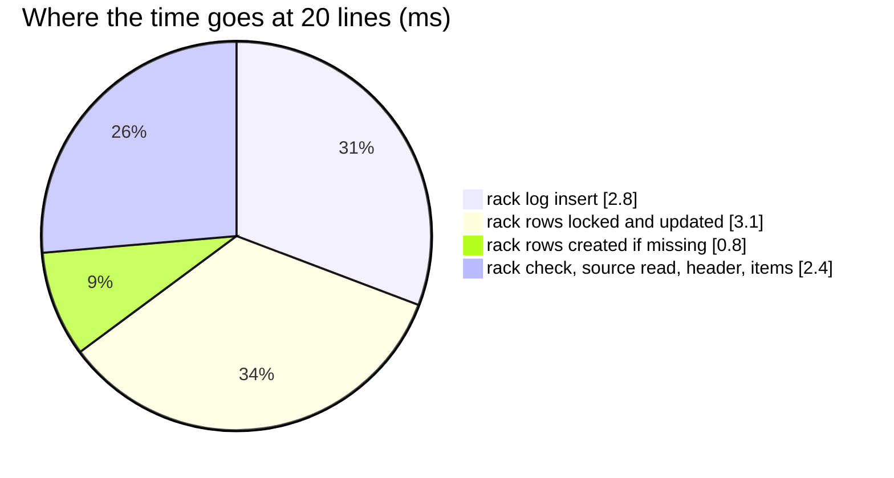

# RackMove — performance audit

**Verdict:** ✅ the N+1 is fixed (2026-10-17, [ledger-writes-are-set-based](../../../../docs/technical/stock/design_decision.md#ledger-writes-are-set-based)) —
**9 statements for one line and for twenty**, 9.1 ms at twenty (was 127 and 43.3 ms). Still over the 5-statement line: a
move checks its racks, reads the source, creates, locks and writes rack rows and records a transaction with items, per
owning team.
**Measured:** 2026-10-17 · `inventory_service/inventory_v1/rack_move.go` → `inventory_mutations.PostMove` · the background
volume of [OrderTransactionCreate](OrderTransactionCreate.md) · 20 products on one rack, each line 1 unit to one other rack ·
warm, 5 runs

| lines | median wall | queries | before (2026-10-17, first audit) |
| --- | --- | --- | --- |
| 1 | 4.8 ms | 9 | 3.8 ms · 13 |
| 20 | 9.1 ms | **9** | 43.3 ms · 127 |

---

## Queries (20 lines)

| # | What | ×N | Time | Plan | Verdict |
| --- | --- | --- | --- | --- | --- |
| 1 | `SELECT count(*) FROM placements WHERE id IN (…) AND warehouse_id = ? AND deleted_at IS NULL` | 1 | 0.5 ms | pkey | ok — both racks at once |
| 2 | `SELECT * FROM product_placements WHERE placement_id = ? AND product_id IN (…)` (the owners) | 1 | 0.6 ms | `product_placements_placement_idx` | ok |
| 3 | `INSERT INTO product_placements … SELECT … FROM unnest(…) ON CONFLICT DO NOTHING` | 1 | 0.8 ms | — | ✅ was ×40 |
| 4 | `SELECT * FROM product_placements WHERE (product_id, placement_id) IN (…) ORDER BY id FOR UPDATE` | 1 | 1.6 ms | Bitmap Index Scans | ok |
| 5 | `UPDATE product_placements AS p … FROM unnest(…)` · `INSERT INTO product_placement_logs …` (40 rows) | 1 + 1 | 1.5 + 2.8 ms | pkey | ✅ was ×39 each |
| 6 | header and items | 2 | 1.3 ms | — | ok |

---

## Findings

### row-at-a-time-ledger-writes

✅ **Fixed 2026-10-17.** `EnsureAndLockRacks` created each missing rack row with its own `INSERT … ON CONFLICT DO
NOTHING` (both ends of every line, 40 at 20 lines), and `ApplyRackChange` wrote one `UPDATE` and one log `INSERT` per rack
row. The missing rows are now one insert, in (product, rack) order so two movers creating the same rows queue rather than
deadlock; the changes are `RackWrites.Apply` in memory and one `Flush`. The two per-rack existence checks became one.
Same cause as [OrderTransactionCreate § row-at-a-time-ledger-writes](OrderTransactionCreate.md#row-at-a-time-ledger-writes).

---

## Not measured

- concurrency (two staff on one rack is covered for correctness by `rack_move_race_test.go`, which passes)
- a move to many destination racks — measured with one destination
- a move whose products belong to several teams — each owning team adds its transaction and its items (2 statements)
- planning inflated by the harness's single long transaction — see [OrderTransactionCreate § Not measured](OrderTransactionCreate.md#not-measured)

---

## Open questions

- None — see [OrderTransactionCreate § Open questions](OrderTransactionCreate.md#open-questions).

---

## History

| Date | Median @20 lines | Queries @1 / @20 | Change |
| --- | --- | --- | --- |
| 2026-10-17 | 43.3 ms | 13 / 127 | first audit |
| 2026-10-17 | 9.1 ms | 9 / 9 | set-based ledger primitives; one rack check for both racks |
