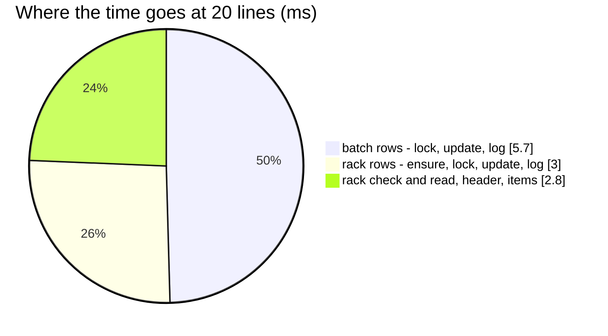

# RackSample — performance audit

**Verdict:** ✅ the N+1 is fixed (2026-10-17, [ledger-writes-are-set-based](../../../../docs/technical/stock/design_decision.md#ledger-writes-are-set-based)) —
**12 statements for one line and for twenty**, 15.8 ms at twenty (was 126 and 42.2 ms). Still over the 5-statement line:
a sample takes from both ledgers and records a transaction with items, whatever its lines.
**Measured:** 2026-10-17 · `inventory_service/inventory_v1/rack_sample.go` → `inventory_mutations.PostSample` · the background
volume of [OrderTransactionCreate](OrderTransactionCreate.md) · 20 products on one rack, 10 batches each · warm, 5 runs

| lines | median wall | queries | before (2026-10-17, first audit) |
| --- | --- | --- | --- |
| 1 | 4.1 ms | 12 | 4.2 ms · 12 |
| 20 | 15.8 ms | **12** | 42.2 ms · 126 |

---

## Queries (20 lines)

| # | What | ×N | Time | Plan | Verdict |
| --- | --- | --- | --- | --- | --- |
| 1 | rack check · the rack's rows (the owners) | 2 | 1.3 ms | pkey · `product_placements_placement_idx` | ok |
| 2 | `SELECT * FROM batches WHERE warehouse_id = ? AND (team_id, product_id) IN (…) AND stock_count > 0 ORDER BY id FOR UPDATE` | 1 | 1.4 ms, 200 rows | Bitmap Index Scans | ✅ was ×20 |
| 3 | `UPDATE batches AS b … FROM unnest(…)` · `INSERT INTO batch_logs …` | 1 + 1 | 2.2 + 2.2 ms | pkey | ✅ was ×20 each |
| 4 | `INSERT INTO product_placements … FROM unnest(…) ON CONFLICT DO NOTHING` · the rack rows locked | 1 + 1 | 1.0 ms | — · Bitmap Index Scans | ✅ was ×20 |
| 5 | `UPDATE product_placements AS p … FROM unnest(…)` · `INSERT INTO product_placement_logs …` | 1 + 1 | 1.0 + 1.0 ms | pkey | ✅ was ×20 each |
| 6 | header, items | 2 | 1.5 ms | — | ok |

---

## Findings

### row-at-a-time-ledger-writes

✅ **Fixed 2026-10-17.** The oldest-first batch take read each product's batches with its own query, and every batch and
rack row was updated and logged one statement at a time. Now every product's batches are locked in one read, taken in
memory and written once; the rack rows likewise. Same cause as
[OrderTransactionCreate § row-at-a-time-ledger-writes](OrderTransactionCreate.md#row-at-a-time-ledger-writes).

---

## Not measured

- concurrency (single caller)
- a sample crossing batches — measured at 1 unit a line, one batch row each
- a sample of several teams' products — each owning team adds its transaction and its items
- planning inflated by the harness's single long transaction — see [OrderTransactionCreate § Not measured](OrderTransactionCreate.md#not-measured)

---

## Open questions

- None — see [OrderTransactionCreate § Open questions](OrderTransactionCreate.md#open-questions).

---

## History

| Date | Median @20 lines | Queries @1 / @20 | Change |
| --- | --- | --- | --- |
| 2026-10-17 | 42.2 ms | 12 / 126 | first audit |
| 2026-10-17 | 15.8 ms | 12 / 12 | set-based ledger primitives |
