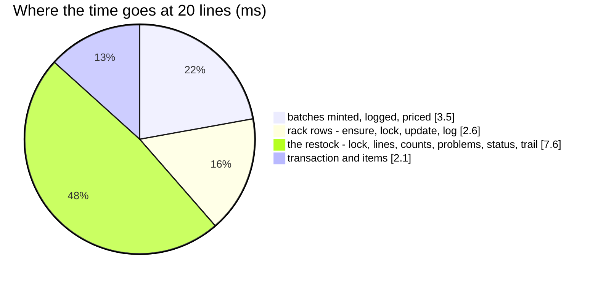

# RestockRequestAccept — performance audit

**Verdict:** ✅ all three findings fixed (2026-10-17) — **17 statements for one line and for twenty**, 14.1 ms at twenty
(was 190 and 62.0 ms). Still over the 5-statement line: the accept writes the restock's own rows, mints into both ledgers
and records a transaction with items, whatever its lines.
**Measured:** 2026-10-17 · `inventory_service/inventory_v1/restock_request_accept.go` → `inventory_mutations.PostRestock` · the
background volume of [OrderTransactionCreate](OrderTransactionCreate.md) plus `restocks` 10 000 and `restock_items` 50 000 ·
each line 10 in the box, 1 broken, 9 onto one rack · restocks raised before the timer · warm, 5 runs

| lines | median wall | queries | before (2026-10-17, first audit) |
| --- | --- | --- | --- |
| 1 | 6.9 ms | 17 | 7.5 ms · 19 |
| 20 | 14.1 ms | **17** | 62.0 ms · 190 |

---

## Queries (20 lines)

| # | What | ×N | Time | Plan | Verdict |
| --- | --- | --- | --- | --- | --- |
| 1 | the restock locked, its lines | 2 | 1.6 ms | pkey · `restock_items` by restock | ok |
| 2 | `SELECT count(*) FROM placements WHERE id IN (…) AND warehouse_id = ? AND deleted_at IS NULL` | 1 | 0.5 ms | pkey | ✅ was ×20 |
| 3 | `UPDATE restock_items AS i SET received_count … FROM unnest(…)` | 1 | 1.0 ms | pkey | ✅ was ×20 |
| 4 | `INSERT INTO restock_problem_items …` (20 rows) | 1 | 1.1 ms | — | ✅ was ×20 |
| 5 | `INSERT INTO batches … RETURNING id` · `batch_logs` · `batch_price_logs` | 1 + 1 + 1 | 3.5 ms | — | ✅ was ×20 each |
| 6 | `INSERT INTO product_placements … ON CONFLICT DO NOTHING` · lock · `UPDATE … FROM unnest(…)` · log `INSERT` | 4 | 2.6 ms | pkey | ✅ was ×20 · 1 · ×19 · ×19 |
| 7 | transaction, items, restock status, trail | 4 | 5.5 ms | pkey | ok — the status `UPDATE` is the single slowest statement, 2.9 ms |

---

## Findings

### the-accept-checks-the-same-rack-once-per-line

✅ **Fixed 2026-10-17.** `rackExists` ran inside the per-line loop, once per placement named — twenty lines onto one rack
asked the same question twenty times. Every named placement is now collected first and checked in one
`SELECT count(*) … WHERE id IN (…)` (`racksExist`, shared with the move and the transfer accept).

### the-accept-writes-its-own-rows-one-at-a-time

✅ **Fixed 2026-10-17.** One `UPDATE restock_items` per line for `received_count` and one `INSERT restock_problem_items` per
line with a problem are now one `UPDATE … FROM unnest(…)` and one multi-row insert.

Found on re-measuring, and fixed with it: saving the restock's status with `tx.Model(&rr).Updates(…)` made GORM upsert the
loaded lines and problem rows again from `rr` — two hidden statements of 20 rows each. The update now omits associations.
⚠ `RestockRequestArrive`, `Cancel`, `MarkLost` and `Update` save through `Model(&rr)` the same way and were not audited
here; any of them that preloads the lines pays the same hidden upsert.

### row-at-a-time-ledger-writes

✅ **Fixed 2026-10-17.** `PostRestock` minted each line's batch with its two logs, and wrote each rack row and its log, one
statement at a time — about 120 of the 190. Mints are now `MintBatches` (three statements for any number of lines) and the
put-away one `PutOnPlacements` (four). Same cause as
[OrderTransactionCreate § row-at-a-time-ledger-writes](OrderTransactionCreate.md#row-at-a-time-ledger-writes).

---

## Not measured

- concurrency (an accept and a cancel at the same second are covered for correctness by the race tests, not timed)
- a line split over several racks — measured at one rack a line
- the restock detail's put-away read (`loadPutAway`) — it now uses the placement log's own index
  ([placement-logs-are-indexed-by-transaction](../../../../docs/technical/stock/design_decision.md#placement-logs-are-indexed-by-transaction))
  but is not on the accept's path
- planning inflated by the harness's single long transaction — see [OrderTransactionCreate § Not measured](OrderTransactionCreate.md#not-measured)

---

## Open questions

- None. The two handler-local fixes went with the ledger refactor, so the accept changed once.

---

## History

| Date | Median @20 lines | Queries @1 / @20 | Change |
| --- | --- | --- | --- |
| 2026-10-17 | 62.0 ms | 19 / 190 | first audit |
| 2026-10-17 | 14.1 ms | 17 / 17 | set-based ledger primitives; one rack check, one count update, one problem insert; no association re-upsert |
