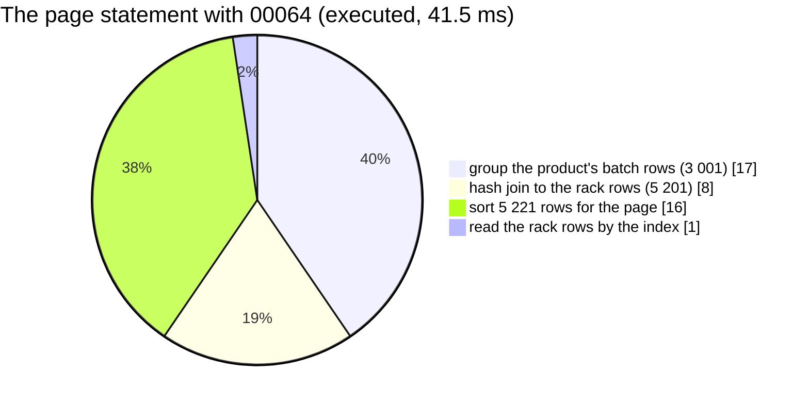

# StockHistory (a product's, without a batch) — performance audit

**Verdict:** 🟡 heavy on one signal — the page statement runs **30–45 ms** on a quiet machine and **past 50 ms** (up to
73 ms) on a loaded one, over the audit's 50 ms single-query line; the median wall (≈ 48 ms) is far under 150 ms. Since
#142 / #143 the warehouse product page's Stock History names each rack row's batch (`rackBatchJoin`) and lists the price
corrections, so the read walks EVERY rack row of the product before it cuts the page — and `product_placement_logs` had
no index on the product, so it seq-scanned the whole table (≈ 100–130 ms). Inventory `00064` adds the pure index
`(product_id, transaction_id, warehouse_id)` (a-pure-index-is-added-without-asking): **page 1 101 → 48 ms**, Placement
History **≈ 100 → 9–15 ms**, the last stock-take **≈ 100 → 9–12 ms**, no reader of the table slower, the order take
unchanged. What is left is linear in the product's history (Finding 2), a rewrite — the owner's call.
**Measured:** 2026-11-27 · `inventory_service/inventory_v1/stock_history.go` (`productHistory`), `ledger_history.go`
(`rackBatchJoin`, `placementBatchSelect`, `priceCorrectionSelect`, `moveBatchExpr`) · seed `perfProductHistory`
(`stock_history_product_perf_test.go`): the ledgers' background (`perfLedgerBackground`) plus ONE product of 5 000 units
with 3 000 takes off two racks, 100 moves and 20 price corrections — **5 201 rack rows of the product among 305 000**,
3 001 batch-row groups · `warehouse_test` VACUUM FULL'd first · warm, 5 runs a reader (7 × 8 alternating rounds for the
headline) · `TestPerf_StockHistory_AProductsBatches` (`-tags perfaudit`); the index states were timed by throwaway probes
on the same seed in one process (none / E interleaved), beside the tester's live e2e — hence the spread.

| read (page of 50) | HEAD, no index | HEAD, `00064` | #142/#143, no index | **#142/#143, `00064`** | queries |
| --- | --- | --- | --- | --- | --- |
| Stock History page 1 | 50–57 ms | 6–7 ms | 101 ms (56 calls; 102–133 per pass) | **48 ms** (56 calls; p25–p75 44–56) | 2 |
| Stock History page 100 | 124–138 ms | 20–28 ms | 103 ms (56 calls) | **45 ms** (p25–p75 40–51) | 2 |
| Placement History (kind `MOVE`) | 92–98 ms | 4–7 ms | 92–112 ms | **9–15 ms** | 2 |
| last stock-take (kind `ADJUST`, 1 row) | 95–129 ms | 7–11 ms | 96–109 ms | **9–12 ms** | 2 |

| the page's two statements (#142/#143) | no index | `00064`, quiet | `00064`, loaded |
| --- | --- | --- | --- |
| the page | 55–71 ms | 30–45 ms | 60–73 ms |
| the count | 46–63 ms | 15–25 ms | 31–46 ms |



---

## Queries

| # | What | Rows | Time (with `00064`) | Plan | Verdict |
| --- | --- | --- | --- | --- | --- |
| 1 | `SELECT COUNT(*) FROM (<rack rows ⟕ batch groups> UNION ALL <price corrections>) h` | 1 | 15–25 ms | Bitmap Index Scan `product_placement_logs_product_idx` (5 201) · the batch groups by `batch_logs_batch_idx` (3 001) · Hash Left Join | 🟡 linear in the product's rows |
| 2 | the page: the same union, `ORDER BY created_at DESC, src DESC, row_id DESC, part DESC LIMIT 50 OFFSET ?`, then per page row `refExpr`, `is_override`, the recipient, `moveBatchExpr` | 50 | 30–45 ms | as 1, then a top-N Sort of 5 221 rows; the per-row probes are index scans, 50 loops each | 🟡 > 50 ms on a loaded run |

---

## Findings

### 1. The product's rack rows were found by a seq scan 🔴 → ✅ applied (`00064`)

`WHERE l.warehouse_id = ? AND l.product_id = ?` on `product_placement_logs` had only the placement-first (`00025`) and
transaction (`00031`) indexes, so every statement read the whole table (305 000 rows) in parallel and dropped the
other products'. Before (page 1, no index):

```
->  Parallel Seq Scan on product_placement_logs l  (actual time=1.463..11.977 rows=1734 loops=3)
Execution Time: 56.793 ms
```

After `00064`:

```
->  Bitmap Heap Scan on product_placement_logs l  (actual time=0.288..1.077 rows=5201 loops=1)
      ->  Bitmap Index Scan on product_placement_logs_product_idx  (actual time=0.265..0.265 rows=5201 loops=1)
Execution Time: 42.179 ms
```

**Applied** — inventory `00064_placement_logs_by_product.sql`, a pure index (no query, write, constraint or result
changes):

```sql
CREATE INDEX product_placement_logs_product_idx ON product_placement_logs (product_id, transaction_id, warehouse_id);
```

**The index trial** — every reader of `product_placement_logs` timed under each candidate on one seed, interleaved:

| candidate | the product's history | the cost elsewhere | verdict |
| --- | --- | --- | --- |
| A `(warehouse_id, product_id)` | HEAD page 1 35 → 4.8 ms, #142's 103 → 45 ms | **a batch's history (#47, `batchRackJoin`) 14 → 383 ms** — the planner BitmapAnd-ed it with the transaction index on a misestimated product range | ❌ rejected |
| C `(warehouse_id, product_id, transaction_id)` | the same gains | **`StockPickLocations` 1.3 → 6.4 ms** — its `transaction_id IN … AND warehouse_id = ?` range-scanned C's warehouse prefix, a cost that grows with the warehouse | ❌ rejected |
| D `(product_id, warehouse_id, transaction_id)` | page 1 46–50 ms, page 100 43–74, Placement History 6–7, last stock-take 8 | none measured | ✅ would do |
| **E `(product_id, transaction_id, warehouse_id)`** | page 1 48 ms, page 100 45, Placement History 9–15, last stock-take 9–12 | none measured; a `(transaction, product)` lookup without a warehouse is exact too (`BatchPlacementList`'s probe 0.010 ms) | ✅ **chosen** |

With E, every other reader of the table (medians, none → E): a batch's history page 1 **26.6 → 26.3 ms** and page 100
75 → 82 ms (56 alternating calls; within the spread — its lateral now probes E exactly, `Index Cond: (product_id =
b.product_id) AND (transaction_id = l.transaction_id) AND (warehouse_id = l.warehouse_id)`, the same 12 105 buffers as
on the transaction index), `StockPickLocations` ≈ 1 ms either way (still `product_placement_logs_transaction_idx`),
`OwnerStockHistory` 19–20 ms (it reads `batch_logs`), `BatchPlacementList` 2–4 ms, and **`ProductStockSummary` 47–58 →
7–8 ms** (it seq-scanned too). The order take's write — `TestPerf_OrderTakeLatency_Committed`, every take committed,
none / E / none / E: 1 line **9.0 / 10.0 / 11.3 / 9.9 ms**, 20 lines **18.2 / 19.6 / 21.0 / 18.2 ms** median — inside the
noise: one more btree insert per rack row.

### 2. The batch naming is per row of the product, not per page 🟡 open — a rewrite, the owner's call

With the index, the time is the work over the product's WHOLE history, done twice (the count and the page): the batch
rows of the product in the warehouse grouped per transaction, change type, side and batch, with their windows (≈ 17 ms
for 3 001 groups), hash-joined to every rack row (≈ 8 ms), then all 5 221 rows sorted to cut 50 (≈ 16 ms). It grows
linearly with the product's ledger in that warehouse; HEAD read the 50 rack rows of the page alone (6–7 ms).

```
Subquery Scan on h  (actual time=41.492..41.735 rows=50 loops=1)
  ->  Limit / Sort  (actual time=41.444..41.454 rows=50 loops=1)
        ->  Append  (actual time=17.849..25.895 rows=5221 loops=1)
              ->  Hash Left Join  (actual time=17.847..24.788 rows=5201 loops=1)
                    ->  Bitmap Heap Scan on product_placement_logs l  (actual time=0.288..1.077 rows=5201 loops=1)
                    ->  Hash  (actual time=17.530..17.535 rows=3001 loops=1)
                          ->  Subquery Scan on bk / WindowAgg ×2 / GroupAggregate  (actual time=2.286..16.068 rows=3001 loops=1)
              ->  Nested Loop (the 20 price corrections)  (actual time=0.644..0.655 rows=20 loops=1)
```

**→ Recommend:** **B — keep it** at revamp's volumes: 48 ms median for a product with 5 000 movements in one warehouse is
an extreme product, under the 150 ms line. **A (later, on a measured need)** — page first, then name: cut the page from
the rack rows and the price rows by `(created_at, src, row_id)` alone, then group only the page's transactions' batch
rows; the count adds each transaction's extra parts from `batch_logs` alone. It is a query rewrite (the split rows move
the page boundaries), so it goes the standing way: a measure-only probe child (old vs new on this seed, same ids, order
and totals across every filter), then the owner's yes. I would pick B now and A if a production product passes ≈ 15 000
rack rows in one warehouse.

---

## Not measured

- concurrency (single caller)
- cache-cold behaviour — every figure is warm
- the generic plan: the page's SQL is interpolated by GORM, not prepared, so the server never switches plans
- production's distribution — the seed is one heavy product over a uniform background; most products have far fewer rows
- the frontend: the page's request count is the speed audit's (`audits/frontend/warehouse-product.md`)

---

## Open questions

- [ ] Finding 2's rewrite — B (recommended: keep, re-measure when a product's ledger in one warehouse nears 15 000 rows)
      or A (a measure-only probe of the page-first rewrite now).

---

## History

| Date | Median | Queries | Change |
| --- | --- | --- | --- |
| 2026-11-27 | page 1 101 → 48 ms (page statement 30–45 ms quiet, ≤ 73 loaded) | 2 | first audit — backlog #142/#143 (each row's batch, the price corrections, the CANCEL / BROKEN / FOUND kinds); inventory `00064` E `(product_id, transaction_id, warehouse_id)` added after the A / C / D / E trial; Finding 2 open |
