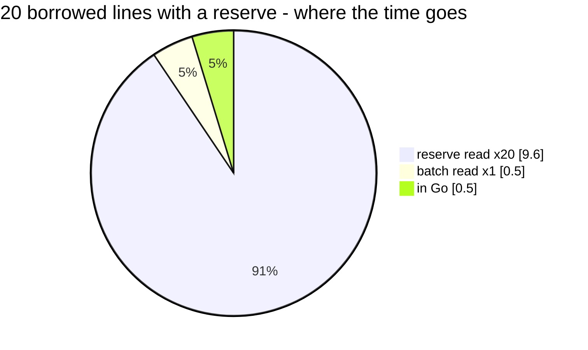

# StockTakeQuote — performance audit

**Verdict:** ✅ fixed 2026-10-26 ([the-reserve-is-read-once-for-every-line](../../../../docs/business/inventory/order_decision.md#the-reserve-is-read-once-for-every-line)) — was 🔴 heavy: the take's reserve rule read once per borrowed line, 21 queries at 20 lines. Now 2 at any count, 1.57 ms at 20.
Own lines are flat — 1 query at 1, 20 or 100 lines.
**Measured:** 2026-10-23 · `inventory_service/inventory_v1/stock_take_quote.go` · seed: the ledgers' background
(`perfLedgerBackground`, 50 000 batches over 20 warehouses), plus 100 target products × 10 batches in Gudang 5 · warm,
5 runs · `stock_take_quote_perf_test.go` (`-tags perfaudit`)

| lines | median wall | db | in Go | queries |
| --- | --- | --- | --- | --- |
| 1 own | 0.51 ms | 0.51 ms | ~0 | 1 |
| 20 own | 1.56 ms | 1.51 ms | 0.05 ms | 1 |
| 100 own | 7.64 ms | 6.81 ms | ~0.5 ms | 1 |
| 1 borrowed, reserve set | 0.99 ms | 0.54 ms | — | 2 |
| **20 borrowed, reserve set** | **10.64 ms** | **10.16 ms** | 0.48 ms | **21** ⚠ |



---

## Queries

| # | What | Rows | Time | Plan | Verdict |
| --- | --- | --- | --- | --- | --- |
| 1 | `SELECT * FROM batches WHERE warehouse_id = ? AND (team_id, product_id) IN (…) AND stock_count > 0 ORDER BY id` | 1 000 at 100 lines | 0.7 ms executed | Bitmap Index Scan `batches_last_price_idx` per pair | ok — the take's own read, once |
| 2 | `SELECT COALESCE(SUM(stock_count), 0) FROM batches WHERE team_id = ? AND product_id = ?` **×20** | 1 | 0.48 ms ea | Index Scan `batches_last_price_idx`, **non-leading columns** | 🔴 N+1 |

The product facts come from product_service (in-process, a fake here) and are not on this probe.

---

## Findings

### 1. The reserve is read once per borrowed line 🔴

`notAllowedLines` — the TAKE's own rule, which the quote reuses so the two cannot disagree — calls `ownerTotalStock` for
every borrowed line whose owner set a reserve (the-reserve-is-read-before-the-take). Queries grow with the lines: 2 at 1,
21 at 20. The take (`OrderTransactionCreate`) runs the same loop on every submit; the quote multiplies it by every
quantity the form settles on.

**→ Recommend:** one grouped read for every borrowed reserved line —
`SELECT team_id, product_id, SUM(stock_count) FROM batches WHERE (team_id, product_id) IN ? GROUP BY 1, 2` — inside
`notAllowedLines`, so the take and the quote both get it. A plain read today, so nothing about locking changes. I would
take it; it is a change to the take's code path, which is why it is a proposal here and not applied.

### 2. The reserve read has no index that leads with its filter 🟡

It filters `team_id, product_id` across EVERY warehouse, and the only index carrying both leads with `warehouse_id`, so
the planner walks the whole index for one row: 163 buffers for 1 row at 50 000 batches, growing with the table.

```
Aggregate  (cost=1166.30..1166.31 rows=1) (actual time=0.164..0.165 rows=1)
  ->  Index Scan using batches_last_price_idx on batches  (cost=0.29..1166.30 rows=1) (actual rows=1)
        Index Cond: ((team_id = 102) AND (product_id = 910020))
        Buffers: shared hit=163
```

**→ Recommend:** the index below, owned by inventory_service. It serves the take's reserve read and the quote's alike,
and would serve the grouped read of finding 1 too.

---

## Proposed migration

```sql
-- backend/services/inventory_service/db_migrations/<next>_batches_owner_product_index.sql
CREATE INDEX CONCURRENTLY batches_owner_product_idx ON batches (team_id, product_id) WHERE stock_count > 0;
```

Cost: one more index on the hottest ledger table — every take, restock and transfer updates `stock_count`, and the
partial predicate means a batch emptied by a take leaves it. Not applied (HARD RULE 3, the owner's call).

---

## Not measured

- concurrency (single-caller measurement) — the quote locks nothing
- product_service's `Facts` call, faked here; in the running app it is an in-process read of the catalogue
- cache-cold behaviour
- production distribution — the seed is uniform; a real lender's product sits in a handful of warehouses
- the debounce on the form, which decides how often this runs while a quantity is typed

---

## Open questions

None — the owner took both findings (2026-10-26): the grouped read in `notAllowedLines` (`ownerTotalStocks`) and
`batches_owner_product_idx`, inventory_service `00032`, built as a plain `CREATE INDEX` like every other migration here.

---

## History

| Date | Median (20 lines) | Queries (20 lines) | Change |
| --- | --- | --- | --- |
| 2026-10-23 | 1.56 ms own · 10.64 ms borrowed with a reserve | 1 own · 21 borrowed with a reserve | first audit |
| 2026-10-26 | 1.57 ms borrowed with a reserve | 2 borrowed with a reserve, at 1 or 20 | one grouped reserve read + `batches_owner_product_idx` (4 buffers, was 163 per line) |
