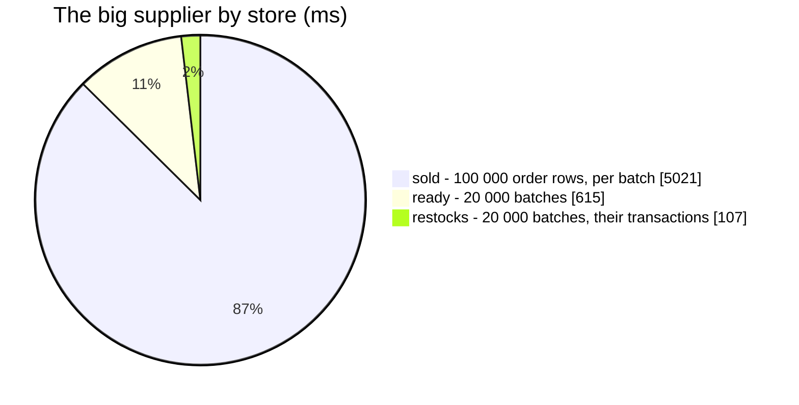

# SupplierGoods — performance audit

**Verdict:** 🟡 HEAVY for one shape only — a list page of 50 ordinary suppliers reads in **41 ms** (3 statements) and a
detail page's warehouses or stores of an ordinary supplier in **2 ms**; a supplier whose goods went out on **100 000
order rows** takes **≈ 5 s** cold (≈ 0.5 s with the hash plan, see finding 1), because *Terjual* is summed from the
ledger rows every time.
**Measured:** 2026-11-07 · `inventory_service/inventory_v1/supplier_goods.go` · 200 000 batches (50 000 restocks × 4
lines), 500 000 orders writing 1 000 000 `order` batch rows (one in fifty rolled back), one big supplier (7) holding a
tenth of every batch, 3 000 others · `VACUUM FULL ANALYZE` first, warm-up + 5 runs (`supplier_goods_perf_test.go`,
`-tags perfaudit`) · with `batches_supplier_idx` (inventory `00039`)

| case | median wall | statements |
| --- | --- | --- |
| list page — 50 suppliers, `GROUP_SUPPLIER` | 41 ms | 3 |
| a small supplier by warehouse | 2 ms | 3 |
| list page with the big supplier on it | 5.6 s | 3 |
| the big supplier by store / by warehouse | 5.3 s / 4.8 s | 3 |
| before `00039` (no supplier index), list page | 396 ms | 3 |

---

## Statements

| # | What | Time (list / big) | Verdict |
| --- | --- | --- | --- |
| 1 | ready — `SUM(stock_count)` over the suppliers' batches (`batches_supplier_idx`) | < 1 ms / 615 ms | ok / cold heap reads |
| 2 | restocks — the batches' restock transactions (pkey) | < 5 ms / 107 ms | ok |
| 3 | sold — each batch's `order` rows through a `LATERAL … OFFSET 0` on `batch_logs_batch_idx`, netted per transaction | 33 ms / 5 s | 🔴 for a big supplier |

## Findings

### 1. Terjual is re-summed from the ledger on every read

The figure is all-time, so its cost grows with every unit the supplier ever sold. At 100 000 order rows the per-batch
index reads are random heap reads (`read=47 116` buffers). The planner's own choice — hashing the whole of `batch_logs`
(1 M rows) — is ≈ 450–650 ms whatever the supplier, i.e. it made the ordinary list page 10× slower (340 ms), which is
why the `OFFSET 0` fence keeps the per-batch plan.

**→ Recommend:** fold it. Keep `sold_units`, `orders` and `last_order_at` per (supplier, store, warehouse) in a small
inventory table written in the take's and the rollback's own transaction (the lost-stock fold's shape,
`inventory_mutations/fold_lost.go`), so the read is one indexed row per key. It is a write-path change on the order
take (a concurrency audit and a lock-order row with it) — the owner's call; not applied.

### 2. Ready on a big supplier is cold heap reads

20 000 batches scattered over the heap. **→ Recommend:** nothing yet; the same fold could carry it, or an index-only
scan with `INCLUDE (stock_count)` on `batches_supplier_idx`.

### 3. The Produk tab's batch lookup had no product ✅ fixed 2026-11-21 by `00063` — 🟡 still open under a chip

`SupplierStoreProductGoods` (`supplier_store_product_goods.go`, the Produk tab's Terjual / Siap — one statement per page)
finds each row's batches by `supplier_id = ? AND supplier_channel_id = <store> AND product_id = <product>` (+ the Gudang
terkait chip's `warehouse_id = ?`). `batches_supplier_idx` holds no product, so for the big supplier every row walked all
≈ 10 000 batches of its store and dropped the other products on the heap: 200 rows 0.7–1.3 s, a page of 20 66–130 ms.
**→ Applied:** `00063` `batches_supplier_product_idx ON batches (supplier_id, supplier_channel_id, product_id,
warehouse_id)` — a pure index (`a-pure-index-is-added-without-asking`): no query and no answer changed (the test compares
the answers with and without it). Full, not partial: Siap sums emptied batches too and Terjual reads their order rows.

**Under a chip the cached generic plan keeps the old index.** With the warehouse bound, the custom plan takes `00063`
(200 rows 0.8–1.0 s → 41–66 ms), but pgx prepares every statement and Postgres goes generic after five runs: the generic
plan estimates one row through either index (cost 8.32 vs 8.45) and keeps the smaller `batches_supplier_idx`, so the
answer production gets (`auto`) stays 0.4–0.9 s. No column order of the new index breaks that tie while
`batches_supplier_idx` exists. **→ Proposal (the owner's — a dropped index, not covered by the standing OK):** drop
`batches_supplier_idx` and let `00063` serve every supplier read. Measured only, one process: under a chip 200 rows
634–775 → **54–70 ms** (generic 610–818 → 54 ms), a page of 20 71 → 5–8 ms; every other read that used
`batches_supplier_idx` moves to `00063` at the same cost (`SupplierGoods`' three statements, the chips' Toko / Produk /
Gudang sets — table below); and the writes keep one index fewer than today. The alternative, a query change keeping the
generic plan off `batches_supplier_idx`, is also the owner's.

Measured with `TestPerf_SupplierStoreProductGoods` (`supplier_store_product_goods_perf_test.go`, `-tags perfaudit`): the
#116 probe's volume (this audit's 200 000 batches, the big supplier 20 000 — 10 000 at its busiest warehouse — over 1 000
(store, product) pairs; 500 000 orders × 2 rows, each in its own warehouse), ONE seed per process — with `00063`, dropped,
dropped, re-created (inside the test transaction) — custom, generic and `auto` plan, 3 processes; min–max of the medians:

| read | without `00063` | with `00063` | option: `00063` alone |
| --- | --- | --- | --- |
| Produk figures, 200 rows, no chip (`auto` · generic) | 677–1 118 · 888–1 135 ms | **42–67 · 43–75 ms** | 51 · 61 ms |
| Produk figures, 20 rows, no chip (`auto` · generic) | 76–130 · 66–112 ms | **4.9–7.8 · 5.0–6.6 ms** | 6.0 · 6.8 ms |
| Produk figures, 200 rows, under a chip (`auto` · custom · generic) | 597–920 · 819–1 042 · 439–841 ms | 417–868 · **41–66** · 496–759 ms | **70 · 55 · 54 ms** |
| Produk figures, 20 rows, under a chip (`auto` · custom · generic) | 54–85 · 84–121 · 67–85 ms | 43–88 · **4.8–7.6** · 46–79 ms | **4.8 · 5.5 · 7.6 ms** |
| the chip's Produk set (`SupplierStoreProductsAtWarehouse`) | 6.7–7.8 ms | 5.7–11.8 ms (takes `00063`: its order is the DISTINCT's) | 9.2 ms |
| the chip's Toko set (`SupplierStoresAtWarehouse`) | 4.5–6.0 ms | 4.8–9.6 ms (plan unchanged) | 8.4 ms |
| the Gudang set (`SupplierIDsAtWarehouse`) | 7.1–21.4 ms | 16.1–24.1 ms (a bitmap on `00063`) | 18.5 ms |
| `SupplierGoods` list page of 50 · big by store · by warehouse · under a chip · small | 42–51 · 347–486 · 369–492 · 89–134 · 2.4–3.5 ms | 46–60 · 386–731 · 400–778 · 106–132 · 2.2–3.4 ms (plans unchanged — noise) | 60 · 424 · 542 · 125 · 2.7 ms |

The whole Produk RPC through the real wiring (`cmd/app_development` `TestPerf_SupplierProductList`, its own volume — the
big supplier ≈ 1 000 batches a store, 2–3 a row — 3 processes before the migration and 3 after): page 1 × 20 17–23 →
16–21 ms (figures 8.9–13.1 → 8.4–10.9), × 50 27–37 → 24–32 ms, page 100 × 20 19–22 → 14–18 ms, typical supplier 4.4–6.8
→ 3.9–4.9 ms, the export of 4 000 rows 1.7–2.3 → 1.7–1.9 s: a small gain where a store holds few batches, 20× where it
holds many.

**The write cost.** A take's `UPDATE batches SET stock_count …` is **not a HOT update today** (`pg_stat` on the committed
probe: 0 of 1 421 batch updates HOT, before and after): `stock_count` is in the predicate of the partial
`batches_take_idx` and `batches_owner_product_idx`, so every take already writes a new entry into every batches index, and
`00063` adds one more per batch a take moves — and one per batch an accept mints. Measured three ways, it stays inside the
noise of this shared host:

| write | before | after |
| --- | --- | --- |
| `TestPerf_OrderTakeLatency_Committed`, 3 processes before the migration, 3 after — p50 (p95) | 1 line 8.9 / 10.2 / 9.3 (11.7 / 14.8 / 12.4) · 20 lines 16.5 / 18.1 / 18.1 (24.0 / 25.6 / 23.6) ms | 1 line 8.0 / 8.4 / 9.0 (10.6 / 12.3 / 12.9) · 20 lines 16.3 / 14.0 / 16.1 (24.3 / 22.5 / 21.9) ms |
| `TestPerf_RestockRequestAccept` (median of 5), same processes | 1 line 11.5 / 14.0 / 18.0 · 20 lines 27.1 / 37.3 / 27.4 ms | 1 line 10.2 / 8.3 / 15.3 · 20 lines 19.5 / 21.8 / 22.0 ms |
| `TestPerf_SupplierProductIndex_WriteCost_Committed` — one seed, committed, with / without / without / with, 3 processes, p50 | take 1 line 6.7–9.2 · 20 lines 17.4–23.6 · accept 1 line 12.0–14.5 · 20 lines 16.0–24.3 ms | take 1 line 7.1–11.0 · 20 lines 16.5–29.1 · accept 1 line 9.0–14.8 · 20 lines 15.5–23.1 ms |
| the statements alone (psql, rolled back, 200 000 batches, 400 × 20 rows a phase, ABBAAB) | UPDATE of 20 batches 1.51 / 1.64 / 2.13 · INSERT of 20 1.0 / 0.86 / 1.08 ms | 1.86 / 2.81 / 1.95 · 1.15 / 0.98 / 1.09 ms |

The direct cost is ≈ 10–20 µs per updated batch and ≈ 5 µs per minted one — ≤ 0.4 ms on a twenty-line take, ≤ 0.1 ms on
a twenty-line accept, against a run-to-run spread of 2–12 ms for the same case in the same process.

## History

| Date | Result |
| --- | --- |
| 2026-11-07 | First audit: Findings 1–2, `00039` `batches_supplier_idx` |
| 2026-11-21 | Finding 3 — `00063` `batches_supplier_product_idx` (backlog #118, a pure index from the #116 probe): the Produk tab's 200 rows of a big supplier 0.7–1.3 s → 41–77 ms, 20 rows 66–130 → 5–8 ms, no chip; under a chip only the custom plan gains (0.8–1.0 s → 41–66 ms) — the cached generic plan keeps `batches_supplier_idx`, so production's answer stays 0.4–0.9 s (dropping `batches_supplier_idx`: 54–70 ms — the owner's call). `SupplierGoods`' plans unchanged; the chips' Produk and Gudang sets move to `00063` at the same cost. Writes: a take's batch updates were never HOT; `00063` adds ≈ 10–20 µs a moved batch, inside the noise (table above) |
