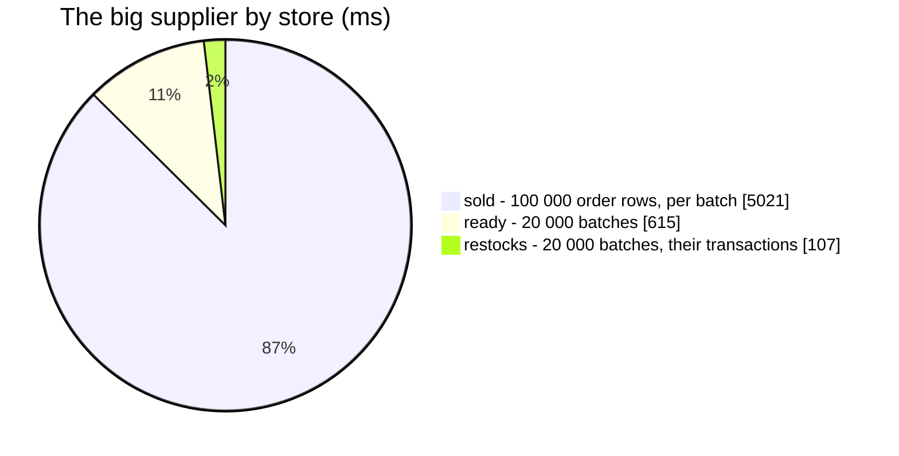

# SupplierGoods — performance audit

**Verdict:** 🟡 HEAVY for one shape only — a list page of 50 ordinary suppliers reads in **41 ms** (3 statements) and a
detail page's warehouses or stores of an ordinary supplier in **2 ms**; a supplier whose goods went out on **100 000
order rows** takes **≈ 5 s** cold (≈ 0.5 s with the hash plan, see finding 1), because *Terjual* is summed from the
ledger rows every time.
**Measured:** 2026-11-07 · `inventory_service/inventory_v1/supplier_goods.go` · 200 000 batches (50 000 restocks × 4
lines), 500 000 orders writing 1 000 000 `order` batch rows (one in fifty rolled back), one big supplier (7) holding a
tenth of every batch, 3 000 others · `VACUUM FULL ANALYZE` first, warm-up + 5 runs (`supplier_goods_perf_test.go`,
`-tags perfaudit`) · with `batches_supplier_idx` (inventory `00039`)

| case | median wall | statements |
| --- | --- | --- |
| list page — 50 suppliers, `GROUP_SUPPLIER` | 41 ms | 3 |
| a small supplier by warehouse | 2 ms | 3 |
| list page with the big supplier on it | 5.6 s | 3 |
| the big supplier by store / by warehouse | 5.3 s / 4.8 s | 3 |
| before `00039` (no supplier index), list page | 396 ms | 3 |

---

## Statements

| # | What | Time (list / big) | Verdict |
| --- | --- | --- | --- |
| 1 | ready — `SUM(stock_count)` over the suppliers' batches (`batches_supplier_idx`) | < 1 ms / 615 ms | ok / cold heap reads |
| 2 | restocks — the batches' restock transactions (pkey) | < 5 ms / 107 ms | ok |
| 3 | sold — each batch's `order` rows through a `LATERAL … OFFSET 0` on `batch_logs_batch_idx`, netted per transaction | 33 ms / 5 s | 🔴 for a big supplier |

## Findings

### 1. Terjual is re-summed from the ledger on every read

The figure is all-time, so its cost grows with every unit the supplier ever sold. At 100 000 order rows the per-batch
index reads are random heap reads (`read=47 116` buffers). The planner's own choice — hashing the whole of `batch_logs`
(1 M rows) — is ≈ 450–650 ms whatever the supplier, i.e. it made the ordinary list page 10× slower (340 ms), which is
why the `OFFSET 0` fence keeps the per-batch plan.

**→ Recommend:** fold it. Keep `sold_units`, `orders` and `last_order_at` per (supplier, store, warehouse) in a small
inventory table written in the take's and the rollback's own transaction (the lost-stock fold's shape,
`inventory_mutations/fold_lost.go`), so the read is one indexed row per key. It is a write-path change on the order
take (a concurrency audit and a lock-order row with it) — the owner's call; not applied.

### 2. Ready on a big supplier is cold heap reads

20 000 batches scattered over the heap. **→ Recommend:** nothing yet; the same fold could carry it, or an index-only
scan with `INCLUDE (stock_count)` on `batches_supplier_idx`.
