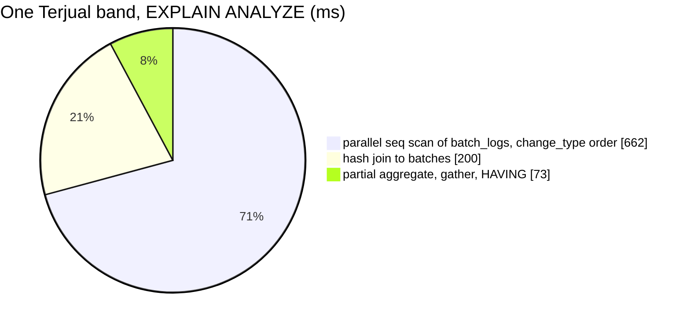

# SupplierIDsByFigure — performance audit

**Verdict:** 🔴 HEAVY for Terjual only — the suppliers in a Terjual band take **≈ 0.6–0.9 s** (one pass over every
`order` row of `batch_logs`, whatever the band; the spread is the heap read cold or warm); Siap's band takes **≈ 60 ms**. A list with no band picked never calls it.
**Measured:** 2026-11-07 · `inventory_service/inventory_v1/supplier_ids_by_figure.go` (an in-process seam for
supplier_service's `SupplierList`, the-range-pills-are-a-fixed-set) · SupplierGoods' background: 200 000 batches
(50 000 restocks × 4 lines), 500 000 orders writing 1 000 000 `order` batch rows (one in fifty rolled back), 3 001
suppliers · warm-up + 5 runs (`supplier_ids_by_figure_perf_test.go`, `-tags perfaudit`)

| case | median wall | statements |
| --- | --- | --- |
| Terjual ≥ 500 (the complement of the `< 500` pill) | 606 ms | 1 |
| Terjual 500–1.000 | 585 ms (902 ms on a second, colder run) | 1 |
| Siap ≥ 50 (the complement of `< 50`) | 65 ms | 1 |
| Siap 50–100 | 58 ms | 1 |

The plan: `Parallel Seq Scan on batch_logs` (1 000 000 `order` rows of 1 235 000, 47 493 buffers read) → `Parallel Hash
Join` to `batches` → `Partial HashAggregate` per supplier → `Gather Merge` → the `HAVING`. No index helps: every row of
the figure is needed before the band can cut.

## Findings

### 1. Terjual is all-time, so a band reads the whole order ledger

The figure is every unit ever sold, a cancel counted back, so the statement aggregates every `order` row of
`batch_logs` per supplier before the `HAVING` can cut — its cost grows with the ledger, not with the band or the page.
At 1 000 000 order rows it is ≈ 0.6–0.9 s, paid once per list request with a Terjual pill on (the list then pages
supplier_service's own rows as before).

**→ Recommend:** the same fold `SupplierGoods.md` finding 1 recommends — `sold_units` per supplier kept in the take's and
the rollback's own transaction — would make this an index range scan on one small table. A write-path change on the order
take, the owner's call; not applied.

### 2. Siap is fine

`SUM(stock_count)` over the batches still holding stock, grouped by supplier — ≈ 60 ms at 200 000 batches.
