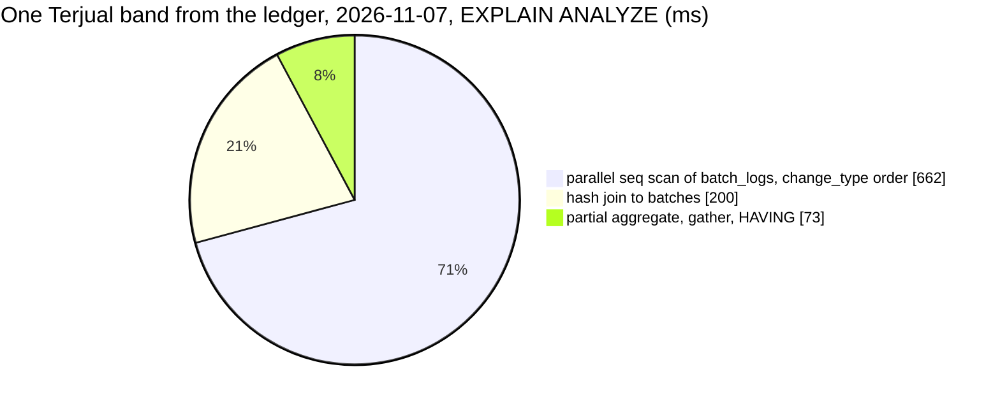

# SupplierIDsByFigure — performance audit

**Verdict:** 🟡 Terjual's band **≈ 0.27–0.30 s** at 1 000 000 order rows since 2026-11-15 — read from inventory's daily
stock fold (`inventory_stock_daily_changes`) instead of the order ledger
([the-terjual-band-reads-the-daily-sold-fold](../../../../docs/business/supplier/context_decision.md#the-terjual-band-reads-the-daily-sold-fold)),
the same ids, supplier for supplier; still one pass over every `order` row of the fold, whatever the band, on a seed that
does not compress (finding 1). Siap's band takes **≈ 50 ms**. A list with no band picked never calls it.
**Measured:** 2026-11-15 · `inventory_service/inventory_v1/supplier_ids_by_figure.go` (an in-process seam for
supplier_service's `SupplierList`, the-range-pills-are-a-fixed-set) · SupplierGoods' background: 200 000 batches
(50 000 restocks × 4 lines), 500 000 orders writing 1 000 000 `order` batch rows (one in fifty rolled back), 3 001
suppliers, folded into `inventory_stock_daily_changes` as inventory 00042's backfill does (1 000 000 fold rows — each
synthetic row hits a random batch, so nothing shares a day × warehouse × team × product × supplier key) · warm-up + 5
runs, the old ledger query and the new one on ONE seed in one process, old → new → new → old, two processes
(`supplier_ids_by_figure_perf_test.go`, `-tags perfaudit`)

| case | before — the ledger (`batch_logs` ⋈ `batches`) | after — the fold | statements |
| --- | --- | --- | --- |
| Terjual ≥ 500 (the complement of the `< 500` pill) | 500 · 484 ms | **296 · 282 ms** | 1 |
| Terjual 500–1.000 | 487 · 481 ms | **282 · 272 ms** | 1 |
| Siap ≥ 50 (the complement of `< 50`) | — | 47 · 50 ms (unchanged) | 1 |
| Siap 50–100 | — | 49 · 50 ms (unchanged) | 1 |

Same answer at that volume: every supplier's Terjual, ledger vs fold, **0 of 1 801 differ**; the five pills' questions
and bands through the bulk (0–∞, 100–200, 200–300, 300–400) return equal id lists. The plan now:
`Parallel Seq Scan on inventory_stock_daily_changes` (`change_type = 'order' AND supplier_id <> 0` — ≈ 700 000 rows
kept at the scan, 12 362 buffers) → `Partial HashAggregate` per supplier → `Gather Merge` → the `HAVING` — no join (the
supplier is on the fold's key). Before: `Parallel Seq Scan on batch_logs` (all 1 000 000 `order` rows, the supplier only
known after) + `Parallel Hash Join` to `batches`, 20 901 buffers.

The 2026-11-07 measurement, the ledger read, kept below.

The ledger plan (2026-11-07: 606 ms ≥ 500, 585–902 ms 500–1.000, Siap 58–65 ms): `Parallel Seq Scan on batch_logs`
(1 000 000 `order` rows of 1 235 000, 47 493 buffers read) → `Parallel Hash Join` to `batches` → `Partial HashAggregate`
per supplier → `Gather Merge` → the `HAVING`. No index helps: every row of the figure is needed before the band can cut.

## Findings

### 1. Terjual is all-time, so a band reads the whole order ledger

The figure is every unit ever sold, a cancel counted back, so the statement aggregates every `order` row of
`batch_logs` per supplier before the `HAVING` can cut — its cost grows with the ledger, not with the band or the page.
At 1 000 000 order rows it is ≈ 0.6–0.9 s, paid once per list request with a Terjual pill on (the list then pages
supplier_service's own rows as before).

**→ Recommend:** the same fold `SupplierGoods.md` finding 1 recommends — `sold_units` per supplier kept in the take's and
the rollback's own transaction — would make this an index range scan on one small table. A write-path change on the order
take, the owner's call; not applied.

**→ Applied 2026-11-15, a smaller step** ([the-terjual-band-reads-the-daily-sold-fold](../../../../docs/business/supplier/context_decision.md#the-terjual-band-reads-the-daily-sold-fold)):
the band reads the daily stock fold every stock transaction already writes in its own transaction (inventory 00042,
`inventory_ledgers.StockTransaction`) — `-SUM(change_count)` of its `order` rows per `supplier_id`, no join, no new index,
no write path. 481–500 → 272–296 ms here. Exact by construction (every `batch_logs` row is noted on the fold under its
batch's supplier; a ledger write outside a stock transaction is refused) and guarded by an equality test that runs the
old query beside it (`supplier_ids_by_figure_fold_test.go`, `cmd/app_development/supplier_terjual_band_test.go`). It is
still a full pass over the fold's `order` rows: that grows with distinct sale-days per key, not with orders, so real sales
(a product sold many times a day in one warehouse is ONE row) read less than this uncompressed seed. A supplier-led index
`(supplier_id, change_type, warehouse_id)` was probed (the decision's probe) and made the band slower (312 ms) — not added. The running totals
stay parked for `SupplierGoods`.

### 2. Siap is fine

`SUM(stock_count)` over the batches still holding stock, grouped by supplier — ≈ 50–60 ms at 200 000 batches.

## History

| Date | Median (Terjual 500–1.000 · Siap 50–100) | Statements | Change |
| --- | --- | --- | --- |
| 2026-11-07 | 585 ms (902 ms colder) · 58 ms | 1 | first audit — the band from the `order` rows of `batch_logs` joined to `batches` |
| 2026-11-15 | **481–487 → 272–282 ms** (old and new on one seed, two processes) · 49–50 ms | 1 | Terjual reads the daily stock fold (`inventory_stock_daily_changes`) — [the-terjual-band-reads-the-daily-sold-fold](../../../../docs/business/supplier/context_decision.md#the-terjual-band-reads-the-daily-sold-fold); same ids (0 of 1 801 suppliers differ at volume; the equality tests); Siap untouched |
