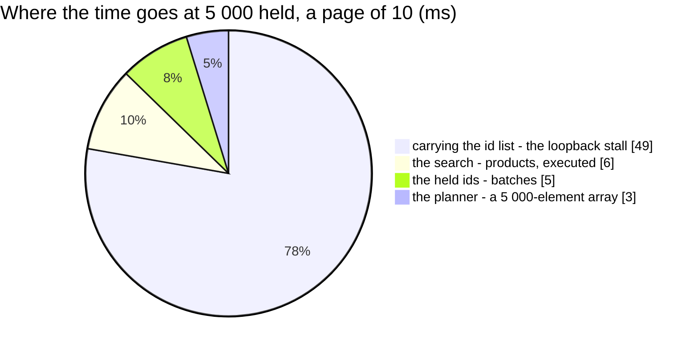

# WarehouseProductSearch — performance audit

**Verdict:** 🟢 fast — **2 statements at a page of 10 and at a page of 200** (no N+1), ≈ 19 ms at a warehouse that has
held 10 000 products. At 5 000 held the median is 62 ms, but **≈ 49 ms of it is this machine's loopback carrying the held-id
list**, not Postgres: the same list bound to `SELECT length($1)` takes 49 ms ([the-id-list-stalls-on-this-loopback](#the-id-list-stalls-on-this-loopback)).
The search itself plans and executes in ≈ 6 ms.
**Measured:** 2026-11-04 · `inventory_service/inventory_v1/warehouse_product_search.go` → the composition root's reader
(`backend/cmd/app_development/product_reader.go`) → `product_service/product_v1/product_search_among.go` · **30 000
products** (40 teams, 2 % archived) and **70 000 batches** — W1 5 000 products × 4 batches, W2 10 000 × 3, 20 000 over
18 other warehouses · warm, 5 runs (`warehouse_product_search_perf_test.go`, `-tags perfaudit`, in `backend/cmd/app_development`
so the real wiring is what is measured)

| held | q | page | median wall | statements | matches |
| --- | --- | --- | --- | --- | --- |
| 5 000 | `kaos` | 10 | 62.2 ms | 2 | 400 |
| 5 000 | `kaos` | 200 | 71.7 ms | 2 | 400 |
| 5 000 | `PF-123` (a code) | 10 | 62.5 ms | 2 | 11 |
| 5 000 | `zzzz` (none) | 10 | 61.4 ms | 2 | 0 |
| 10 000 | `kaos` | 10 | 18.9 ms | **2** | 800 |
| 10 000 | `kaos` | 200 | 20.5 ms | **2** | 800 |

---

## Statements (5 000 held, page 10)

| # | What | ×N | Time | Verdict |
| --- | --- | --- | --- | --- |
| 1 | the held ids — `SELECT DISTINCT product_id FROM batches WHERE warehouse_id = ?` | 1 | 4.7 ms | ok — `batches_last_price_idx` (a bitmap scan; a seq scan here, where W1 is 29 % of the seeded ledger) |
| 2 | the window AND the count — `products WHERE id = ANY($1::bigint[]) AND (name ILIKE … OR product_code ILIKE …) ORDER BY name, product_code, id LIMIT`, `COUNT(*) OVER ()` | 1 | 51.7 ms in the probe, **6.2 ms executed** | ok — `products_pkey` index scan over the 5 000 ids, top-N heapsort |

---

## Findings

### the-id-list-stalls-on-this-loopback 🟡

The held ids travel to Postgres as ONE `bigint[]` parameter. On this machine (Docker Desktop on Windows), a parameter of
≈ 25–30 KB stalls ≈ 50 ms on the loopback whatever the statement does with it, while 16 KB and 50–65 KB do not:

| bound to `SELECT length($1)` | median |
| --- | --- |
| 5 000 ids, 30 KB | 49.2 ms |
| 10 000 ids, 65 KB | 1.1 ms |

So the 5 000-held figures above are the stall plus ≈ 13 ms of work, and the 10 000-held ones are the honest cost. The
same EXPLAIN on the test's own transaction executes in 6.2 ms.

**→ Recommend:** nothing in the code — it is the host's network path, not the query. Re-measure on the deployed path
(Cloud Run → the database) before reading the 5 000-held line as a production number.

### the-list-is-sent-once 🟢

The first build counted and then paged — two statements, each carrying the list (128 ms at 5 000 held, two stalls). The
window now carries `COUNT(*) OVER ()`, so the list goes once; only a page past the last match counts on its own.
Fixed in the build, measured after.

### the-held-read-grows-with-the-ledger 🟡

Statement 1 reads every batch row of the warehouse to find its distinct products — 20 000 rows → 4.7 ms here. It grows
with the batch HISTORY, not the products: a warehouse with 200 000 batches would spend ≈ 50 ms on it per keystroke.

**→ Recommend:** nothing now. If it grows, either a skip-scan over `(warehouse_id, team_id, product_id)` (a recursive CTE,
one probe per distinct product) or a `(warehouse_id, product_id)` index — the migration is inventory_service's and the
owner's call (HARD RULE 3).

---

## Not measured

- the production network — the loopback stall above is this host's
- the picker's second read in the browser: `TeamByIds` for the owners' names (team_service), one call per result set
- concurrency — a read, no locks

---

## History

| Date | Median @10, 5 000 held | Median @10, 10 000 held | Statements | Change |
| --- | --- | --- | --- | --- |
| 2026-11-04 | 62.2 ms (≈ 49 ms loopback) | 18.9 ms | 2 | first audit, at the build (3 statements and 128 ms before the window count) |

> *(2026-11-03, later)* `AND NOT archived` was dropped ([an-archived-product-held-here-can-be-picked](../../../../docs/business/inventory/opname_decision.md#an-archived-product-held-here-can-be-picked)): the held set already bounds the rows, so one predicate fewer cannot make the plan heavier; not re-measured.
