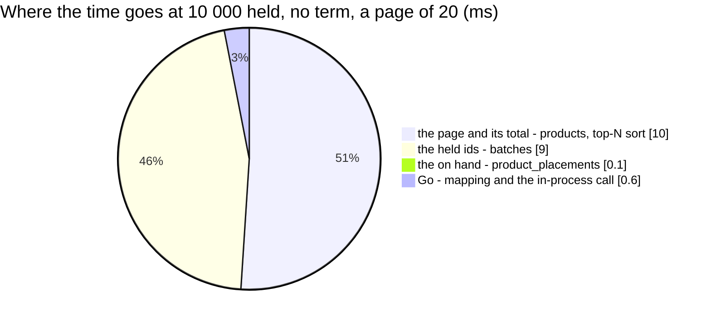

# WarehouseStockList — performance audit

**Verdict:** 🟢 fast — **3 statements at a page of 20 and at a page of 50** (no N+1), ≈ 20 ms at a warehouse that has
held 10 000 products, with or without a term. At 5 000 held the median is ≈ 65 ms, but **≈ 49 ms of it is this machine's
loopback carrying the held-id list**, not Postgres — the same control as the picker's
([WarehouseProductSearch.md § the-id-list-stalls-on-this-loopback](WarehouseProductSearch.md#the-id-list-stalls-on-this-loopback)).
**Measured:** 2026-11-04 · `inventory_service/inventory_v1/warehouse_stock_list.go` → the composition root's reader
(`backend/cmd/app_development/product_reader.go`) → `product_service/product_v1/product_search_among.go` (its list mode),
then `warehouseOnHand` (`stock_list.go`) · the picker's seed — **30 000 products** (40 teams, 2 % archived) and **70 000
batches** (W1 5 000 products × 4, W2 10 000 × 3, 20 000 over 18 other warehouses) — plus **80 racks** and **30 000
`product_placements` rows** (every held product on two racks; one in four of W1's at 0) · warm, 5 runs
(`warehouse_stock_list_perf_test.go`, `-tags perfaudit`, in `backend/cmd/app_development` so the real wiring is measured)

| held | q | page | median wall | statements | rows of total |
| --- | --- | --- | --- | --- | --- |
| 10 000 | — (the first paint) | 1 of 20 | 22.7 ms | 3 | 20 of 10 000 |
| 10 000 | — | 1 of 50 | 19.5 ms | 3 | 50 of 10 000 |
| 10 000 | — | 200 of 50 (the last) | 27.0 ms | 3 | 50 of 10 000 |
| 10 000 | `kaos` | 1 of 20 | 20.5 ms | 3 | 20 of 1 000 |
| 10 000 | `kaos` | 1 of 50 | 19.2 ms | 3 | 50 of 1 000 |
| 10 000 | `PF-123` (a code) | 1 of 20 | 19.2 ms | 3 | 20 of 100 |
| 5 000 | — | 1 of 20 | 66.0 ms (≈ 49 ms loopback) | 3 | 20 of 5 000 |
| 5 000 | `kaos` | 1 of 50 | 63.5 ms (≈ 49 ms loopback) | 3 | 50 of 500 |

---

## Statements (10 000 held, no term, page 20)

| # | What | ×N | Time | Verdict |
| --- | --- | --- | --- | --- |
| 1 | the held ids — `SELECT DISTINCT product_id FROM batches WHERE warehouse_id = ?` | 1 | 9.3 ms, **8.0 ms executed** | ok — a seq scan + HashAggregate here, where W2 is 43 % of the seeded ledger (the picker's statement, unchanged) |
| 2 | the page AND the total — `products WHERE id = ANY($1::bigint[]) ORDER BY name, product_code, id LIMIT 20`, `COUNT(*) OVER ()` | 1 | 10.0 ms, **9.1 ms executed** | ok — `products_pkey` index scan over the 10 000 ids, top-N heapsort (29 kB) |
| 3 | the on hand — `SUM(stock_count) FROM product_placements WHERE warehouse_id = ? AND product_id IN (the page) GROUP BY warehouse_id, product_id` | 1 | 0.1 ms | ok — `product_placements_one_per_product` bitmap scan, 40 rows for 20 products |

The count does not grow with the page: 3 statements at 20 and at 50, and statement 3 reads only the page's products.

---

## Findings

### the-list-mode-costs-what-the-search-costs 🟢

With no term the products statement drops its `ILIKE`, so it reads every held product's row and sorts the lot for the
window — 10 000 rows, top-N heapsort, ≈ 9 ms; with `kaos` it reads the same 10 000 rows and filters 1 000. The first
paint is not dearer than a search. The LAST page (offset 9 950) keeps the heap deeper: 16 ms for the statement, 27 ms in
all.

**→ Recommend:** nothing.

### the-id-list-stalls-on-this-loopback 🟡

The held ids travel to Postgres as ONE `bigint[]` parameter, as the picker's do. The same control:

| bound to `SELECT length($1)` | median |
| --- | --- |
| 5 000 ids, 24 KB | 49.4 ms |
| 10 000 ids, 55 KB | 1.3 ms |

So the 5 000-held lines above are the stall plus ≈ 15 ms of work.

**→ Recommend:** nothing in the code — it is the host's network path. Re-measure on the deployed path before reading the
5 000-held line as a production number.

### the-held-read-grows-with-the-ledger 🟡

Statement 1 is the picker's and grows the same way: with the warehouse's batch HISTORY, not its products (30 000 batch
rows → 8 ms here). The Stock screen asks it on every page turn and every settled search.

**→ Recommend:** nothing now — the picker's audit carries the fix options (a skip-scan over `(warehouse_id, team_id,
product_id)`, or a `(warehouse_id, product_id)` index); one migration would serve both reads, and it is inventory_service's
and the owner's call (HARD RULE 3).

---

## Not measured

- the production network — the loopback stall above is this host's
- the screen's second read in the browser: `TeamByIds` for the owners' names (team_service), one call per page, through
  the shared team-name cache
- concurrency — a read, no locks

---

## History

| Date | Median @20, 10 000 held, no term | Median @20, 5 000 held | Statements | Change |
| --- | --- | --- | --- | --- |
| 2026-11-04 | 22.7 ms | 66.0 ms (≈ 49 ms loopback) | 3 | first audit, at the build |
