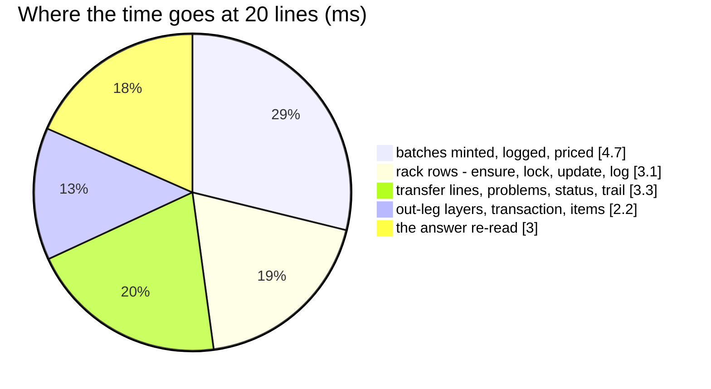

# WarehouseTransferAccept — performance audit

**Verdict:** ✅ all three findings fixed (2026-10-17) — **23 statements for one line and for twenty**, 18.7 ms at twenty (was
156 and 57.0 ms, plus a seq scan). Still over the 5-statement line: the accept writes the transfer's own rows, mints at B
into both ledgers and re-reads its answer, whatever its lines.
**Measured:** 2026-10-17 · `inventory_service/inventory_v1/warehouse_transfer_accept.go` → `inventory_mutations.PostTransferIn` ·
the background volume of [OrderTransactionCreate](OrderTransactionCreate.md) · 3 units a line sent from 10-batch stock, 1
broken at B, the rest onto one rack · transfers opened, processed and shipped before the timer · warm, 5 runs

| lines | median wall | queries | before (2026-10-17, first audit) |
| --- | --- | --- | --- |
| 1 | 29.4 ms ⚠ | 23 | 22–41 ms ⚠ · 23 |
| 20 | 18.7 ms | **23** | 57.0 ms · 156 |

⚠ The one-line figure is again above the twenty-line one with the same 23 statements — the harness's planning cost, not
the accept's (see [Not measured](#not-measured)).

---

## Queries (20 lines)

| # | What | ×N | Time | Plan | Verdict |
| --- | --- | --- | --- | --- | --- |
| 1 | the out-leg's layers: `SELECT … FROM batch_logs l JOIN batches b … WHERE l.transaction_id = ?` | 1 | 0.8 ms | Index Scan `batch_logs_transaction_idx` | ok |
| 2 | `INSERT INTO batches … RETURNING id` · `batch_logs` · `batch_price_logs` | 1 + 1 + 1 | 4.7 ms | — | ✅ was ×20 each |
| 3 | `INSERT INTO product_placements … ON CONFLICT DO NOTHING` · lock · `UPDATE … FROM unnest(…)` · log `INSERT` | 4 | 3.1 ms | pkey | ✅ was ×20 each |
| 4 | `UPDATE warehouse_transfer_items AS i SET arrived_count … FROM unnest(…)` | 1 | 0.9 ms | pkey | ✅ was ×20 |
| 5 | `SELECT … FROM product_placement_logs WHERE transaction_id IN (…)` (the answer's leg racks) | 1 | under the probe's 0.5 ms clock | the create's plan: Index Scan `product_placement_logs_transaction_idx` | ✅ was a seq scan |
| 6 | the transfer locked, its items, one rack check, problems, transaction, items, status, trail | 9 | 4.4 ms | pkey | ok |
| 7 | the answer: the transfer, its items, problems and trail, re-read | 4 | 3.0 ms | pkey | ok |

---

## Findings

### the-placement-log-index-misses-its-reads

✅ **Fixed 2026-10-17** by `00031_placement_logs_by_transaction`
([placement-logs-are-indexed-by-transaction](../../../../docs/technical/stock/design_decision.md#placement-logs-are-indexed-by-transaction)).
`loadLegRacks` read both legs' rack rows by `transaction_id` alone and scanned the whole log
(`Rows Removed by Filter: 50412`).

### the-accept-writes-its-lines-one-at-a-time

✅ **Fixed 2026-10-17.** `arrived_count` was set with one `UPDATE warehouse_transfer_items` per line; it is now one
`UPDATE … FROM unnest(…)`. The racks B named are checked in one statement (`racksExist`) instead of one per rack.

### row-at-a-time-ledger-writes

✅ **Fixed 2026-10-17.** `PostTransferIn` minted one batch per source layer with its two logs, and wrote each rack row and
log, one statement at a time. Every layer is now one `MintBatches` and the put-away one `PutOnPlacements`. Same cause as
[OrderTransactionCreate § row-at-a-time-ledger-writes](OrderTransactionCreate.md#row-at-a-time-ledger-writes).

---

## Not measured

- concurrency (single caller; the race and interleave tests cover correctness and pass)
- ⚠ **planning cost.** On the first audit the layer read took 37 ms inside one run and 0.8 ms in the next. Re-run under
  `PREPARE … EXPLAIN ANALYZE EXECUTE`, its plan was the same index nested loop either way — **execution 0.05 ms, planning
  65 ms (custom plan) / 17 ms (generic)**. The planner's index-end probes walk tuples the audit's single uncommitted
  transaction has inserted and updated by the thousand, which nothing can vacuum until it ends; a committed, vacuumed
  production table does not carry that. Every wall time in these reports is therefore an upper bound, and the one-line
  accept's spread is this, not the handler. Postgres 17.
- layers per line in the wild — measured at 1–2 layers a line
- `warehouse_transfers` was not seeded to volume, so its own reads seq-scan a near-empty table — not a finding

---

## Open questions

- None — see [OrderTransactionRelease](OrderTransactionRelease.md#open-questions) (the index) and
  [OrderTransactionCreate](OrderTransactionCreate.md#open-questions) (the primitives).

---

## History

| Date | Median @20 lines | Queries @1 / @20 | Change |
| --- | --- | --- | --- |
| 2026-10-17 | 57.0 ms | 23 / 156 | first audit |
| 2026-10-17 | 18.7 ms | 23 / 23 | set-based ledger primitives; one `arrived_count` update; `00031` index on `(transaction_id)` |
