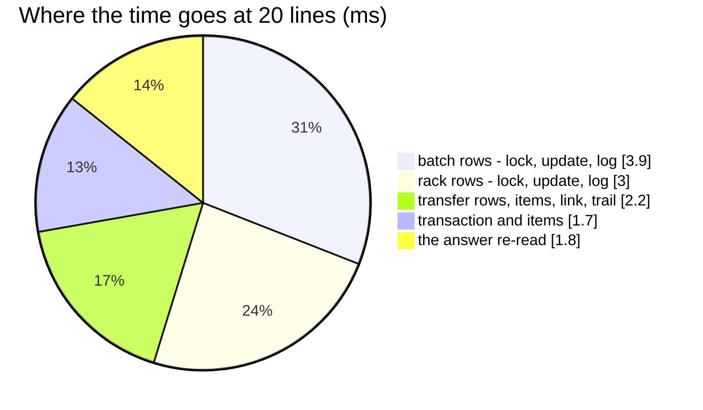

# WarehouseTransferCreate — performance audit

**Verdict:** ✅ both findings fixed (2026-10-17) — **19 statements for one line and for twenty**, 12.5 ms at twenty (was 153
and 56.0 ms, plus a seq scan). Still over the 5-statement line: the out-leg is the order's take, and the transfer's own
rows and its answer add a constant dozen.
**Measured:** 2026-10-17 · `inventory_service/inventory_v1/warehouse_transfer_create.go` → `inventory_mutations.PostTransferOut` ·
the background volume of [OrderTransactionCreate](OrderTransactionCreate.md) · 20 products at Gudang 5, 10 batches each
over 3 racks · warm, 5 runs

| lines | median wall | queries | before (2026-10-17, first audit) |
| --- | --- | --- | --- |
| 1 | 7.2 ms | 19 | 11.0 ms · 20 |
| 20 | 12.5 ms | **19** | 56.0 ms · 153 |

---

## Queries (20 lines)

| # | What | ×N | Time | Plan | Verdict |
| --- | --- | --- | --- | --- | --- |
| 1 | the take — every line's batches locked, updated, logged; then every line's racks | 6 | 8.0 ms | Bitmap Index Scans · pkey | ✅ was ×140 |
| 2 | `SELECT transaction_id, product_id, placement_id, stock_change FROM product_placement_logs WHERE transaction_id IN (…)` | 1 | execution 0.03 ms (EXPLAIN) | Index Scan `product_placement_logs_transaction_idx` | ✅ was a seq scan |
| 3 | the product link upsert, the transfer and its items, its header, the trail | 6 | 3.1 ms | — | ok |
| 4 | the answer: the transfer, its items, problems and trail, re-read | 4 | 1.8 ms | pkey | ok |

---

## Findings

### the-placement-log-index-misses-its-reads

✅ **Fixed 2026-10-17** by `00031_placement_logs_by_transaction`
([placement-logs-are-indexed-by-transaction](../../../../docs/technical/stock/design_decision.md#placement-logs-are-indexed-by-transaction)).
`loadLegRacks` reads the out-leg's rack rows by `transaction_id` alone, which scanned the whole log
(`Rows Removed by Filter: 50306`). See [OrderTransactionRelease § Proposed migration](OrderTransactionRelease.md#proposed-migration).

### row-at-a-time-ledger-writes

✅ **Fixed 2026-10-17.** The out-leg shares the order's take (`refuseShortLines`, `takeLines`), so it carried the same 7
statements a line and gained the same fix. Same cause as
[OrderTransactionCreate § row-at-a-time-ledger-writes](OrderTransactionCreate.md#row-at-a-time-ledger-writes).

---

## Not measured

- concurrency (single caller; the race tests cover the out-leg's correctness and pass)
- the product facts call and the link upsert's cost against a real product_service — the facts are a fake here
- `warehouse_transfers` was not seeded to volume, so its own reads seq-scan a near-empty table — not a finding
- planning inflated by the harness's single long transaction — see [OrderTransactionCreate § Not measured](OrderTransactionCreate.md#not-measured)

---

## Open questions

- None — see [OrderTransactionRelease](OrderTransactionRelease.md#open-questions) (the index) and
  [OrderTransactionCreate](OrderTransactionCreate.md#open-questions) (the primitives).

---

## History

| Date | Median @20 lines | Queries @1 / @20 | Change |
| --- | --- | --- | --- |
| 2026-10-17 | 56.0 ms | 20 / 153 | first audit |
| 2026-10-17 | 12.5 ms | 19 / 19 | set-based ledger primitives; `00031` index on `(transaction_id)` |
