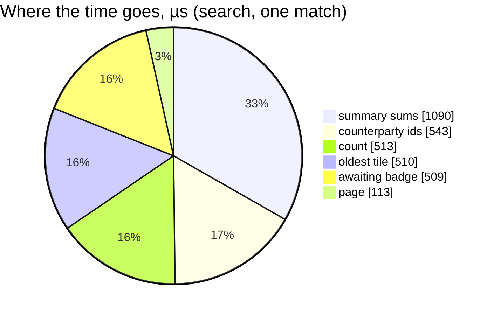

# LiabilityPositionList — performance audit

**Verdict:** 🔴 heavy — by query count only: 7 queries per call with a search or a kind filter (6 without), constant in the pairs; 3–5 ms.
**Measured:** 2026-11-07 · `liability_service/liability_v1/position_list.go` · seed 500 counterparties (1 000 `liability_balances` rows, both legs) + 20 000 `liability_payments` · warm, 5 runs
Probe: `go test -tags perfaudit -run TestPerf_LiabilityPositionList -v ./backend/services/liability_service/liability_v1/`

| | median | max |
| --- | --- | --- |
| wall (search, one match) | 3.4 ms | — |
| wall (search, every pair matches) | 5.1 ms | — |
| wall (warehouses only) | 3.5 ms | — |
| wall (awaiting only) | 4.1 ms | — |
| in Go (wall − db) | ≈ 0 ms | |
| queries | 7 (6 for awaiting only and unfiltered) | |

---

## Queries

| # | What | Rows | Time | Plan | Verdict |
| --- | --- | --- | --- | --- | --- |
| 1 | `SELECT counterparty_id FROM liability_balances WHERE team_id = ?` (search / kind only, backlog #34) | 500 | 0.5 ms | Seq Scan (1 000-row table) | ok |
| 2 | `SELECT count(*) … AND counterparty_id IN (matched)` | 1 | 0.5 ms | Seq Scan | ok |
| 3 | `SELECT * … IN (matched) ORDER BY oldest_unsettled_at … LIMIT 20` | ≤ 20 | 0.1 ms | Seq Scan + top-N | ok |
| 4 | awaiting badge `GROUP BY payer_team_id` on `liability_payments_awaiting_idx` | ≤ 20 | 0.5 ms | Index | ok |
| 5 | open payment requests of the team | few | ≈ 0 | Index | ok |
| 6 | summary sums (whole set, unnarrowed) | 1 | 1.1 ms | Seq Scan | ok |
| 7 | oldest tile `… LIMIT 1` | 1 | 0.5 ms | Seq Scan + top-N | ok |

The sequential scans are the planner's choice on a 1 000-row table; `liability_balances` grows with the teams a team
trades with, never with the orders. `awaiting_only` adds no query: it is a subquery inside 2 and 3.

---

## Findings

### 1. Seven queries for one page 🟡

The search and the kind need the team's own counterparty ids before they can ask team_service (HARD RULE 3: no join to
`teams`), which is one read on top of the six the unfiltered list already makes (count, page, badge, requests, sum,
oldest). The count is constant — no N+1 — and every query is under 1.2 ms, so it trips only the "> 5 queries" line.

**→ Recommend:** leave it. Folding the count into the page (`count(*) OVER ()`) would take it to 6 but returns no count
for an empty page, which the pager needs; the badge and requests reads are per-page lookups by design. Revisit only if
a team ever trades with thousands of counterparties (then the matched-id `IN` list is the thing to watch).

### 2. The probe's stale bound 🟡

`TestPerf_LiabilityPositionList` asserted "at most 5, want 4" and had been red since the badge and the payment
requests joined the page (6 at HEAD 8644d2ba, before this change). The bound is 6 now, with the six named.

---

## Not measured

- concurrency (single-caller measurement)
- team_service's own TeamByIds time (the probe's seam is an in-memory fake; the live adapter is one in-process
  TeamByIds call per 200 ids)
- cache-cold behaviour

---

## History

| Date | Median | Queries | Change |
| --- | --- | --- | --- |
| 2026-11-07 | 3.4 ms (search) · 8 ms (unfiltered, 500 pairs) | 7 / 6 | backlog #34 — search, kind and awaiting before the page |
