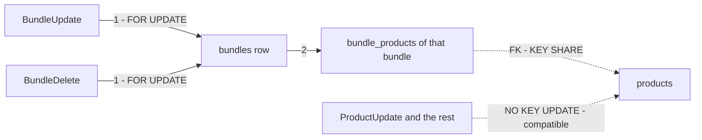

# product_service — lock order

The service-wide matrix the `audit-sql` skill writes unconditionally. Not a finding — the reference the next write
handler is checked against.

**Verdict: one row lock in the whole service — a bundle's own row, `FOR UPDATE`, taken first by the two writes that
change a bundle.** No handler locks two rows, so no two handlers can take locks in opposite orders. Raced: **safe** for
`BundleCreate`, `BundleUpdate`, `BundleDelete`. The catalogue's writes are listed, not raced in this pass.

| Handler | Lock order | Notes |
| --- | --- | --- |
| `BundleUpdate` | `bundles` (one row, `FOR UPDATE`) → `bundle_products` (delete … returning, insert) | the lock is taken BEFORE the lines are read, so a save that waited reads the previous save's lines (the "kept" set) |
| `BundleDelete` | `bundles` (one row, `FOR UPDATE`) → delete; its lines go by `ON DELETE CASCADE` | an update that waited on a deleted bundle finds no row → NotFound |
| `BundleCreate` | none | a new bundle shares no row with anything; the line rows' FK to `products` takes `KEY SHARE`, which no product write conflicts with |
| `ProductCreate`, `ProductUpdate`, `ProductDelete`, `ProductRestore` | none explicit | single-row writes by id. An `UPDATE products` takes `FOR NO KEY UPDATE`, compatible with a bundle line's `KEY SHARE` — a product save never waits on a bundle save, nor the other way. ⚠ not raced in this pass |

Evidence: [`bundle_race_test.go`](../../../../backend/services/product_service/product_v1/bundle_race_test.go) (`raceaudit`),
run `-count=20`, all green.

| proved | how |
| --- | --- |
| eight saves of one bundle never mix their lines | `Race` ×8, each replacing every line with its own pair → exactly one caller's pair, no failure |
| a second save WAITS for the first, then reads its lines | `Interleave`: B's save ⏸ blocked, released on A's commit — and B keeps a product A added and its owner locked in between, which it could only do by reading A's committed lines after the lock |
| saves and deletes of one bundle leave no orphan lines | `Race` ×8, half delete, half save → bundle gone, 0 lines, the only failure a lost save may give is NotFound |
| creates are independent | `Race` ×8 of one name over the same products → 8 bundles, 16 lines, nothing waits or fails |

Not proved: a bundle save racing the **owner's** product lock or archive is a check-then-act by design — a product locked
an instant after it was added is the same outcome as one locked a day later
([a-borrowed-product-never-blocks-its-owner](../../../../docs/business/product/product_bundle_decision.md#a-borrowed-product-never-blocks-its-owner)):
the line stays, unavailable. Not a finding, and not raced.

| History | |
| --- | --- |
| 2026-10-22 | first matrix — the bundle writes |
