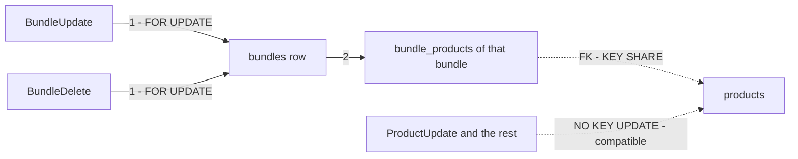

# product_service — lock order

The service-wide matrix the `audit-sql` skill writes unconditionally. Not a finding — the reference the next write
handler is checked against.

**Verdict: one row lock in the whole service — a bundle's own row, `FOR UPDATE`, taken first by the two writes that
change a bundle.** No handler locks two rows, so no two handlers can take locks in opposite orders. Raced: **safe** for
`BundleCreate`, `BundleUpdate`, `BundleDelete`. The catalogue's writes are listed, not raced in this pass.

**Since #149, one advisory lock per team — the team's product-code lock** (`lockTeamProductCodes`:
`pg_advisory_xact_lock(hashtextextended('product_service:product-code:<team>', 0))`), taken FIRST by every write that
composes a code from the team's code: `ProductCreate`, a code correction in `ProductUpdate`, and the team code change's
recompose. Nothing takes it after a row lock, so it adds no cycle. Raced: **safe**.

| Handler | Lock order | Notes |
| --- | --- | --- |
| `BundleUpdate` | `bundles` (one row, `FOR UPDATE`) → `bundle_products` (delete … returning, insert) | the lock is taken BEFORE the lines are read, so a save that waited reads the previous save's lines (the "kept" set) |
| `BundleDelete` | `bundles` (one row, `FOR UPDATE`) → delete; its lines go by `ON DELETE CASCADE` | an update that waited on a deleted bundle finds no row → NotFound |
| `BundleCreate` | none | a new bundle shares no row with anything; the line rows' FK to `products` takes `KEY SHARE`, which no product write conflicts with |
| `ProductCreate` (#149) | the team's product-code advisory lock → (the team's code through `TeamByIds`, no lock) → insert | waits while the team's code changes, then composes from the new code; a create that took the lock first commits and is recomposed with the rest. Raced: **safe** |
| a code correction in `ProductUpdate` (#149) | the team's product-code advisory lock → the product row `FOR UPDATE` → update | the lock only when a part is sent, and before the row's, as the recompose. Raced: **safe** |
| `RecomposeTeamCodes` — inside team_service's `TeamCodeUpdate` (#149) | (team_service: the team row `FOR UPDATE`) → the team's product-code advisory lock → the team's `products` (ONE `UPDATE product_code` — a column of a unique index, so each row is locked `FOR UPDATE`, which DOES conflict with `KEY SHARE`) → `product_reprint_waits`, `product_tag_links` (clear, insert; their FKs take `KEY SHARE` on its own rows and on the app tag) | a tag put-on, a bundle line or a product save on one of the team's products WAITS for the change to commit (up to its run time, the TeamCodeUpdate audit), and the change waits for one in flight; neither takes a lock the other holds next, so no cycle. Inventory is only read. Raced: **safe** |
| `RecordReprint` — inside inventory's `ProductReprintRecord` (#151), on inventory's transaction | the owning teams' product-code advisory locks (all of them in ONE statement, in key order) → the products' live codes (plain read) → `product_reprint_waits` (this warehouse's rows, delete) → `product_tag_links` (the app tag off where `NOT EXISTS` a wait, delete) | serializes with the recompose and the arrival on the same key, so a record never clears a wait a newer code set, and two warehouses recording at once take the tag off once (the second sees the first's delete). Inventory takes no row lock first. Raced: **safe** (`product_reprint_race_test.go`) |
| `AddArrivalReprintWaits` — inside inventory's `WarehouseTransferAccept` (#151), on its transaction | (inventory: the accept's own row locks) → the owning teams' product-code advisory locks → `product_reprint_waits` (insert `ON CONFLICT DO NOTHING`) | the advisory lock is taken AFTER inventory's row locks, but no holder of the advisory lock (a code change, a create, a record) asks for an inventory row lock — the recompose only READS `product_placements` — so no cycle. Raced: **safe** (an arrival before or after a record keeps no untagged wait) |
| `ProductUpdate` (no correction), `ProductDelete`, `ProductRestore` | none explicit | single-row writes by id. An `UPDATE products` takes `FOR NO KEY UPDATE`, compatible with a bundle line's `KEY SHARE` — a product save never waits on a bundle save, nor the other way. ⚠ not raced in this pass |
| `ProductTagAdd` / `Remove`, `ProductSystemTagAdd` / `Remove` (#147) | `products` (one row, `FOR KEY SHARE`) → `product_tags` (one row, `FOR KEY SHARE`) → `product_tag_links` (insert `ON CONFLICT DO NOTHING` / delete) | KEY SHARE is compatible with a product save's NO KEY UPDATE — a tag put-on never waits on a product edit; a `ProductDelete` waits for it, then cascades the link. Raced: **safe** |
| `ProductTagRename`, `ProductTagDelete` (#147) | `product_tags` (one row, `FOR UPDATE`) → `product_tag_links` of that tag (delete) | a put-on in flight holds the tag KEY SHARE, so the delete waits and takes its link too; a later put-on finds no tag → NotFound. Never the product row, so no cycle with the put-on's product → tag order. Raced: **safe** |
| `ProductTagCreate`, `ProductTagSystemCreate` (#147) | none — `INSERT … ON CONFLICT ((lower(name))) DO NOTHING`, then the holder is read | two makes of one name meet on the unique index: one tag. Raced: **safe** |

Evidence: [`bundle_race_test.go`](../../../../backend/services/product_service/product_v1/bundle_race_test.go) (`raceaudit`),
run `-count=20`, all green.

| proved | how |
| --- | --- |
| eight saves of one bundle never mix their lines | `Race` ×8, each replacing every line with its own pair → exactly one caller's pair, no failure |
| a second save WAITS for the first, then reads its lines | `Interleave`: B's save ⏸ blocked, released on A's commit — and B keeps a product A added and its owner locked in between, which it could only do by reading A's committed lines after the lock |
| saves and deletes of one bundle leave no orphan lines | `Race` ×8, half delete, half save → bundle gone, 0 lines, the only failure a lost save may give is NotFound |
| creates are independent | `Race` ×8 of one name over the same products → 8 bundles, 16 lines, nothing waits or fails |

Not proved: a bundle save racing the **owner's** product lock or archive is a check-then-act by design — a product locked
an instant after it was added is the same outcome as one locked a day later
([a-borrowed-product-never-blocks-its-owner](../../../../docs/business/product/product_bundle_decision.md#a-borrowed-product-never-blocks-its-owner)):
the line stays, unavailable. Not a finding, and not raced.

| History | |
| --- | --- |
| 2026-10-22 | first matrix — the bundle writes |
| 2026-11-27 | the product tag writes (#147) — `product_tags_race_test.go` (`raceaudit`): one name one tag, one link, on vs off, put-on vs tag delete, put-on vs product delete, two renames to one name |
| 2026-11-27 | the team code change (#149) — `cmd/app_development/product_code_recomposer_race_test.go` (`raceaudit`, the real seam): a create and a correction racing the change never land the old prefix, two teams to one code, two changes of one team, a tag put-on / take-off beside the recompose; each lock's removal fails its race (mutation-checked) |
