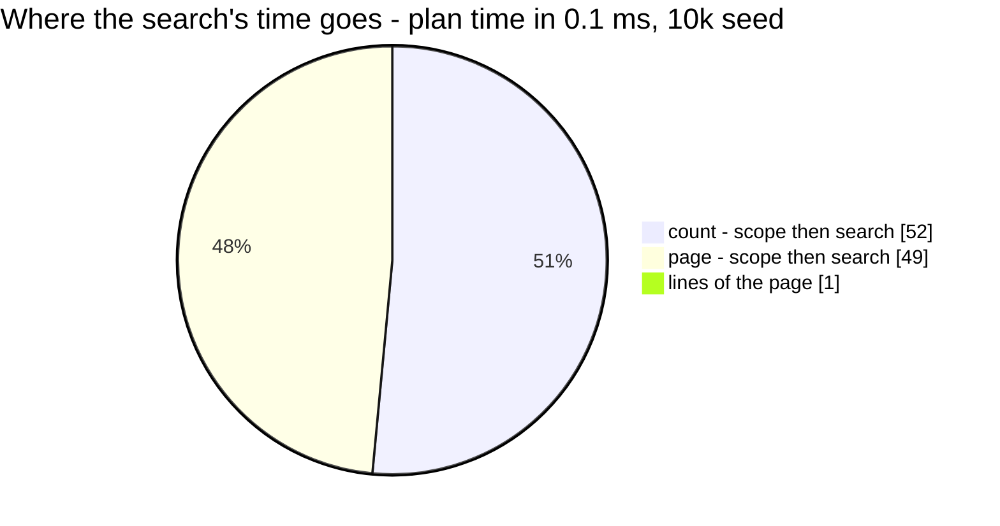

# BundleList — performance audit

**Verdict:** 🔴 heavy — the product half of the search (`q`) scans **every team's** `bundle_products`, so its cost grows with the whole system's bundles, not with the team searching.
**Measured:** 2026-10-22 · `product_service/product_v1/bundle_list.go` · seed 10 000 `bundles` (40 teams, 250 in the audited one), 30 000 `bundle_products`, 10 000 `products` · warm, 5 runs · and the search once more at **10×** (100 000 bundles, 300 000 lines)

| | no search, 20 rows | search `q=gula`, 20 rows | search at 10× |
| --- | --- | --- | --- |
| wall (median) | 1.7 ms | 12.7 ms | 49.7 ms |
| wall (max) | 1.7 ms | 20.8 ms | — |
| in Go (wall − db) | ~0 | ~0 | ~0 |
| queries | 3 | 3 | 3 |

Without a search, BundleList is fast and flat: 3 queries at 20 rows and at 200 (no N+1), every one on an index. Only the search is the finding.



---

## Queries

| # | What | Rows | Time | Plan | Verdict |
| --- | --- | --- | --- | --- | --- |
| 1 | `SELECT count(*) FROM bundles WHERE team_id = ? [AND search]` | 1 | 0.4 ms · 5.2 ms with `q` | Bitmap Index Scan `bundles_team_updated_idx` | ok without `q` · 🔴 with `q` |
| 2 | `SELECT * FROM bundles WHERE team_id = ? [AND search] ORDER BY updated_at DESC, id DESC LIMIT ?` | 20 | 0.5 ms · 4.9 ms with `q` | Index Scan `bundles_team_updated_idx` | ok without `q` · 🔴 with `q` |
| 3 | `SELECT * FROM bundle_products WHERE bundle_id IN (…page…) ORDER BY bundle_id, id` | 60 | 0.07 ms | Index Scan `bundle_products_bundle_product_unique` | ok |

---

## Findings

### 1. The product search reads every team's bundle lines 🔴

The search matches a bundle's name OR a line's product name or code. The product half is a subquery scoped to the
team's own bundles (`bundles own … WHERE own.team_id = ?`). The team's 250 bundles come off the index, but the planner
**hash-joins them to a sequential scan of all of `bundle_products`** rather than probing the `(bundle_id, product_id)`
index 250 times. That scan is every team's lines.

```
Nested Loop  (actual time=0.838..4.732 rows=110)
  ->  Hash Join  (actual time=0.825..3.540 rows=750)
        Hash Cond: (bp.bundle_id = own.id)
        ->  Seq Scan on bundle_products bp  (rows=30000)                ← every team's lines
        ->  Hash
              ->  Bitmap Heap Scan on bundles own  (rows=250)
                    ->  Bitmap Index Scan on bundles_team_updated_idx    ← this team's bundles
  ->  Index Scan using products_pkey on products p  (loops=750)
        Filter: ((name ~~* '%gula%') OR (sku ~~* '%gula%'))
Execution Time: 4.850 ms
```

At **10×** the plan did **not** switch: `Seq Scan on bundle_products bp (rows=300000)`, the count query at 36 ms and the
search at 49.7 ms median. It is a cost-based choice: hashing a whole small table beats random index probes until the
table is several times larger still. So it will flip eventually, but only after the search has already grown to
tens of milliseconds.

Not a missing index: `bundle_products_bundle_product_unique (bundle_id, product_id)` and `bundles_team_updated_idx` are
both there and both used elsewhere in the same plan.

**What was already changed during implementation (before this report):** the first shape was a correlated
`EXISTS (…bp JOIN products p…)` beside `name ILIKE ? OR`. Postgres hoisted it into a hashed subplan over **all**
`bundle_products ⋈ products` with no team scope at all. Scoping the subquery to the team's bundles is what brought the
team's rows onto the index. The remaining scan is the join choice above.

**→ Recommend — I would take (a):**

| | option | trade-off |
| --- | --- | --- |
| **(a)** | **leave it, and re-audit at a real volume.** 12.7 ms at 10 000 bundles, ~50 ms at 100 000, and the planner switches to the index past that | nothing to build. The one risk is a team searching every keystroke on a very large system — the order form's search is debounced, so it is one query per pause |
| (b) | a `pg_trgm` GIN index on `products (name, sku)`, and search products first, then their lines by `bundle_products_product_idx` | the search then touches only matching products' lines. Costs the `pg_trgm` extension (a database-level decision) and write amplification on every product save — and ProductList's own `name ILIKE` search would gain from the same index |
| (c) | split the search: the name match as one query, the product match as a second query driven from the page's ids | more round trips, and paging over a union of two queries is fiddly — the page count must still be one number |

---

## Proposed migration

Only for option (b), and only if it is chosen — not applied.

```sql
-- backend/services/product_service/db_migrations/<next>_add_product_search_trgm.sql
CREATE EXTENSION IF NOT EXISTS pg_trgm;
CREATE INDEX CONCURRENTLY products_name_trgm_idx ON products USING gin (name gin_trgm_ops);
CREATE INDEX CONCURRENTLY products_sku_trgm_idx  ON products USING gin (sku gin_trgm_ops);
```

Cost: two GIN indexes on `products`, maintained on every product write. ⚠ `CONCURRENTLY` cannot run inside goose's
default transaction — the migration needs `-- +goose NO TRANSACTION`.

---

## Not measured

- concurrency (single-caller measurement)
- cache-cold / cold-buffer behaviour — every buffer here was a hit
- production distribution: the seed gives every team the same share. A real system has a few large sellers, and the
  largest team's search reads the same whole-table scan
- the other four bundle RPCs — measured in the same pass, all fast (below), so no file of their own

| RPC | queries | median |
| --- | --- | --- |
| BundleByIds | 2 at 1 id and at 200 | 0.6 ms · 4.7 ms |
| BundleCreate | 3 at 3 lines and at 50 | 1.2 ms · 3.1 ms |
| BundleUpdate | 5 at 3 lines and at 50 | 2.6 ms · 4.2 ms |
| BundleDelete | 2 | 1.0 ms |

(Counts exclude the `SAVEPOINT` the per-test transaction makes of GORM's nested transaction; the probe records it.)

---

## Open questions

- [ ] Option (a), (b) or (c) for the product half of the search? **I would take (a)** and re-audit once a real team
      has hundreds of bundles — (b) is the right answer if ProductList's search turns out to need trigram too, since one
      extension would serve both.

---

## History

| Date | Median (search) | Queries | Change |
| --- | --- | --- | --- |
| 2026-10-22 | 21.7 ms (10 teams) | 3 | first shape — correlated `EXISTS`, hoisted to a hashed subplan over every team's lines ⋈ products |
| 2026-10-22 | 12.7 ms (40 teams) · 49.7 ms at 10× | 3 | subquery scoped to the team's bundles first — this report |
