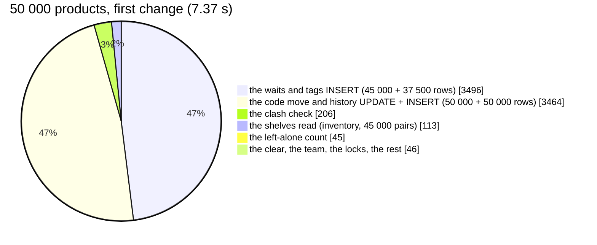

# TeamCodeUpdate (the team code change's product recompose) — performance audit

**Verdict:** 🟡 **heavy** — the < 1 s target is missed at 50 000 products and sits on the edge at 5 000: **5 000 products 0.90–1.23 s, 50 000 products
6.29–8.14 s**, in ONE transaction, **15 statements at every size** (set-based: no statement per product). Two statements
are ≈ 95 % of it at 50 000 — the code move with its history lines (3.5–3.7 s) and the reprint waits with their tags
(3.5–3.8 s) — and both are linear in the rows they write: 50 000 `products` rows rewritten (a column of a unique index,
so every index takes a new entry), 50 000 `product_logs`, 45 000 `product_reprint_waits` and 37 500 `product_tag_links`
inserted, each with its foreign-key check. No plan is wrong; what is left is the volume, and every way to cut it changes
the write path the decision fixed (one transaction) — the owner's call (*Options*). One real defect was found and fixed
on the way: the clear of earlier waits was quadratic (5 000 products' second change 1 m 47 s → 1.1 s).
**Measured:** 2026-11-27 · `product_v1/product_code_recompose_team.go` (`RecomposeTeamCodes`), `team_v1/team_code_update.go`,
`inventory_v1/stock_sits_among.go` · `cmd/app_development/product_code_recomposer_perf_test.go`
(`TestPerf_TeamCodeUpdate`, `-tags perfaudit`), through the real wiring (`team_v1.NewService` →
`NewProductCodeRecomposer` → `product_v1` → `NewProductStockNarrower`) · seed `perfTcSeed`: 150 000 background products
in five other teams (half on a shelf), a team of 5 000 and a team of 50 000 (10 % archived each), 75 % of each team on a
shelf with units in warehouse A, 15 % in warehouse B too, 5 % on a shelf at 0 — so 3 750 / 37 500 products tagged,
4 500 / 45 000 waits · `warehouse_test`, warm, inside the test transaction (each statement on this host pays ≈ 0.5 ms of
loopback: a bare `SAVEPOINT` 0.5 ms).

| the change | products | wall | db | statements | tagged |
| --- | --- | --- | --- | --- | --- |
| 5 000 · first change (ABC → XYZ, nothing to clear) | 5 000 | **0.90 / 1.23 s** | 0.90 / 1.23 s | 15 | 3 750 |
| 50 000 · first change | 50 000 | **6.29 / 7.37 s** | 6.27 / 7.35 s | 15 | 37 500 |
| 5 000 · second change (XYZ → QWE, every wait and tag re-set, ⚠7) | 5 000 | **1.13 / 1.17 s** | 1.13 / 1.16 s | 15 | 3 750 |
| 50 000 · second change | 50 000 | **8.14 / 7.82 s** | 8.13 / 7.81 s | 15 | 37 500 |

Two runs on the one seed each (`perf2`, `perf3` — the test asserts the statement count, constant at 15, and logs the
🟡 over 1 s). The pie and the statement table are the first run's.

`ProductCreate`, which now takes the team's product-code lock inside a transaction (`lockTeamProductCodes`): **median
1.08 ms, 2 statements → 2.00 ms, 4 statements** (200 creates each, alternated, one process, one seed of 100 000
products; HEAD's body beside today's in a throwaway probe). The two new statements are the advisory lock and the
transaction's savepoint in the test (a `BEGIN` / `COMMIT` in production) — one loopback each. Not heavy.

---

## Queries (50 000 products, first change)

| # | What | Rows | Time | Plan | Verdict |
| --- | --- | --- | --- | --- | --- |
| 1 | `SELECT … FROM teams WHERE id = ? AND deleted = false FOR UPDATE` | 1 | 0.5 ms | pkey | ✅ |
| 2 | the held-or-former check: `teams UNION ALL team_former_codes ⋈ teams` on the code | 0 | < 1 ms | `teams_team_code_unique`, `team_former_codes_pkey` | ✅ |
| 3–4 | `team_former_codes` delete (its own taken back) + insert, `UPDATE teams SET team_code` | 1 | ≈ 1 ms each | pkey | ✅ |
| 5 | `pg_advisory_xact_lock(hashtextextended(…))` | 1 | < 1 ms | — | ✅ |
| 6 | left alone: `SELECT product_code, COUNT(*) OVER () … WHERE team_id = ? AND NOT starts_with(product_code, ?) ORDER BY id LIMIT 20` | 0 | 45 ms | Seq Scan on products (the team is a third of the table) | ✅ |
| 7 | the clash: the team's rows under `<old>-` whose new code another row carries | 0 | 206 ms | Index Scan `products_pkey` (mine) → `products_product_code_unique` per row, never executed with no candidate | 🟡 linear in the team |
| 8 | `SELECT id FROM product_tags WHERE app_task = ?` | 1 | 1 ms | `product_tags_app_task_key` | ✅ |
| 9 | the clear: `WITH cleared AS (DELETE FROM product_reprint_waits w USING products p …) DELETE FROM product_tag_links l USING products p …` | 0 / 37 500 | 25 ms first, 276 ms second | Hash Join on the team's rows under `<old>-` | ✅ (was quadratic, Finding 1) |
| 10 | the move: `WITH changed AS (UPDATE products SET product_code = … WHERE team_id = ? AND starts_with(product_code, ?) RETURNING …) INSERT INTO product_logs … FROM changed` | 50 000 | 3.46 s | Seq Scan on products → Update (1.7 s: every index of `products` takes a new entry — `product_code` is in a unique index, no HOT) → Insert `product_logs` (0.8 s) + its FK check per row (1.0 s under EXPLAIN) | 🔴 the volume |
| 11 | the shelves: `SELECT DISTINCT product_id, warehouse_id FROM product_placements WHERE product_id = ANY(?) AND stock_count > 0` | 45 000 | 113 ms | Seq Scan on product_placements, the array hashed | ✅ |
| 12 | the waits + tags: `WITH waits AS (INSERT INTO product_reprint_waits SELECT … FROM unnest(?, ?) JOIN products p …) INSERT INTO product_tag_links SELECT DISTINCT … ON CONFLICT DO NOTHING` | 37 500 | 3.50 s | Hash Join of the pairs to the team's products → Insert waits (0.6 s) → HashAggregate → Insert links; FK checks: waits → products 0.85 s, links → products 0.80 s, links → product_tags 0.35 s (under EXPLAIN) | 🔴 the volume |
| 13–15 | `SELECT … FROM teams WHERE id = ?` (the answer), savepoint, release | 1 | ≈ 1 ms | | ✅ |

Under `EXPLAIN ANALYZE` the foreign-key triggers are ≈ 3.0 s of the two big statements' ≈ 7.2 s, but timing inflates a
per-row trigger: a throwaway probe that dropped the two NEW foreign keys (`product_logs`, `product_reprint_waits` →
`products`) on the same seed ran the 50 000 change in **6.4 s against 7.1 s** — 0.7 s, not the 1.8 s the triggers
report. The rest is the rows themselves.

---

## Findings

### 1. The second change's clear was quadratic 🔴 → ✅ fixed in this build

The first version cleared the moving products' earlier waits and tags inside the move statement, joined on the
update's own `RETURNING` set: `DELETE FROM product_reprint_waits w USING changed c WHERE w.product_id = c.id`. A
data-modifying CTE carries no statistics, so the planner estimated one row and chose a nested loop — **5 000 products'
second change took 1 m 47 s** (perf run 1). The clear is now its own statement BEFORE the move, joined on `products` by
the team and the old prefix — the very rows the move takes: a hash join, **25 ms (nothing to clear) / 276 ms (37 500
links and 45 000 waits) at 50 000**. Kept by the second-change rows above and by
`TestRecomposeTeamCodes_ASecondChangeResetsTheWaits` (mutation-checked).

### 2. The two writes are linear in the team's products 🟡 → the owner's call

At ≈ 70 µs a product on this host, 50 000 products is ≈ 7 s: the move rewrites every product row (no HOT update is
possible — `product_code` is indexed — so `products_pkey`, `products_product_code_unique` and the matching partial
indexes each take an entry) and inserts one history line; the waits insert one row per (product, warehouse) and one tag
link per product, each checked against its parents. All of it is what the decision asks for, in the one transaction it
asks for; no index or plan change removes it.

**What waits meanwhile** (the locks it holds until COMMIT, `audits/services/*/concurrency/lock-order.md`): the team's
`ProductCreate`s and code corrections (the team's product-code lock); a save, a tag put-on / take-off, a bundle line or
a delete touching one of the team's products (each product row, `FOR UPDATE`); a `TeamUpdate` / `TeamDelete` of the
team (the team row). Nothing of any other team. Nothing times out: no `statement_timeout`, no HTTP write timeout in the
build. The selling and inventory flows (orders, picking, restocks) take no lock on `products` and do not wait.

**How big are real teams?** Not measured — the brief's 50 000 is a ceiling, and a team code change is a rare,
deliberate act (once in a team's life, typically right after it is set up). On production hardware the per-row cost
will differ from this Windows / Docker host; unmeasured.

## Options (not built — a write-path change)

| | what | 50 000 products | cost |
| --- | --- | --- | --- |
| **A** (recommended) | keep it: one transaction, as decided; the screen's confirm already says how many products move, and a 50 000-product team waits ≈ 8 s on its own writes | 6.3–8.1 s | none |
| **B** | write the waits and tags in a SECOND transaction right after the commit (an outbox row the app replays) | ≈ 3.7 s held | a crash between the two leaves products recomposed but not yet tagged until the replay — the decision's *one transaction* bent |
| **C** | drop the two new tables' foreign keys to `products` and delete their rows in `ProductDelete` by hand | ≈ 6.4 s | 0.7 s for a hand-kept cascade in one more place |

## History

| | |
| --- | --- |
| 2026-11-27 | first audit (backlog #149) — the quadratic clear found and fixed; 🟡 heavy at volume, options A/B/C for the owner |

**Kept as built** (2026-11-27, `revamp_dev`): a team code change is a rare, one-off action and a team of 5 000 products takes ≈ 1 s; the 50 000-product figure is named in the owner's report, and options B / C (a second transaction, dropping the new tables' foreign keys) change the write path — built only if the owner asks.
