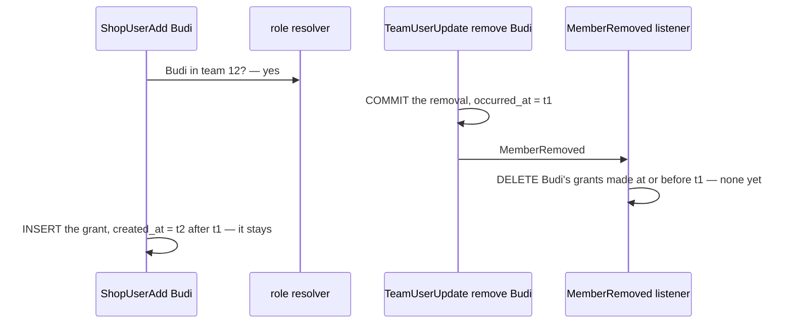

# ShopUserAdd — concurrency audit

**Verdict:** 🟡 **unsafe by construction, low impact — not reproduced.** The membership check
([a-grant-goes-only-to-a-team-member](../../../../docs/business/shop/context_decision.md#a-grant-goes-only-to-a-team-member))
is a cross-service read made BEFORE the transaction, so it cannot lock what it read. A removal from the team that commits
between the check and the grant's insert can leave a grant for a person who is no longer a member.
**Read:** 2026-11-04 · `selling_service/selling_v1/shop_user_add.go`, `role_reader.go` · the in-transaction half is
unchanged and still holds (`shop_user_add_race_test.go`, `-tags raceaudit`, passed 2026-11-04)
**Isolation:** READ COMMITTED; the check is user_service's cached resolver, outside selling's transaction

| | |
| --- | --- |
| race | ShopUserAdd(Budi) in parallel with TeamUserUpdate removing Budi from the shop's team |
| result | the check reads "member", the removal commits and announces `MemberRemoved`, the grant inserts after the removal's `occurred_at` — and the listener keeps it, since it drops only grants made before the removal |
| window | the check-to-insert gap (one shop lock, ~1 ms) plus the resolver cache's staleness between the removal's commit and its invalidation |
| impact | a dormant grant on a non-member — what the decision forbids. They cannot sign in to the team, so it opens nothing until they rejoin. Make primary has the same window, and refuses a non-member on its next call |

## Recommendations (not applied)

1. **Accept and document** (recommended for now): the window is milliseconds, needs an owner removing a person while
   another manager grants them a shop, and the grant is inert while they are outside the team.
2. **Re-check after commit**: after the insert commits, ask the resolver again (uncached) and delete the grant if the
   person is gone. Closes the event-ordering half; one more read per grant.
3. **The listener drops by membership, not by time**: on `MemberRemoved`, delete every grant of the person in the team
   unless the resolver says they are a member again. Closes it on the listener side; needs the resolver in the listener.
