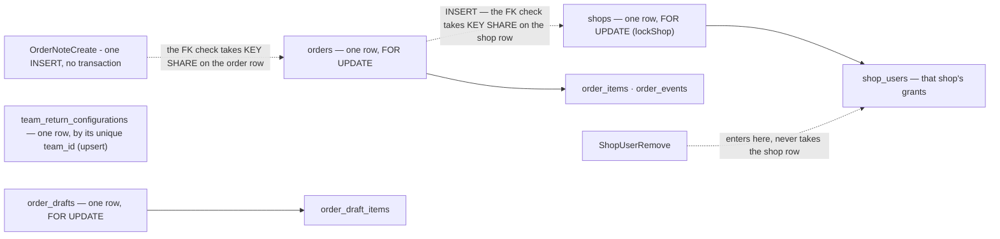

# selling_service — lock order

The service-wide matrix that the `audit-sql` skill writes unconditionally. It is not a finding: it is the reference
the next write handler is checked against.

| | |
| --- | --- |
| Isolation | READ COMMITTED (Postgres default; nothing in this repo raises it) |
| Last swept | 2026-11-05, `SettlementOpened` — settlement stamping the order's account opening (one conditional UPDATE, safe; see its row) · 2026-11-05, the shop write gate (`refuseShopWrite` — two unlocked reads before `OrderCreate`, `OrderDraftPush` and a draft's shop set; see the [OrderCreate](#per-handler-in-acquisition-order) row) · 2026-11-05, the order metrics' fold writing Warehouse Fee beside the move's row ([a-warehouse-fee-counts-on-its-day-and-a-cancel-takes-it-back-on-its-day](../../../../docs/business/analytic/rpc_provide_decision.md#a-warehouse-fee-counts-on-its-day-and-a-cancel-takes-it-back-on-its-day)) · 2026-11-04, `OrderCancel` releases by event (backlog #10 slice 4 — the count checked in process first, no inventory write inside the transaction) and a commit that reports an error re-read by K before any release (#10c) · 2026-11-04, `OrderCreate`'s take BEFORE the order row (backlog #10 slice 3 — the take under the order's key, outside the transaction, compensated by a direct release and `InventoryTxCancel`; `OrderCancel` releases by the order's key) · 2026-11-04, `OrderCreate`'s idempotency key (backlog #10 slice 1 — the key looked up first, `orders_idempotency_key_idx` as the backstop) · 2026-10-30, adding `ShopeeOrderImport` · `TiktokOrderImport` (the order import — its writes are `moveOrders`) · 2026-10-26, adding `OrderNoteCreate` and the create form's note row (a-note-is-a-timeline-row) · 2026-10-23, `placeOrder` freezing the take's draw (the fee priced after the take, inside the transaction) · 2026-10-21, adding `OrderStatusChange` (replacing the four per-step RPCs) and `TeamReturnConfigurationSet` · before that 2026-09-29, the primary CS |

**Verdict: two hierarchies, no inversion, and one hole.** The shop side locks `shops` before `shop_users`. The order
side locks one `orders` or `order_drafts` row before its children. No handler takes the two sides in opposite orders.
⚠ `ShopUserRemove` writes `shop_users` without the shop row, which is the
[ShopUserSetPrimary](ShopUserSetPrimary.md) finding.

---

## The hierarchy



Parent before child. A handler may enter part-way down, but never in a different relative order.

## Per handler, in acquisition order

| Handler | Locks, in order | Notes |
| --- | --- | --- |
| `ShopUserAdd` | `shops` (`FOR UPDATE`) → `shop_users` (its new row: INSERT, then the flag UPDATE) | the INSERT's FK takes KEY SHARE on the shop row it already holds |
| `ShopUserSetPrimary` | `shops` (`FOR UPDATE`) → `shop_users`: the old primary, then the new one | ⚠ its grant check before them takes no lock ([finding](ShopUserSetPrimary.md)) |
| `ShopUserRemove` | `shop_users` (1 row, DELETE) | ⚠ **no** shop row, so it enters part-way. Its own write is safe, but it is what makes Make primary's check go stale |
| `ShopUpdate` · `ShopDelete` | `shops` (1 row: UPDATE, i.e. a NO KEY UPDATE lock) | conflicts with `lockShop`, so both serialise with the grant writers |
| `ShopCreate` | none: an INSERT | `shops_team_code_active_unique` refuses a duplicate code |
| `OrderCreate` (`placeOrder`, and the draft page's Promote since OrderDraftPromote was removed) | *(before the transaction, holding nothing: the key lookup, the owner lookup, the credit check, then **`stock.Pick` under the order's key K** — inventory's own transaction)* → `orders` INSERT (with `transaction_id`) — the unique index stays the backstop, but a same-key twin is now refused KEY_USED at the take before it gets here → KEY SHARE on `shops` (the FK) → `order_timeline_logs` (the placement row and, when one was typed, the note row — one INSERT, rows of its own order) → promote only: `order_drafts` DELETE → **the warehouse fee priced inside the transaction** (`WarehouseFeeCalculate`, a read) → `orders` UPDATE of its own row (`warehouse_fee`, `total_cost`) → `order_items` · on any failure after the take: **the compensation, after the rollback** — `stock.Return(K)` under `context.WithoutCancel`, then `InventoryTxCancel` published | pattern 6 is **gone for the take** (backlog #10 slice 3, [the-release-is-direct-then-the-event](../../../../docs/business/order/context_decision.md#the-release-is-direct-then-the-event)): no selling lock is held across the inventory call. It remains for the fee read, which takes no lock; the UPDATE touches only the row this transaction inserted. The compensation runs after the transaction ended, so it holds nothing of selling's either. A KEY_USED refusal is never compensated ([a-used-key-is-never-cancelled](../../../../docs/business/order/context_decision.md#a-used-key-is-never-cancelled)) |
| `OrderCancel` | `orders` (`FOR UPDATE`) → **`stock.StockLockCheck(K)` — an in-process READ of inventory, no lock** → UPDATE → `order_timeline_logs` · after the commit: `OrderCancelled{K, warehouse}` published | pattern 6 is **gone for the release** (backlog #10 slice 4, [inventory-returns-stock-on-order-cancelled](../../../../docs/business/order/context_decision.md#inventory-returns-stock-on-order-cancelled)): the release is inventory's, on the event, holding nothing of selling's. The check is a read under the order's row lock — it takes no inventory lock, so it cannot close a cycle. A count planned after the check stops the release, not the cancel: the listener errors until the count ends ([a-cancel-still-meets-the-count-first](../../../../docs/business/order/context_decision.md#a-cancel-still-meets-the-count-first)) |
| `OrderStatusChange` | one transaction for the batch: `orders` (up to 200 rows, `FOR UPDATE` **`ORDER BY id`**) → one UPDATE → one `order_events` INSERT | id order, never scan order, so two batches over the same orders queue rather than deadlock ([a-batch-move-saves-in-one-transaction](../../../../docs/technical/frontend/warehouse_order_list_decision.md#a-batch-move-saves-in-one-transaction)). Replaced `OrderConfirm` · `OrderPick` · `OrderPack` · `OrderShip` (2026-10-21) |
| `ShopeeOrderImport` · `TiktokOrderImport` | no lock on its reads (the shop; the shop's live orders by ref) → then `moveOrders` once per target status and batch of ≤200: `orders` (`FOR UPDATE` **`ORDER BY id`**) → one UPDATE → one `order_timeline_logs` INSERT; the events after each commit | one batch per transaction and never two held at once, so it is never half of a cycle. ⚠ It decides each move from an UNLOCKED read; safe because `moveOrders` re-checks every move against the status diagram under the lock — an 8-way race of one file moved each order once (`TestRace_OrderImport_SameFileAtOnce`, ×20), and an import racing a hand return never shipped a returned order (`TestRace_OrderImport_AgainstAHandReturn`, ×20). The lock itself is proved by `TestInterleave_OrderStatusChange_SecondWaitsAndReReads` |
| `OrderNoteCreate` | none taken explicitly: a plain read of the order (scope), then one `order_timeline_logs` INSERT whose FK check takes **KEY SHARE on that order's row** | autocommit, one lock, so it is never half of a cycle. KEY SHARE conflicts with the `FOR UPDATE` a move or a cancel holds, so a note waits for a move in flight (and for `OrderCancel`'s count check) — and lands after it. Notes are append-only with no key: two at once are two notes, by design |
| `TeamReturnConfigurationSet` | `team_return_configurations` (1 row: `INSERT … ON CONFLICT (team_id) DO UPDATE`) | one statement. The first set is a phantom insert, and `team_return_configurations_team_idx` is what serialises it |
| `OrderDraftPush` | *(the shop write gate first, holding nothing)* → `order_drafts` (1 row by team, source and external id, `FOR UPDATE`) → `order_draft_items` | a new draft is backed by `order_drafts_external_ref_idx`, and the handler maps its duplicate |
| `OrderDraftUpdate` | *(the shop write gate first when the edit sets a shop, holding nothing)* → `order_drafts` (1 row, `FOR UPDATE`) → `order_draft_items` | |
| the shop write gate (`refuseShopWrite`, 2026-11-05) | none: a plain read of the shop, of its grants (`shop_users`, ≤2 rows), and the cached role — before any transaction | never half of a cycle. A revoke, a removal from the team or a close landing between the gate and the write lets that ONE write through — serializable as *write, then revoke*, the same window the settlement importer's `ShopAccessCheck` has always had. Not a finding; a lock on the grant would make every order wait on grant edits ([the-lock-no-grep-finds](#the-lock-no-grep-finds)) |
| `OrderDraftDelete` | `order_drafts` (n rows in one `DELETE … WHERE id IN`) → items by cascade | one statement, index order |
| `SettlementOpened` (in-process, from settlement after its post commits — a-missing-account-is-found-by-its-opened-at, 2026-11-05) | `orders` (1 row: `UPDATE … SET settlement_opened_at WHERE id = ? AND settlement_opened_at IS NULL`, autocommit) | one statement, holding nothing before it, so never half of a cycle. It waits behind a cancel or a move holding the row `FOR UPDATE` and lands on its commit; parallel stamps queue on the row and the first wins (`TestRace_SettlementOpened_ManyStampsOneWins`, `TestInterleave_SettlementOpened_WaitsForALockedOrder`) |
| the order metrics' fold (`Analytic.FoldHandler` — OrderPlaced · OrderCancelled · OrderStatusChanged · OrderReturnAccepted) | `order_event_logs` (the claim: `INSERT … ON CONFLICT (id) DO NOTHING`) → a plain read of the order (no lock) → `order_daily_reports`, the move's row (upsert on `order_daily_reports_key_idx`) → **placement or cancel of an order with a fee only:** `order_daily_reports`, the day's `warehouse_fee` row (upsert, signed: +1/+fee or −1/−fee) | derived tables only — no `orders` lock, so it is never half of a cycle with a handler above. The fee row is ALWAYS the second report lock, after the move's own row (`created` or `cancelled`, two different rows), so a placement and a cancel meeting on one fee row queue and never cross: `TestRace_WarehouseFeeFold_PlacementsAndCancelsIntoOneFeeRow` (×10 rounds, 4 placements + 4 cancels at once, 0 deadlocks, the row exactly the net). A redelivery waits on the first claim's uncommitted row and folds nothing (`TestRace_OrderMetricFold_ARedeliveryCountsOnce`) |

`shop_users_one_primary_idx` (one primary per shop) is a backstop that never fired in any race below. If it ever did,
`dbError` would report it with its generic unique-violation message: *"a shop with this code already exists"*.

---

## the-lock-no-grep-finds

`INSERT INTO orders` checks `orders.shop_id → shops(id)` with a `FOR KEY SHARE` on the shop's row. KEY SHARE
conflicts with exactly one mode: `FOR UPDATE`, which is the one `lockShop` takes.

| Proved | |
| --- | --- |
| a grant change holds back an order on the shop | `TestInterleave_LockShop_HoldsBackAnOrderOnTheShop`: the order INSERT blocked, released on the grant's commit |
| an order in flight holds back a grant change | `TestInterleave_LockShop_WaitsForAnOrderInFlight`: `lockShop` blocked until the order's transaction ended |
| `FOR NO KEY UPDATE` keeps grant changes serial and lets the order through | `TestInterleave_LockShop_NoKeyUpdateLetsTheOrderThrough`: the order did not wait, and a second NO KEY UPDATE still did |

It cannot deadlock: `lockShop` is the **first** lock both grant writers take, so they hold nothing while they wait.
The cost is waiting. `placeOrder` holds its KEY SHARE across the fee read (and, until backlog #10 slice 3, across
`stock.Pick` — the take now runs before the transaction), so a grant or Make primary on a busy shop waits for every order
being placed on it, and new orders on that shop stall while the grant holds the row.

**→ Recommend:** use `clause.Locking{Strength: "NO KEY UPDATE"}` in `lockShop`. It still conflicts with itself and
with `ShopUpdate`/`ShopDelete`'s UPDATE, so every guarantee `lockShop` gives today holds, and it stops conflicting with
the FK. Proved on raw SQL above; not applied (HARD RULE 8).

---

## Proved

| Test | Shows |
| --- | --- |
| `TestRace_ShopUserAdd_ManyUsersOnAShopWithNoPrimary` | 8 grants at once × 10 rounds: 8 grants, **exactly one** primary, 0 errors, and a different winner from round to round |
| `TestRace_ShopUserAdd_SameUserAtOnce` | one user 8× at once: 1 grant, it is primary, 0 errors |
| `TestInterleave_ShopUserAdd_SecondGrantWaitsForTheFirst` | **the proof `lockShop` holds.** B blocked on `SELECT "id" FROM "shops" … FOR UPDATE` (named via `pg_blocking_pids`), re-read after A committed, and left 102 unflagged |
| `TestInterleave_ShopUserAdd_WhileThePrimaryIsRemoved` | Remove takes no shop lock, so the grant does not wait. The end state (no primary) is serializable as *grant, then remove*, so it is not a finding |
| `TestRace_ShopUserSetPrimary_ManyUsersAtOnce` | 8 Make primary × 10 rounds: exactly one primary, 0 errors, no unique violation |
| `TestInterleave_ShopUserSetPrimary_SecondWaitsAndReReads` | B blocked, then cleared A's 102 rather than the 101 it had seen before the lock, with no 23505 |
| `TestInterleave_ShopUserSetPrimary_HoldsBackAGrant` | the two handlers share the one lock |
| `TestRace_ShopUserSetPrimary_AgainstGrantsAndRemovals` | 12 mixed callers × 10 rounds: at most one primary, only `FailedPrecondition` refusals, no deadlock |
| `TestRace_OrderStatusChange_SameMoveAtOnce` | 8 crew pick one order at once × 10 rounds: **exactly one** moves it, 7 told *already picked*, one `picked` history row |
| `TestInterleave_OrderStatusChange_SecondWaitsAndReReads` | **the proof the order's row lock holds.** B blocked on A's `FOR UPDATE`, re-read *picked* after A committed, and was refused rather than writing the move twice |
| `TestRace_OrderStatusChange_ConfirmAgainstCancel` | the warehouse's confirm and the selling team's `OrderCancel` on one pending order × 20 rounds: one wins, the other is refused by the state it left. Both won rounds (e.g. 9/11, 16/4), so the window was hit |
| `TestRace_OrderStatusChange_OppositeBatchOrders` | two batches over the same two orders in opposite orders × 20: 0 deadlocks, each order moved once. Re-run on the set-based save, where each batch holds both rows: the id-ordered lock is what keeps it at 0 |
| `TestRace_TeamReturnConfigurationSet_FirstSetAtOnce` | 8 first sets at once, 8 warehouses × 10 rounds: 0 errors, no unique violation, one row |
| `TestInterleave_TeamReturnConfigurationSet_FirstSetWaits` | **the phantom-insert proof.** B's insert waited on A's uncommitted key, then took the conflict path: one row, the later 58 |
| `TestInterleave_TeamReturnConfigurationSet_ReplaceWaits` | a replace waits on the row and lands after: one row, the later 58 |
| `TestRace_OrderCreate_EachOrderFreezesItsOwnDraw` (`backend/cmd/app_development`) | 8 creates of 2 over a shelf of 2 at 10.000 + 2 at 14.000, × 5 rounds, through the REAL take and fee: exactly 2 orders, cogs 20.000 and 28.000 (48.000, what the goods cost), each fee 10% of its own cogs, each order's cogs = what its inventory transaction took, the shelf at 0 |
| `TestRace_OrderCreate_TheFeeCallHoldsTheShopKeyShareOnly` | an order parked in the fee call still holds KEY SHARE on its shop (a `FOR UPDATE NOWAIT` is refused, 55P03) — the pattern-6 exposure, now one read longer. A second create on the same shop runs to the end meanwhile: the fee read blocks nobody, so nothing can deadlock on it |
| `TestRace_OrderCreateSameKey` (`backend/cmd/app_development`) | two submits of ONE idempotency key at once, through the REAL take, × 5 rounds: exactly one order holds the key, the other caller is refused `AlreadyExists` with the KEY_USED detail (by the order lookup or, since slice 3, by the take's claim of the key — never compensated), and the shelf of 4 gives up exactly one take of 2 — re-run 2026-11-04 after slice 3 |
| `TestInterleave_OrderCreateSameKey_TheTakeRefusesTheTwin` | **the twin of a key is refused at the take, at once** (replaced *TheIndexIsTheBackstop*, 2026-11-04, slice 3). Submit 1 parked in the fee call (its take committed under K, its row inserted, uncommitted); submit 2 of the same key passed the order lookup and was refused KEY_USED by inventory WITHOUT waiting — inventory's claim of K committed with submit 1's take. It released nothing (a-used-key-is-never-cancelled): the shelf stayed at 2 while submit 1 was parked, and submit 1 then committed |
| `TestOrderCreate_ACommitThat*`, `TestOrderCreate_AnUnknownCommitReleasesNothing` (`selling_v1/order_create_commit_test.go`, #10c) | a commit that LANDED but reported an error (test seam `SetOrderCommitResult`): the order is answered as placed, nothing released, no `InventoryTxCancel`, one `OrderPlaced`; a commit that did not land: compensated once by K; the re-read failing too: `Unavailable`, nothing released |
| `TestOrderCancel_*` (`selling_v1/order_stock_test.go`) | a count holding the take refuses the cancel BEFORE anything changes (still pending, no cancel row, nothing published or released); the cancel checks by K and publishes `OrderCancelled` with K and the warehouse, never calling `Return`; a failed check is `Unavailable`, still pending. The listener's races are inventory's ([its lock-order](../../inventory_service/concurrency/lock-order.md#a-cancelled-order-released-on-its-event-2026-11-04)) |
| `TestOrderCreate_*` compensation unit tests (`selling_v1/order_create_compensation_test.go`) | a fee refusal and a draft already promoted after the take, a request cancelled during and after the take, a stock refusal: no order, ONE direct release under K with a live context, ONE `InventoryTxCancel{K}`; a KEY_USED refusal releases and publishes nothing; a failed publish still leaves the direct release, a failed release still publishes |
| `TestRace_OrderNoteCreate_NotesAndAMoveAtOnce` | 4 seller notes, 4 crew notes and the warehouse's pick on one order at once × 10 rounds: 0 errors, 4 notes from each side, one `picked` row |
| `TestRace_OrderNoteCreate_AgainstOppositeBatches` | two batch moves over two orders in opposite orders with 4 notes on them, × 20 rounds: 0 deadlocks, each order moved once, no note lost |
| `TestInterleave_OrderNoteCreate_WaitsForAMoveInFlight` | **the proof a note is not lost behind a move.** B's note blocked on A's `FOR UPDATE` (its FK's KEY SHARE), released on A's commit, and landed |
| `TestInterleave_OrderNoteCreate_AMoveWaitsForANoteInFlight` | the other direction: an uncommitted note holds KEY SHARE, so a move's `FOR UPDATE` waits for it — one INSERT long in production |
| ✅ `TestInterleave_ShopUserSetPrimary_GrantRemovedMeanwhile` | the [finding](ShopUserSetPrimary.md)'s regression test. It failed by design, and passes since option 2 was applied (2026-09-29) |

Every passing test ran `-count=20` clean.

```sh
go test -tags raceaudit -run 'TestRace_ShopUser|TestInterleave_ShopUser|TestInterleave_LockShop' -v ./backend/services/selling_service/selling_v1/
go test -tags raceaudit -count=20 -run 'TestRace_OrderStatusChange|TestInterleave_OrderStatusChange|TestRace_TeamReturnConfigurationSet|TestInterleave_TeamReturnConfigurationSet' -v ./backend/services/selling_service/selling_v1/
go test -tags raceaudit -p 1 -count=20 -run 'TestRace_OrderCreate|TestInterleave_OrderCreate' -v ./backend/cmd/app_development/
go test -tags raceaudit -count=20 -run 'TestRace_OrderNoteCreate|TestInterleave_OrderNoteCreate' -v ./backend/services/selling_service/selling_v1/
```

---

## Seen while sweeping, not audited

- **`OrderDraftPromote`** reads the draft *outside* its transaction, and the draft DELETE inside `placeOrder` does not
  check `RowsAffected`. Two promotes of one draft look able to both place an order, and both pick stock. Suspected,
  not raced: it is outside this pass.
  🔄 *(2026-10-29)* **Addressed in code, still not raced.** OrderDraftPromote is gone; Promote is `OrderCreate` with
  `order_draft_id` ([a-draft-becomes-an-order-through-order-create](../../../../docs/business/order/context_decision.md#a-draft-becomes-an-order-through-order-create)).
  Its in-transaction DELETE now checks `RowsAffected`: the second of two promotes waits on the first's row lock, finds
  the row gone, answers `Aborted` and rolls its order and its pick back. Sequentially, the second is `NotFound` —
  `TestOrderCreateFromDraft_TheSameDraftCannotBecomeTwoOrders`. A `san_race` proof of the concurrent half is not written.

## Not proved

- `OrderCancel` racing itself was read, not raced (OrderDraftPromote no longer exists — see above) (`OrderCreate` racing itself was raced on 2026-10-23, above). `OrderCancel` was raced only against `OrderStatusChange`
- ✅ the set-based `OrderStatusChange` ([its performance audit](../performances/OrderStatusChange.md)) was taken and every order test re-run on it: 80/80 at `-count=20`
- an inversion against another service: `placeOrder` no longer calls inventory inside its transaction (slice 3), and
  `OrderCancel` only READS it there (`StockLockCheck`, slice 4) — no inventory lock is taken under a selling lock any more
- the move to `shop_service`
  ([the-shop-gets-its-own-service](../../../../docs/business/shop/context_decision.md#the-shop-gets-its-own-service)):
  this hierarchy moves with it
