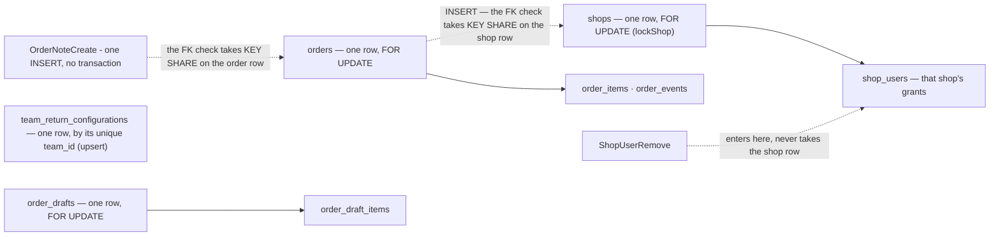

# selling_service — lock order

The service-wide matrix that the `audit-sql` skill writes unconditionally. It is not a finding: it is the reference
the next write handler is checked against.

| | |
| --- | --- |
| Isolation | READ COMMITTED (Postgres default; nothing in this repo raises it) |
| Last swept | 2026-10-26, adding `OrderNoteCreate` and the create form's note row (a-note-is-a-timeline-row) · 2026-10-23, `placeOrder` freezing the take's draw (the fee priced after the take, inside the transaction) · 2026-10-21, adding `OrderStatusChange` (replacing the four per-step RPCs) and `TeamReturnConfigurationSet` · before that 2026-09-29, the primary CS |

**Verdict: two hierarchies, no inversion, and one hole.** The shop side locks `shops` before `shop_users`. The order
side locks one `orders` or `order_drafts` row before its children. No handler takes the two sides in opposite orders.
⚠ `ShopUserRemove` writes `shop_users` without the shop row, which is the
[ShopUserSetPrimary](ShopUserSetPrimary.md) finding.

---

## The hierarchy



Parent before child. A handler may enter part-way down, but never in a different relative order.

## Per handler, in acquisition order

| Handler | Locks, in order | Notes |
| --- | --- | --- |
| `ShopUserAdd` | `shops` (`FOR UPDATE`) → `shop_users` (its new row: INSERT, then the flag UPDATE) | the INSERT's FK takes KEY SHARE on the shop row it already holds |
| `ShopUserSetPrimary` | `shops` (`FOR UPDATE`) → `shop_users`: the old primary, then the new one | ⚠ its grant check before them takes no lock ([finding](ShopUserSetPrimary.md)) |
| `ShopUserRemove` | `shop_users` (1 row, DELETE) | ⚠ **no** shop row, so it enters part-way. Its own write is safe, but it is what makes Make primary's check go stale |
| `ShopUpdate` · `ShopDelete` | `shops` (1 row: UPDATE, i.e. a NO KEY UPDATE lock) | conflicts with `lockShop`, so both serialise with the grant writers |
| `ShopCreate` | none: an INSERT | `shops_team_code_active_unique` refuses a duplicate code |
| `OrderCreate` · `OrderDraftPromote` (`placeOrder`) | `orders` INSERT → KEY SHARE on `shops` (the FK) → `order_timeline_logs` (the placement row and, when one was typed, the note row — one INSERT, rows of its own order) → promote only: `order_drafts` DELETE → **`stock.Pick` inside the transaction** → **the warehouse fee priced inside the transaction** (`WarehouseFeeCalculate`, a read) → `orders` UPDATE of its own row (`cogs`, `warehouse_fee`) → `order_items` | pattern 6 by design (#149): every lock here is held across the inventory call — and, since 2026-10-23, across the fee read too, because the fee's basis is the take's draw ([an-order-is-costed-at-what-leaves-the-shelf](../../../../docs/business/order/context_decision.md#an-order-is-costed-at-what-leaves-the-shelf)). The fee read takes no lock and the UPDATE touches only the row this transaction inserted, so the order of acquisition is unchanged |
| `OrderCancel` | `orders` (`FOR UPDATE`) → UPDATE → `order_events` → **`stock.Return` inside the transaction** | pattern 6 by design (#70) |
| `OrderStatusChange` | one transaction for the batch: `orders` (up to 200 rows, `FOR UPDATE` **`ORDER BY id`**) → one UPDATE → one `order_events` INSERT | id order, never scan order, so two batches over the same orders queue rather than deadlock ([a-batch-move-saves-in-one-transaction](../../../../docs/technical/frontend/warehouse_order_list_decision.md#a-batch-move-saves-in-one-transaction)). Replaced `OrderConfirm` · `OrderPick` · `OrderPack` · `OrderShip` (2026-10-21) |
| `OrderNoteCreate` | none taken explicitly: a plain read of the order (scope), then one `order_timeline_logs` INSERT whose FK check takes **KEY SHARE on that order's row** | autocommit, one lock, so it is never half of a cycle. KEY SHARE conflicts with the `FOR UPDATE` a move or a cancel holds, so a note waits for a move in flight (and for `OrderCancel`'s `stock.Return`) — and lands after it. Notes are append-only with no key: two at once are two notes, by design |
| `TeamReturnConfigurationSet` | `team_return_configurations` (1 row: `INSERT … ON CONFLICT (team_id) DO UPDATE`) | one statement. The first set is a phantom insert, and `team_return_configurations_team_idx` is what serialises it |
| `OrderDraftPush` | `order_drafts` (1 row by team, source and external id, `FOR UPDATE`) → `order_draft_items` | a new draft is backed by `order_drafts_external_ref_idx`, and the handler maps its duplicate |
| `OrderDraftUpdate` | `order_drafts` (1 row, `FOR UPDATE`) → `order_draft_items` | |
| `OrderDraftDelete` | `order_drafts` (n rows in one `DELETE … WHERE id IN`) → items by cascade | one statement, index order |

`shop_users_one_primary_idx` (one primary per shop) is a backstop that never fired in any race below. If it ever did,
`dbError` would report it with its generic unique-violation message: *"a shop with this code already exists"*.

---

## the-lock-no-grep-finds

`INSERT INTO orders` checks `orders.shop_id → shops(id)` with a `FOR KEY SHARE` on the shop's row. KEY SHARE
conflicts with exactly one mode: `FOR UPDATE`, which is the one `lockShop` takes.

| Proved | |
| --- | --- |
| a grant change holds back an order on the shop | `TestInterleave_LockShop_HoldsBackAnOrderOnTheShop`: the order INSERT blocked, released on the grant's commit |
| an order in flight holds back a grant change | `TestInterleave_LockShop_WaitsForAnOrderInFlight`: `lockShop` blocked until the order's transaction ended |
| `FOR NO KEY UPDATE` keeps grant changes serial and lets the order through | `TestInterleave_LockShop_NoKeyUpdateLetsTheOrderThrough`: the order did not wait, and a second NO KEY UPDATE still did |

It cannot deadlock: `lockShop` is the **first** lock both grant writers take, so they hold nothing while they wait.
The cost is waiting. `placeOrder` holds its KEY SHARE across `stock.Pick`, so a grant or Make primary on a busy shop
waits for every order being placed on it (each an inventory round trip), and new orders on that shop stall while the
grant holds the row.

**→ Recommend:** use `clause.Locking{Strength: "NO KEY UPDATE"}` in `lockShop`. It still conflicts with itself and
with `ShopUpdate`/`ShopDelete`'s UPDATE, so every guarantee `lockShop` gives today holds, and it stops conflicting with
the FK. Proved on raw SQL above; not applied (HARD RULE 8).

---

## Proved

| Test | Shows |
| --- | --- |
| `TestRace_ShopUserAdd_ManyUsersOnAShopWithNoPrimary` | 8 grants at once × 10 rounds: 8 grants, **exactly one** primary, 0 errors, and a different winner from round to round |
| `TestRace_ShopUserAdd_SameUserAtOnce` | one user 8× at once: 1 grant, it is primary, 0 errors |
| `TestInterleave_ShopUserAdd_SecondGrantWaitsForTheFirst` | **the proof `lockShop` holds.** B blocked on `SELECT "id" FROM "shops" … FOR UPDATE` (named via `pg_blocking_pids`), re-read after A committed, and left 102 unflagged |
| `TestInterleave_ShopUserAdd_WhileThePrimaryIsRemoved` | Remove takes no shop lock, so the grant does not wait. The end state (no primary) is serializable as *grant, then remove*, so it is not a finding |
| `TestRace_ShopUserSetPrimary_ManyUsersAtOnce` | 8 Make primary × 10 rounds: exactly one primary, 0 errors, no unique violation |
| `TestInterleave_ShopUserSetPrimary_SecondWaitsAndReReads` | B blocked, then cleared A's 102 rather than the 101 it had seen before the lock, with no 23505 |
| `TestInterleave_ShopUserSetPrimary_HoldsBackAGrant` | the two handlers share the one lock |
| `TestRace_ShopUserSetPrimary_AgainstGrantsAndRemovals` | 12 mixed callers × 10 rounds: at most one primary, only `FailedPrecondition` refusals, no deadlock |
| `TestRace_OrderStatusChange_SameMoveAtOnce` | 8 crew pick one order at once × 10 rounds: **exactly one** moves it, 7 told *already picked*, one `picked` history row |
| `TestInterleave_OrderStatusChange_SecondWaitsAndReReads` | **the proof the order's row lock holds.** B blocked on A's `FOR UPDATE`, re-read *picked* after A committed, and was refused rather than writing the move twice |
| `TestRace_OrderStatusChange_ConfirmAgainstCancel` | the warehouse's confirm and the selling team's `OrderCancel` on one pending order × 20 rounds: one wins, the other is refused by the state it left. Both won rounds (e.g. 9/11, 16/4), so the window was hit |
| `TestRace_OrderStatusChange_OppositeBatchOrders` | two batches over the same two orders in opposite orders × 20: 0 deadlocks, each order moved once. Re-run on the set-based save, where each batch holds both rows: the id-ordered lock is what keeps it at 0 |
| `TestRace_TeamReturnConfigurationSet_FirstSetAtOnce` | 8 first sets at once, 8 warehouses × 10 rounds: 0 errors, no unique violation, one row |
| `TestInterleave_TeamReturnConfigurationSet_FirstSetWaits` | **the phantom-insert proof.** B's insert waited on A's uncommitted key, then took the conflict path: one row, the later 58 |
| `TestInterleave_TeamReturnConfigurationSet_ReplaceWaits` | a replace waits on the row and lands after: one row, the later 58 |
| `TestRace_OrderCreate_EachOrderFreezesItsOwnDraw` (`backend/cmd/app_development`) | 8 creates of 2 over a shelf of 2 at 10.000 + 2 at 14.000, × 5 rounds, through the REAL take and fee: exactly 2 orders, cogs 20.000 and 28.000 (48.000, what the goods cost), each fee 10% of its own cogs, each order's cogs = what its inventory transaction took, the shelf at 0 |
| `TestRace_OrderCreate_TheFeeCallHoldsTheShopKeyShareOnly` | an order parked in the fee call still holds KEY SHARE on its shop (a `FOR UPDATE NOWAIT` is refused, 55P03) — the pattern-6 exposure, now one read longer. A second create on the same shop runs to the end meanwhile: the fee read blocks nobody, so nothing can deadlock on it |
| `TestRace_OrderNoteCreate_NotesAndAMoveAtOnce` | 4 seller notes, 4 crew notes and the warehouse's pick on one order at once × 10 rounds: 0 errors, 4 notes from each side, one `picked` row |
| `TestRace_OrderNoteCreate_AgainstOppositeBatches` | two batch moves over two orders in opposite orders with 4 notes on them, × 20 rounds: 0 deadlocks, each order moved once, no note lost |
| `TestInterleave_OrderNoteCreate_WaitsForAMoveInFlight` | **the proof a note is not lost behind a move.** B's note blocked on A's `FOR UPDATE` (its FK's KEY SHARE), released on A's commit, and landed |
| `TestInterleave_OrderNoteCreate_AMoveWaitsForANoteInFlight` | the other direction: an uncommitted note holds KEY SHARE, so a move's `FOR UPDATE` waits for it — one INSERT long in production |
| ✅ `TestInterleave_ShopUserSetPrimary_GrantRemovedMeanwhile` | the [finding](ShopUserSetPrimary.md)'s regression test. It failed by design, and passes since option 2 was applied (2026-09-29) |

Every passing test ran `-count=20` clean.

```sh
go test -tags raceaudit -run 'TestRace_ShopUser|TestInterleave_ShopUser|TestInterleave_LockShop' -v ./backend/services/selling_service/selling_v1/
go test -tags raceaudit -count=20 -run 'TestRace_OrderStatusChange|TestInterleave_OrderStatusChange|TestRace_TeamReturnConfigurationSet|TestInterleave_TeamReturnConfigurationSet' -v ./backend/services/selling_service/selling_v1/
go test -tags raceaudit -count=20 -run 'TestRace_OrderCreate' -v ./backend/cmd/app_development/
go test -tags raceaudit -count=20 -run 'TestRace_OrderNoteCreate|TestInterleave_OrderNoteCreate' -v ./backend/services/selling_service/selling_v1/
```

---

## Seen while sweeping, not audited

- **`OrderDraftPromote`** reads the draft *outside* its transaction, and the draft DELETE inside `placeOrder` does not
  check `RowsAffected`. Two promotes of one draft look able to both place an order, and both pick stock. Suspected,
  not raced: it is outside this pass.

## Not proved

- `OrderDraftPromote` and `OrderCancel` racing themselves were read, not raced (`OrderCreate` racing itself was raced on 2026-10-23, above). `OrderCancel` was raced only against `OrderStatusChange`
- ✅ the set-based `OrderStatusChange` ([its performance audit](../performances/OrderStatusChange.md)) was taken and every order test re-run on it: 80/80 at `-count=20`
- an inversion against another service: `placeOrder` and `OrderCancel` call inventory inside their transaction
- the move to `shop_service`
  ([the-shop-gets-its-own-service](../../../../docs/business/shop/context_decision.md#the-shop-gets-its-own-service)):
  this hierarchy moves with it
