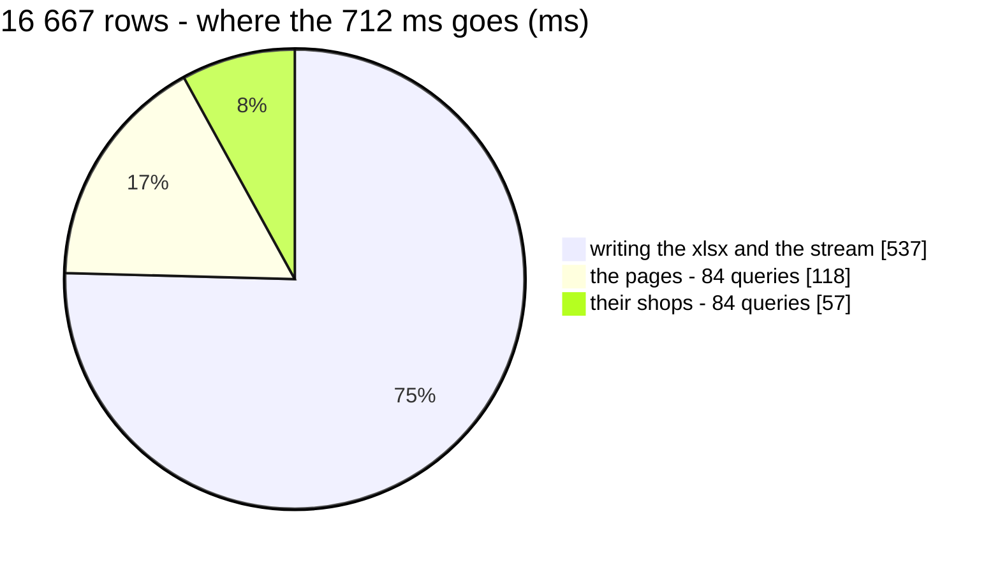

# OrderExport — performance audit

**Verdict:** 🟡 heavy by the rule only — the query count grows with the rows and 75% of the time is in Go, and both are what an export is: **16 667 rows in 0.71 s**, two indexed queries per 200 rows, the rest writing the .xlsx.
**Measured:** 2026-10-21 · `selling_service/selling_v1/order_export.go` · seed 50 000 rows in `orders`, 100 000 in `order_items` · warehouse 900's whole list (16 667 orders), warehouse view · warm, over a real HTTP stream, names from a fake store

| | 16 667 rows |
| --- | --- |
| wall | 712 ms |
| db | 175 ms |
| in Go (wall − db) | 537 ms — the .xlsx encoding and 86 stream messages |
| queries | 170 — a count, then per 200 rows: the page and its shops |
| file | 665 KB |

---

## Queries

| # | What | Rows | Time | Plan | Verdict |
| --- | --- | --- | --- | --- | --- |
| 1 | `SELECT count(*)` through `scopedOrders` | 1 | once | as `OrderList` | ok |
| 2 | the page: `orders.*` + each row's `item_quantity`, `id < last ORDER BY id DESC LIMIT 200` **×84** | 200 | 1.46 ms ea · 0.65 ms in Postgres | Index Scan Backward `orders_pkey`, the sum on `order_items_order_idx` | 🟡 per 200 rows, by design |
| 3 | `SELECT * FROM shops WHERE id IN (…)` **×84** | ≤ 10 | 0.6 ms ea | primary key | 🟡 per 200 rows, by design |

✅ **No N+1 per row** — the query count grows by two per 200 rows, and neither query slows as the keyset walks down the table.

---

## Findings

### 1. The count grows with the rows 🟡

An export of N rows reads N rows: 2 queries per 200 is the floor for a stream that reports progress and names each step's
sellers and creators (the names are at most 200 ids a call).

**→ Recommend: accept.** Bigger steps would cut the queries but not the time, which is mostly encoding. The name lookups'
200-id cap sets the step.

### 2. Most of the time is in Go 🟡

537 of 712 ms is building the .xlsx and sending 86 progress messages. That is the work the RPC exists to do.

**→ Recommend: accept.** Revisit only if an export of a whole year's orders (hundreds of thousands of rows) turns out to be
asked for — then a size cap or a background job, which is a design question, not a tuning one.

---

## Not measured

- the real name lookups (team_service, user_service) and the real upload — a fake store stood in. Each step adds two RPCs
- a real network between the API, document storage and the browser
- concurrency: it is read-only

---

## Open questions

- [ ] None for performance. The file's NAME is a separate, open question (it downloads under its storage key) — asked in chat
  2026-10-21

---

## History

| Date | Wall (16 667 rows) | Queries | Change |
| --- | --- | --- | --- |
| 2026-10-21 | 712 ms | 170 | first audit |
