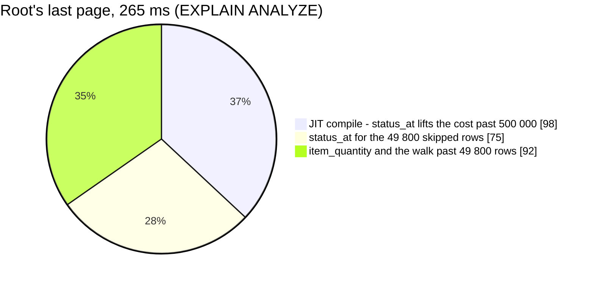
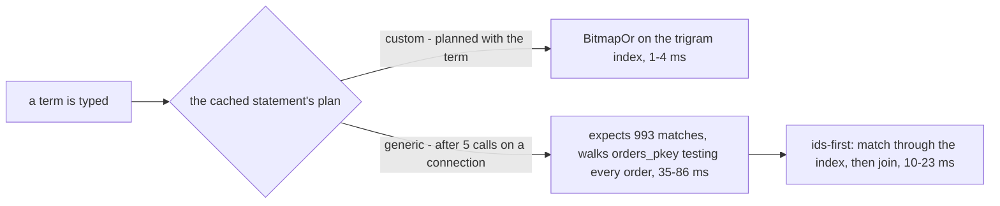

# OrderList — performance audit

**Verdict:** 🔴 heavy. Two reads cross the line, and an ordinary page does not.

- **A search** seq-scans `orders` with four `ILIKE`s, once for the count and once for the page. That is 112–158 ms for root.
- **A deep page** runs both per-row subqueries for every row its `OFFSET` skips. Root's last page takes 252 ms, and `status_at` is two-thirds of it.

An ordinary page is 3–8 ms, and `status_at` costs about 0.1 ms of a 20-row page.

> ✅ **Both reads are fixed** — the deep page on 2026-10-22 (finding 2), the search on 2026-11-15 (finding 1, ids first,
> [the-order-search-matches-ids-first](../../../../docs/business/order/context_decision.md#the-order-search-matches-ids-first)):
> root's and a warehouse's search are **2–5 ms** under the custom and the generic plan (were 52–75 ms). What keeps the
> file 🔴 is finding 5 (the status-date window, by the plan rule).

**Measured:** 2026-10-22 · `selling_service/selling_v1/order_list.go` · seed 50 000 `orders` (11 statuses, 5 teams, 3 warehouses; every order has its own name, phone, marketplace ref and tracking number), 125 000 `order_items` (2–3 per order), 246 206 `order_timeline_logs` (~5 per order: pending at create, then every move; a send-back detour on every fourth order, a note on every third) · warm, median of 5 · `TestPerf_OrderList_Root` in [order_status_change_perf_test.go](../../../../backend/services/selling_service/selling_v1/order_status_change_perf_test.go)

| Case | Median wall | Queries | |
| --- | --- | --- | --- |
| root · all · 20 | 4.0 ms | 2 | ok |
| root · all · 200 | 5.3 ms | 2 | ok |
| root · one status tab · 20 | 4.7 ms | 2 | ok |
| root · `warehouse_id` 900 · 20 / 200 | 5.0 / 5.7 ms | 2 | ok |
| seller team 2 · `warehouse_id` 900 · 20 | 3.8 ms | 2 | ok |
| warehouse 900's own queue · 20 | 3.3 ms | 2 | ok |
| root · search a tracking number · 20 | 119 ms → **3.8 ms** (2026-11-15) | 3 | ✅ [finding 1](#1-a-search-reads-every-order-in-scope-four-ilikes-a-row-) |
| root · search digits · 20 | 112 ms → **2.1 ms** (2026-11-15) | 3 | ✅ [finding 1](#1-a-search-reads-every-order-in-scope-four-ilikes-a-row-) |
| warehouse 900 · search a tracking number · 20 | 47 ms → **4.1 ms** (2026-11-15) | 3 | ✅ the same read over 16 667 orders |
| **root · all · 200 · last page (offset 49 800)** | **252 ms** | 2 | 🔴 [finding 2](#2-an-offset-page-runs-both-subqueries-for-every-row-it-skips--fixed-2026-10-22) |
| root · all · 20 · sort by total | 37 ms | 2 | 🟡 [finding 3](#3-sorting-by-total-sorts-every-order-in-scope-) |

✅ **No N+1.** Every case makes 2 queries, at 20 rows and at 200.
✅ **`status_at` is cheap on an ordinary page.** It adds 0.04–0.11 ms at 20 rows and 0.3–0.6 ms at 200 (EXPLAIN with it
and without it). The plan is an Index Scan Backward on `order_timeline_logs_order_idx` (`Index Cond: order_id = orders.id`,
`Filter: status = orders.status`, 0–1 rows removed), taking the newest matching row as `Limit 1`. Only
[finding 2](#2-an-offset-page-runs-both-subqueries-for-every-row-it-skips--fixed-2026-10-22) makes it material.

The table is the quietest of five full runs. A peer session shared the Postgres, so the small cases moved between 3
and 11 ms from run to run. Across all five runs, root's search took 112–158 ms and the last page 237–275 ms.



---

## Queries

| # | What | Rows | Time | Plan | Verdict |
| --- | --- | --- | --- | --- | --- |
| 1 | `SELECT count(*) FROM orders WHERE <scope> [AND status = ?]` | 1 | 0.5–3.6 ms | root: Seq Scan · a team: BitmapOr `orders_team_idx` + `orders_warehouse_idx` | ok · 🟡 root grows ([finding 4](#4-roots-count-still-reads-the-whole-table-)) |
| 1s | … `AND (name ILIKE … OR phone … OR ref … OR receipt … [OR id = ?])` | 1 | 48–60 ms root · 17–23 ms warehouse | root: **Seq Scan**, 49 999 removed by filter | 🔴 |
| 2 | `SELECT orders.*, (item_quantity), (status_at) … ORDER BY id DESC LIMIT n` | 20 / 200 | 0.15 / 0.75 ms | Index Scan Backward `orders_pkey`. SubPlans: `order_items_order_idx`, `order_timeline_logs_order_idx` | ok |
| 2s | the same, with the search | ≤ 20 | 47–73 ms root | **Seq Scan** → Sort. The SubPlans run for the matches only | 🔴 |
| 2d | the same, `LIMIT 200 OFFSET 49800` | 200 | 147–275 ms | Index Scan Backward over all 50 000. **Both SubPlans `loops=50000`**, 112 ms of JIT | 🔴 |
| 2t | the same, `ORDER BY total_cost DESC, id DESC` (Total) or `platform_total DESC, id DESC` (Platform total) | 20 | 35 ms root · 8 ms team 2 | Seq Scan (root) / BitmapOr (team) → top-N heapsort. The SubPlans run after the sort (`loops=20`) | 🟡 |
| 2n | `… AND settlement_opened_at IS NULL ORDER BY id DESC LIMIT 20` (*not opened*) | 20 | 0.12–0.15 ms | Index Scan Backward `orders_settlement_not_opened_idx` (the partial index); its count 0.27 ms | ok |

EXPLAIN times. The handler's own query times are within these ranges.

---

## Findings

### 1. A search reads every order in scope, four ILIKEs a row 🔴

No index serves `ILIKE '%term%'`, so root's count and root's page each scan the table: ~50–60 ms apiece, 112–158 ms
per call. The tracking number added the fourth `ILIKE`. With the same term, it adds 8–21 ms to each root query and
4–7 ms to each warehouse query.
The disjunction lives in `scopedOrders`, so OrderStat's and OrderExport's searches read it the same way.

```
Aggregate (actual time=59.594 rows=1)
  ->  Seq Scan on orders (rows=20) (actual time=36.402..59.583 rows=1)
        Filter: (customer_name ~~* …) OR (customer_phone ~~* …) OR (order_external_ref_id ~~* …) OR (receipt ~~* …)
        Rows Removed by Filter: 49999
Execution Time: 59.596 ms
```

**The probe.** I created `pg_trgm` and one multicolumn GIN index inside the test's transaction, so it rolled back
with the test and is not a migration. Then I measured the unchanged handler with the plan cache pinned to each mode:

| median wall | custom plan | generic plan | `auto` |
| --- | --- | --- | --- |
| root · tracking number | 2.3–3.6 ms | 76–86 ms | 3.1–85 ms |
| root · digits | 1.3–1.6 ms | 71–82 ms | 1.6–76 ms |
| warehouse 900 · tracking number | 2.4–3.5 ms | 35–39 ms | 35–38 ms |

The index fixes the **count** in both modes: the generic count takes 1.1–1.4 ms, a BitmapOr over the trigram index.
The index does **not** fix the **page** under the generic plan. The generic plan is planned without the term, so it
expects 993 matches (4 × 250 by default). With `LIMIT 20`, it then walks the primary key and tests every order:

```
Limit (actual time=28.053..80.193 rows=1)
  ->  Index Scan Backward using orders_pkey on orders (rows=993) (actual rows=1)
        Filter: (customer_name ~~* like_escape($1, '\')) OR … OR (receipt ~~* like_escape($1, '\'))
        Rows Removed by Filter: 49999
Execution Time: 80.298 ms
```

pgx prepares and caches every statement per connection (`cmd/app_development/deps.go` opens it with the defaults).
After five searches on a connection, Postgres may plan generically. `auto` chose the generic plan for the
warehouse's search in every run.



**Ids-first, measured on the generic plan.** The shape is
`WITH m AS MATERIALIZED (SELECT id FROM orders WHERE <match>) … WHERE id IN (SELECT id FROM m) ORDER BY id DESC LIMIT 20`,
which becomes a Merge Semi Join. One tracking number takes 9.9 ms instead of 85.6 ms. A broad term, "Budi 1" with
11 111 matches, takes 22.7 ms instead of 46.3 ms.

**→ Recommend: the trigram index ([proposed migration](#proposed-migration)) and the ids-first page.** The index
alone fixes the count and any search Postgres still plans with the term. Ids-first keeps the page off the primary-key
walk when the plan is generic.

| Option | Cost |
| --- | --- |
| **index + ids-first page** ✅ | the schema's first extension, a GIN index (see [proposed migration](#proposed-migration)), and the search clause in `scopedOrders` becomes a subquery |
| index + `plan_cache_mode=force_custom_plan` in the DSN | every service on the pool replans every statement. [AnalyticGroupSearch](../../supplier_service/performances/AnalyticGroupSearch.md#2-after-five-calls-a-pooled-connection-plans-every-window-as-if-it-were-tiny-) declined this |
| index alone | the generic page stays at 35–86 ms |

Only the CTE form was measured. Inside `scopedOrders` the same fence would be
`id IN (SELECT id FROM orders WHERE <match> OFFSET 0)`, which fits the `Where` chain and also serves the count and
OrderStat. That form needs one measurement before it is adopted.

> 🔄 **Re-measured 2026-11-06 — the customer moved to `order_addresses` (selling `00045`,
> [one-address-per-order-and-per-draft](../../../../docs/business/order/context_decision.md#one-address-per-order-and-per-draft)).**
> The name and phone are no longer columns of `orders`, so the search reads them as `orders.id IN (SELECT a.order_id FROM
> order_addresses a WHERE a.customer_name ILIKE … OR a.customer_phone ILIKE …)` beside the order's ref and receipt — a
> hashed SubPlan that scans every address row once. Same seed, every order with its address row (`TestPerf_OrderList_Root`):
>
> | Case | before (2026-10-22) | now, `IN` (built) | a correlated `EXISTS` (measured, not built) | now + trigram on both tables (probed, rolled back) |
> | --- | --- | --- | --- | --- |
> | root · search a tracking number · 20 | 119 ms | **142 ms** | 160 ms | 80–84 ms |
> | root · search digits · 20 | 112 ms | **128 ms** | 146 ms | 75–84 ms |
> | warehouse 900 · search a tracking number · 20 | 47 ms | **118 ms** 🔴 | 111 ms | 58–83 ms |
>
> **What got worse:** a WAREHOUSE's search now reads every team's address rows (the subquery has no scope), so 16 667
> orders in scope cost as much as 50 000. **→ Recommend (not applied):** the same GIN trigram fix, split over the two
> tables — `order_addresses (customer_name gin_trgm_ops, customer_phone gin_trgm_ops)` and `orders (order_external_ref_id
> gin_trgm_ops, receipt gin_trgm_ops)` — which the probe measures at 58 ms for the warehouse and 80 ms for root under the
> generic plan; an index migration is the owning service's and the owner's call (HARD RULE 2).
>
> ✅ **Applied 2026-11-06 — the index half, as recommended** (selling `00048_order_search_trigram.sql`): `pg_trgm`,
> `order_addresses_customer_trgm_idx (customer_name, customer_phone)` and `orders_ref_receipt_trgm_idx
> (order_external_ref_id, receipt)`, GIN `gin_trgm_ops`. Re-measured on the same seed (`TestPerf_OrderList_Root`, median of 5,
> nothing else on the machine). Rows seeded inside the test's transaction sit in the GIN pending list with no statistics,
> which the planner prices as a scan and skips — so the probe now flushes the lists (`gin_clean_pending_list`) and runs
> `ANALYZE` first, as autovacuum leaves a live database:
>
> | Case | before the index (00045) | with 00048, `auto` | custom plan | generic plan |
> | --- | --- | --- | --- | --- |
> | root · search a tracking number · 20 | 133–143 ms | **77 ms** | 77 ms | 83 ms |
> | root · search digits · 20 | 123–129 ms | **73 ms** | 72 ms | 80 ms |
> | warehouse 900 · search a tracking number · 20 | 112–118 ms | **55 ms** | 55 ms | 84 ms |
>
> The address side now reads through its index (the hashed SubPlan's seq scan of every address row, ~30 ms, is a Bitmap
> Index Scan), and the count of a generic plan halved (80 → 42 ms). **Still 🔴 for root, 🟡 for a warehouse:** the
> orders side cannot BitmapOr an `IN (subquery)` with the two `ILIKE`s, so the ref and receipt are still FILTERED over
> every order in scope — the remaining cost. The ids-first page measured here (`page ids-first`, 48–56 ms generic) does
> not beat the built shape any more. **→ Recommend (✅ applied 2026-11-15, below):** the match as a `UNION` of three
> index-served id sets (address rows, refs, receipts) fenced before the scope — a query change in `scopedOrders` that
> needs its own measurement; the owner's call.
>
> ✅ **Applied 2026-11-15 — the query half, as recommended**
> ([the-order-search-matches-ids-first](../../../../docs/business/order/context_decision.md#the-order-search-matches-ids-first);
> `selling_v1/order_search.go`). The match is `orders.id = ANY(ARRAY(SELECT order_id FROM order_addresses WHERE name ILIKE
> … OR phone ILIKE … UNION SELECT id FROM orders WHERE order_external_ref_id ILIKE … UNION SELECT id FROM orders WHERE
> receipt ILIKE … [UNION SELECT <the id>]))`. The array is an InitPlan computed once, without the scope: each arm is a
> Bitmap Index Scan on its trigram index, and the scope, the filters and the page then read only those orders by
> `orders_pkey` (`Index Cond: id = ANY ((InitPlan 2).col1)`). Three fences were probed on the same seed first (psql,
> 50 000 orders, lists flushed): the built `= ANY(ARRAY(…))` 1.9–2.3 ms custom and generic; `IN (… UNION …)` 2 ms custom
> but 7–12 ms generic (a hash join over every order in scope); the old clause 35–39 ms. Measured through the handler
> (`TestPerf_OrderList_Root`, old and new in ONE process on ONE seed — the old clause swapped in through
> `SetOrderSearchMatch` — each case scan, ids first, ids first, scan; two processes, tables vacuumed before each; median
> of 5, wall):
>
> | Case | custom: scan → ids first | generic: scan → ids first | `auto` |
> | --- | --- | --- | --- |
> | root · a tracking number | 74.4–75.4 → **3.8–4.5 ms** | 73.5–75.2 → **3.0–3.2 ms** | 73.8–75.7 → 4.1–4.7 ms |
> | root · digits (`31337`) | 70.6–72.3 → **1.9–2.6 ms** | 72.2–72.6 → **1.2–1.4 ms** | 73.6–75.1 → 1.9–2.4 ms |
> | warehouse 900 · a tracking number | 53.4–54.4 → **3.9–4.4 ms** | 74.5–76.0 → **3.0–3.3 ms** | 53.8–54.4 → 4.0–4.5 ms |
> | warehouse 900 · digits | 50.7–52.7 → **2.2–2.4 ms** | 72.1–74.9 → **1.3–1.6 ms** | 52.0–53.2 → 1.9–2.4 ms |
> | seller team 2 · a name (second process only) | 48.5–49.1 → 3.7–4.3 ms | 75.4–77.2 → 2.7–3.1 ms | 49.1–49.7 → 3.6–3.8 ms |
> | root · `Budi 1` (11 111 orders) | 64.8–66.6 → 21.1–22.0 ms | 80.1–81.8 → 21.5–22.4 ms | 64.9–66.5 → 21.2–21.8 ms |
> | warehouse 900 · `Budi 1` (3 977) | 47.7–49.9 → 22.3–22.7 ms | 79.1–86.8 → 23.4–24.9 ms | 47.9–49.7 → 22.3–23.0 ms |
> | root · `Budi` (**every** order) | 55.2–58.0 → **76.0–78.5 ms** ⚠ | 100.7–102.9 → 87.8–89.7 ms | 56.2–59.4 → 77.6–78.9 ms ⚠ |
> | root · `08` (no trigram: the scan both ways) | 73.6–75.1 / 73.9–76.9 ms | 144–147 / 146–152 ms | 91–92 / 92 ms |
>
> The same rows, order and total in every case. **The one cost:** a term matching EVERY order builds a 50 000-id array,
> ~1.35× the scan under a custom plan (still faster under the generic one); a broader-than-20 % term pays it in part.
> A **1–2-character** term (no trigram to look up: the GIN index reads every entry) keeps the scan — ids first measured
> 2.5–3× slower there (`08`: 167 vs 62 ms generic, 86 vs 32 ms custom, psql) — chosen by `trigramsServe` (a run of three
> letters or digits). The same clause serves **OrderStat** (team 50k · a receipt 57.6–64.6 → 1.6–2.4 ms, a warehouse's
> phone 43–66 → 2.5–3.1 ms, [OrderStat](OrderStat.md) finding 4) and **OrderExport** (a warehouse's tracking-number file
> 82–115 → 8–12 ms; a broad term's file +1–10 %, the union recomputed per 200-row step — [OrderExport](OrderExport.md)).
> Equality is proved on a fixture by `order_search_ids_first_test.go` (mutation-checked). **Finding 1 is closed.**

### 2. An OFFSET page runs both subqueries for every row it skips ✅ fixed 2026-10-22

> ✅ **Applied 2026-10-22, as recommended below**, by the pass that added `status_at` — the regression was its own,
> and the fix changes neither the contract nor the schema. Re-measured with the same seed: the last 200-row page is
> **20.5 ms** (was 252 ms); page 1 is unchanged at 4.2 ms. See [order_list.go](../../../../backend/services/selling_service/selling_v1/order_list.go).

Postgres evaluates the select list where the rows are scanned, which is below the `Limit`. Root's last 200-row page
therefore runs `item_quantity` and `status_at` for all 50 000 rows (`loops=50000`) and throws 49 800 of them away.
`status_at` also lifts the estimate: 17.3 per row moves the plan from 0.42 M to 1.29 M. That crosses
`jit_inline_above_cost` and `jit_optimize_above_cost` (500 000), so the query is also JIT-compiled (112 ms).

```
Limit (cost=1281982.77..1287131.29 rows=200) (actual time=263.020..263.686 rows=200)
  ->  Index Scan Backward using orders_pkey on orders (actual rows=50000)
        SubPlan 1 -> Index Scan using order_items_order_idx … (loops=50000)
        SubPlan 3 -> Index Scan Backward using order_timeline_logs_order_idx … (loops=50000)
JIT: Inlining 9.602 ms, Optimization 56.164 ms, Emission 45.039 ms, Total 111.536 ms
Execution Time: 264.506 ms
```

| last page, EXPLAIN | ms |
| --- | --- |
| as built | 264–343 |
| JIT off | 167–216 |
| without `status_at` | 92–111 |
| **deferred**: page the bare orders, then look up the two facts for the 200 rows kept | **17–20** |

The cost grows with the page *number*, not the page size. Page 1 is unaffected.

**→ Recommend: defer the subqueries past the LIMIT.** Page `SELECT orders.*` in a derived table aliased `orders`,
select `orderListColumns` over it, and order again outside. `orderListColumns` stays as it is, because the alias is
the same:

```go
rows := query.Select("orders.*").Order(clause).Offset(offset).Limit(limit)
err = s.db.WithContext(ctx).Table("(?) AS orders", rows).Select(orderListColumns).Order(clause).Find(&orders).Error
```

The cost is that the order is written twice, because a derived table's order is not kept. Keyset paging would be
cheaper still, but the pager shows page numbers
([the-pager-is-always-on-screen](../../../../docs/technical/frontend/context_decision.md#the-pager-is-always-on-screen)),
so it is not proposed.

### 3. Sorting by total sorts every order in scope 🟡

Root takes 37–48 ms: a Seq Scan, then a top-N heapsort of 50 000 rows. There is no index on `total`. `status_at` adds
nothing here, because the SubPlans run after the sort. The query is under the 50 ms line, but it is linear: root passes
50 ms at ~70 000 orders.

🔄 *(2026-11-05, [the-total-sort-is-ours-and-the-platform-total-sorts-apart](../../../../docs/business/order/context_decision.md#the-total-sort-is-ours-and-the-platform-total-sorts-apart).)*
The sort named a `total` column that 00027 had replaced, so it had stopped working: *Total* now orders by `total_cost`,
a new *Platform total* by `platform_total`, each with `id` as the tie-break in the same direction. Re-measured over
50 000 orders with distinct figures (`order_list_sort_settlement_perf_test.go`): root **37.2 / 37.1 ms** wall
(35.3 / 35.0 ms EXPLAIN), team 2 **10.8 / 10.7 ms**, warehouse 900 **15.8 ms** (Platform total) — the same shape and
cost as before; the tie-break adds a sort key, not a pass.

**→ Recommend: nothing yet.** An index on `orders (total_cost, id)` or `(platform_total, id)` would serve root's sort
alone, because a team's scope is an `OR` and is narrowed first. Add it when root's sort starts to hurt.

### 4. Root's count still reads the whole table 🟡

This finding is carried from 2026-10-21 and is unchanged. Root's unfiltered `count(*)` is a Seq Scan, now 0.5–3.6 ms.
A status tab scans too (3.2 ms), because `status` has no index. A team is narrowed by its two indexes first.

**→ Recommend: accept it until ~500 000 orders.** Then give root's *unfiltered* view an estimated total
(`pg_class.reltuples`) and keep the exact count once a filter narrows it. The alternative is a "has more" pager, which
would need an exception to the-pager-is-always-on-screen.

### 6. *Settlement not opened* reads only the missing ones ✅

*(2026-11-05, [a-missing-account-is-found-by-its-opened-at](../../../../docs/business/settlement/context_decision.md#a-missing-account-is-found-by-its-opened-at).)*
`settlement_not_opened` adds `settlement_opened_at IS NULL`. Once things run, those orders are FEW — each one is a failed
open a person is about to fix — so selling 00040 gives them a partial index, `orders (id) WHERE settlement_opened_at IS
NULL`. Measured over 50 000 orders with 1 in 100 missing (500), with the index and, in the same transaction, without:

| case | with the index | without |
| --- | --- | --- |
| root · not opened · 20 | **1.6 ms** wall · count 0.27 ms · page 0.12 ms (Index Scan Backward on the partial index) | 9.8 ms · count 9.5 ms (Seq Scan, 49 500 removed) |
| team 2 · not opened · 20 | 1.8 ms | 4.5 ms |
| warehouse 900 · not opened · 20 | 1.6 ms | 6.4 ms |
| root · not opened · sort Total · 20 | 1.7 ms | 17.4 ms |

The stat's mirror (OrderStat with the same filter) reads the same index. Cost: one entry per order until its account
opens, then the entry leaves the index — the index stays the size of the backlog, not of the table.

---

### 5. A status-date window seq-scans the timeline 🔴

*(2026-10-30, the status dates of [the-order-list-filters-by-seven-dates](../../../../docs/technical/frontend/order_list_decision.md#the-order-list-filters-by-seven-dates).)*
A window on the first entry into a status is `orders.id IN (SELECT order_id FROM order_timeline_logs WHERE status = ? AND
created_at BETWEEN … AND NOT EXISTS (an earlier row into it))`. `order_timeline_logs` has one index,
`(order_id, created_at, id)`, and nothing that starts with `status`. So the subquery reads **every team's whole
timeline** to find one week. Measured over 50 000 orders and 150 000 timeline rows, with one week of `completed` for
team 2 (137 orders):

| | as built | with `(status, created_at)` |
| --- | --- | --- |
| OrderList (count + page) | **50.6 ms**, 2 queries | **7.0 ms** |
| OrderStat | **25.3 ms**, 1 query | **4.0 ms** |
| the subquery | `Parallel Seq Scan on order_timeline_logs`, 149 041 rows removed | `Bitmap Index Scan` on the new index |

```
->  Parallel Seq Scan on order_timeline_logs tl  (actual time=1.410..11.198 rows=959 loops=1)
      Rows Removed by Filter: 149041
```

The time is under every threshold today. It is 🔴 by the plan rule: the table holds every team's history and only grows,
so this window gets slower with every status change anyone makes. The earlier-row check (`NOT EXISTS`) already uses
`order_timeline_logs_order_idx`. The row's own date (`date_entered_at`, a MIN per page row) uses it too, for ~0.1 ms.

**→ Recommend:** the index below. It is one b-tree on two narrow columns. It also serves any later "moves into X between
A and B" read, such as the order metrics, should they ever read the timeline directly.

---

## Proposed migration

```sql
-- backend/services/selling_service/db_migrations/00020_order_search_trgm.sql
-- +goose NO TRANSACTION
-- +goose Up
CREATE EXTENSION IF NOT EXISTS pg_trgm;
CREATE INDEX CONCURRENTLY orders_search_trgm_idx ON orders USING gin
    (customer_name gin_trgm_ops, customer_phone gin_trgm_ops, order_external_ref_id gin_trgm_ops, receipt gin_trgm_ops);

-- +goose Down
DROP INDEX CONCURRENTLY IF EXISTS orders_search_trgm_idx;
```

Cost:

- **Writes.** A GIN insert on every order, and on every update to the four columns. The tracking number is written
  after create, so that update stops being HOT.
- **Reach.** It serves OrderStat's and OrderExport's searches too.
- **Stale comments.** 00012 and 00018 say "not indexed: ILIKE cannot use a b-tree". That is still true of a b-tree,
  and a trigram index is the one that serves it.
- **Short terms.** A 1–2 character term cannot use trigrams and still scans. `search` has `max_len 100` and no
  `min_len`.


```sql
-- backend/services/selling_service/db_migrations/00031_order_timeline_status_created_idx.sql — finding 5
-- +goose NO TRANSACTION
-- +goose Up
CREATE INDEX CONCURRENTLY order_timeline_logs_status_created_idx ON order_timeline_logs (status, created_at);

-- +goose Down
DROP INDEX CONCURRENTLY IF EXISTS order_timeline_logs_status_created_idx;
```

Cost: one more b-tree write for every timeline row (every move and every note). A note row has `status = ''`, so it
lands in one large `''` bucket that no window reads.

---

## Not measured

- concurrency (one caller at a time)
- cache-cold behaviour
- production distribution. Real names repeat, so a common name matches many orders. Real timelines vary: `status_at`
  walks back past every note and move written after the current status was entered.
- the trigram index's size and write cost
- ~~1–2 character terms~~ — measured 2026-11-15: they keep the scan (finding 1)
- ~~the `OFFSET 0` form of ids-first inside `scopedOrders`~~ — superseded 2026-11-15: the built fence is `= ANY(ARRAY(…))`; `IN (… UNION …)` was probed beside it (finding 1)
- a team's deep page and a team's sort by total (root only)
- the production server's `jit` settings. This is a stock Postgres 17: `jit` on, thresholds 100 000 / 500 000 / 500 000.
- why one sample in every batch of last-page runs lands near 150 ms (the others land at 235–295 ms)

---

## Open questions

- [x] ✅ *applied 2026-11-06 (selling 00048, split over the two tables)* — **Adopt `pg_trgm` and the trigram index on `orders`?**
  [SupplierList](../../supplier_service/performances/SupplierList.md#open-questions) asks the same question. I would
  adopt it: a label scan is the warehouse's most frequent search, and the index serves three RPCs.
- [x] ✅ *ids first — [the-order-search-matches-ids-first](../../../../docs/business/order/context_decision.md#the-order-search-matches-ids-first), built 2026-11-15* — **Ids-first in `scopedOrders`, or `force_custom_plan` in the DSN?** I would take ids-first, as AnalyticGroupSearch
  took literals over the DSN option.
- [ ] **Defer the subqueries past the LIMIT ([finding 2](#2-an-offset-page-runs-both-subqueries-for-every-row-it-skips--fixed-2026-10-22))?**
  It is a handler change with no contract change, and it is my pick.
- [ ] **Add `order_timeline_logs (status, created_at)` for the status-date window ([finding 5](#5-a-status-date-window-seq-scans-the-timeline-))?** My pick: yes. It is the only thing between that window and a full read of every team's history.
- [ ] At ~500 000 orders: an estimated total for root's unfiltered list, or a "has more" pager? The estimate is my pick
  ([finding 4](#4-roots-count-still-reads-the-whole-table-)). Nothing to decide today.

---

## History

| Date | Median (root, all, 20) | Queries | Change |
| --- | --- | --- | --- |
| 2026-10-21 | 4.4 ms | 2 | first audit — root reads every team since today |
| 2026-10-21 | 3.7 ms | 2 | the row's `item_quantity` added — a correlated sum per row on `order_items_order_idx`, 0.002 ms a row; the page is still 0.08 ms in Postgres, measured over 100 000 lines |
| 2026-10-22 | 4.0 ms | 2 | re-audit: `status_at` (a correlated MAX over 246 206 timeline rows), the `warehouse_id` filter, the tracking number in the search. `status_at` adds ~0.1 ms to a 20-row page. Now 🔴 on the search (112–158 ms, first measured here; the tracking number adds 8–21 ms per query) and on a deep OFFSET page (252 ms, two-thirds of it `status_at`) |
| 2026-10-22 | 4.2 ms | 2 | finding 2 fixed — the page is chosen bare in a derived table and the two facts computed for its rows only: the last 200-row page **252 → 20.5 ms**. The search (finding 1) is unchanged at 112–120 ms and waits on the proposed migration |
| 2026-10-30 | — | 2 | the status-date window (`ENTERED_*`) measured: 50.6 ms for the list and 25.3 ms for OrderStat at 150 000 timeline rows, by a seq scan of the timeline. 7.0 / 4.0 ms with the proposed `(status, created_at)` index — not applied (finding 5) |
| 2026-11-05 | — | 2 | the two money sorts (Total = `total_cost`, Platform total = `platform_total`, id tie-break): root 37 ms, team 10.8 ms — finding 3 unchanged. `settlement_not_opened` with its partial index (00040): 1.6–1.8 ms; without it 4.5–17.4 ms (finding 6) |
| 2026-11-11 | — | 2 | `Order.is_override` (the "by Root team" badge, an-override-shows-a-platform-badge) — `orders.is_override` is a column of the `orders.*` row already read: no query, no join, cost nil |
| 2026-11-15 | 5.1 ms | 3 | finding 1 closed — the search matches ids first (the-order-search-matches-ids-first): root's tracking number 74 → 3.8 ms custom / 74 → 3.1 ms generic, a warehouse's 54 → 4.1 / 75 → 3.2 ms, `Budi 1` 65 → 21 ms; a term naming every order 56 → 77 ms custom (102 → 88 generic); 1–2-character terms keep the scan. OrderStat and OrderExport read the same clause. The third query is the page's address rows (`attachAddresses`, 2026-11-06). The probe's DEFERRED step now logs "applied" — the select list goes on past `status_at` since `return_warehouse_id` |
| 2026-11-20 | — | 3 | *Perlu cetak ulang* (`reprint_label`, selling 00054 — a-changed-label-asks-the-warehouse-to-reprint), `TestPerf_OrderList_ReprintLabel`: 50 000 orders, a warehouse shipping 16 667, 38 marked. Without an index the filtered list is 27.3 ms (generic 29.8) — its count 13.9 ms and its page 19.6 ms walk every order the warehouse ships — and OrderStat 10.7 ms (12.5). With the partial `orders_reprint_label_idx (id) WHERE <the filter's literal condition>` (a-pure-index-is-added-without-asking): **3.7 ms** (generic 2.6; count 0.11, page 0.24) and OrderStat **1.5 ms** (1.0). A `(warehouse_id)` candidate helped the count only — the newest-first page stayed on `orders_pkey` backward. Unfiltered list and stat unchanged; `Order.reprint_label` is two columns of the row already read |
