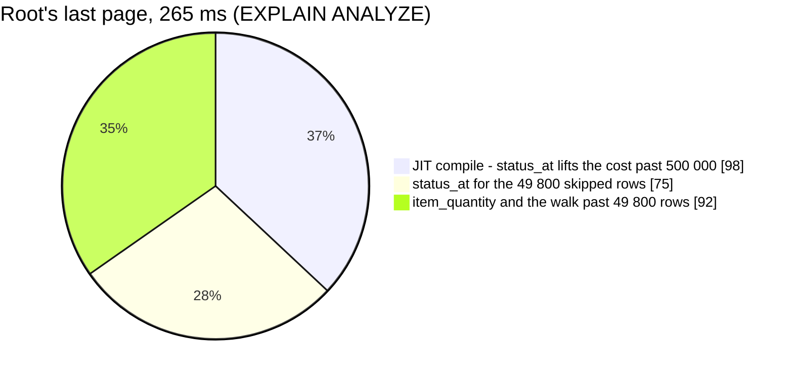
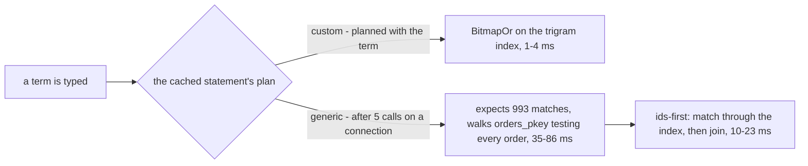

# OrderList — performance audit

**Verdict:** 🔴 heavy. Two reads cross the line, and an ordinary page does not.

- **A search** seq-scans `orders` with four `ILIKE`s, once for the count and once for the page. That is 112–158 ms for root.
- **A deep page** runs both per-row subqueries for every row its `OFFSET` skips. Root's last page takes 252 ms, and `status_at` is two-thirds of it.

An ordinary page is 3–8 ms, and `status_at` costs about 0.1 ms of a 20-row page.

**Measured:** 2026-10-22 · `selling_service/selling_v1/order_list.go` · seed 50 000 `orders` (11 statuses, 5 teams, 3 warehouses; every order has its own name, phone, marketplace ref and tracking number), 125 000 `order_items` (2–3 per order), 246 206 `order_timeline_logs` (~5 per order: pending at create, then every move; a send-back detour on every fourth order, a note on every third) · warm, median of 5 · `TestPerf_OrderList_Root` in [order_status_change_perf_test.go](../../../../backend/services/selling_service/selling_v1/order_status_change_perf_test.go)

| Case | Median wall | Queries | |
| --- | --- | --- | --- |
| root · all · 20 | 4.0 ms | 2 | ok |
| root · all · 200 | 5.3 ms | 2 | ok |
| root · one status tab · 20 | 4.7 ms | 2 | ok |
| root · `warehouse_id` 900 · 20 / 200 | 5.0 / 5.7 ms | 2 | ok |
| seller team 2 · `warehouse_id` 900 · 20 | 3.8 ms | 2 | ok |
| warehouse 900's own queue · 20 | 3.3 ms | 2 | ok |
| **root · search a tracking number · 20** | **119 ms** | 2 | 🔴 [finding 1](#1-a-search-reads-every-order-in-scope-four-ilikes-a-row-) |
| **root · search digits · 20** | **112 ms** | 2 | 🔴 [finding 1](#1-a-search-reads-every-order-in-scope-four-ilikes-a-row-) |
| warehouse 900 · search a tracking number · 20 | 47 ms | 2 | 🟡 the same read over 16 667 orders |
| **root · all · 200 · last page (offset 49 800)** | **252 ms** | 2 | 🔴 [finding 2](#2-an-offset-page-runs-both-subqueries-for-every-row-it-skips-) |
| root · all · 20 · sort by total | 37 ms | 2 | 🟡 [finding 3](#3-sorting-by-total-sorts-every-order-in-scope-) |

✅ **No N+1.** Every case makes 2 queries, at 20 rows and at 200.
✅ **`status_at` is cheap on an ordinary page.** It adds 0.04–0.11 ms at 20 rows and 0.3–0.6 ms at 200 (EXPLAIN with it
and without it). The plan is an Index Scan Backward on `order_timeline_logs_order_idx` (`Index Cond: order_id = orders.id`,
`Filter: status = orders.status`, 0–1 rows removed), taking the newest matching row as `Limit 1`. Only
[finding 2](#2-an-offset-page-runs-both-subqueries-for-every-row-it-skips-) makes it material.

The table is the quietest of five full runs. A peer session shared the Postgres, so the small cases moved between 3
and 11 ms from run to run. Across all five runs, root's search took 112–158 ms and the last page 237–275 ms.



---

## Queries

| # | What | Rows | Time | Plan | Verdict |
| --- | --- | --- | --- | --- | --- |
| 1 | `SELECT count(*) FROM orders WHERE <scope> [AND status = ?]` | 1 | 0.5–3.6 ms | root: Seq Scan · a team: BitmapOr `orders_team_idx` + `orders_warehouse_idx` | ok · 🟡 root grows ([finding 4](#4-roots-count-still-reads-the-whole-table-)) |
| 1s | … `AND (name ILIKE … OR phone … OR ref … OR receipt … [OR id = ?])` | 1 | 48–60 ms root · 17–23 ms warehouse | root: **Seq Scan**, 49 999 removed by filter | 🔴 |
| 2 | `SELECT orders.*, (item_quantity), (status_at) … ORDER BY id DESC LIMIT n` | 20 / 200 | 0.15 / 0.75 ms | Index Scan Backward `orders_pkey`. SubPlans: `order_items_order_idx`, `order_timeline_logs_order_idx` | ok |
| 2s | the same, with the search | ≤ 20 | 47–73 ms root | **Seq Scan** → Sort. The SubPlans run for the matches only | 🔴 |
| 2d | the same, `LIMIT 200 OFFSET 49800` | 200 | 147–275 ms | Index Scan Backward over all 50 000. **Both SubPlans `loops=50000`**, 112 ms of JIT | 🔴 |
| 2t | the same, `ORDER BY total DESC` | 20 | 34–48 ms | Seq Scan → top-N heapsort. The SubPlans run after the sort (`loops=20`) | 🟡 |

EXPLAIN times. The handler's own query times are within these ranges.

---

## Findings

### 1. A search reads every order in scope, four ILIKEs a row 🔴

No index serves `ILIKE '%term%'`, so root's count and root's page each scan the table: ~50–60 ms apiece, 112–158 ms
per call. The tracking number added the fourth `ILIKE`. With the same term, it adds 8–21 ms to each root query and
4–7 ms to each warehouse query.
The disjunction lives in `scopedOrders`, so OrderStat's and OrderExport's searches read it the same way.

```
Aggregate (actual time=59.594 rows=1)
  ->  Seq Scan on orders (rows=20) (actual time=36.402..59.583 rows=1)
        Filter: (customer_name ~~* …) OR (customer_phone ~~* …) OR (order_external_ref_id ~~* …) OR (receipt ~~* …)
        Rows Removed by Filter: 49999
Execution Time: 59.596 ms
```

**The probe.** I created `pg_trgm` and one multicolumn GIN index inside the test's transaction, so it rolled back
with the test and is not a migration. Then I measured the unchanged handler with the plan cache pinned to each mode:

| median wall | custom plan | generic plan | `auto` |
| --- | --- | --- | --- |
| root · tracking number | 2.3–3.6 ms | 76–86 ms | 3.1–85 ms |
| root · digits | 1.3–1.6 ms | 71–82 ms | 1.6–76 ms |
| warehouse 900 · tracking number | 2.4–3.5 ms | 35–39 ms | 35–38 ms |

The index fixes the **count** in both modes: the generic count takes 1.1–1.4 ms, a BitmapOr over the trigram index.
The index does **not** fix the **page** under the generic plan. The generic plan is planned without the term, so it
expects 993 matches (4 × 250 by default). With `LIMIT 20`, it then walks the primary key and tests every order:

```
Limit (actual time=28.053..80.193 rows=1)
  ->  Index Scan Backward using orders_pkey on orders (rows=993) (actual rows=1)
        Filter: (customer_name ~~* like_escape($1, '\')) OR … OR (receipt ~~* like_escape($1, '\'))
        Rows Removed by Filter: 49999
Execution Time: 80.298 ms
```

pgx prepares and caches every statement per connection (`cmd/app_development/deps.go` opens it with the defaults).
After five searches on a connection, Postgres may plan generically. `auto` chose the generic plan for the
warehouse's search in every run.



**Ids-first, measured on the generic plan.** The shape is
`WITH m AS MATERIALIZED (SELECT id FROM orders WHERE <match>) … WHERE id IN (SELECT id FROM m) ORDER BY id DESC LIMIT 20`,
which becomes a Merge Semi Join. One tracking number takes 9.9 ms instead of 85.6 ms. A broad term, "Budi 1" with
11 111 matches, takes 22.7 ms instead of 46.3 ms.

**→ Recommend: the trigram index ([proposed migration](#proposed-migration)) and the ids-first page.** The index
alone fixes the count and any search Postgres still plans with the term. Ids-first keeps the page off the primary-key
walk when the plan is generic.

| Option | Cost |
| --- | --- |
| **index + ids-first page** ✅ | the schema's first extension, a GIN index (see [proposed migration](#proposed-migration)), and the search clause in `scopedOrders` becomes a subquery |
| index + `plan_cache_mode=force_custom_plan` in the DSN | every service on the pool replans every statement. [AnalyticGroupSearch](../../supplier_service/performances/AnalyticGroupSearch.md#2-after-five-calls-a-pooled-connection-plans-every-window-as-if-it-were-tiny-) declined this |
| index alone | the generic page stays at 35–86 ms |

Only the CTE form was measured. Inside `scopedOrders` the same fence would be
`id IN (SELECT id FROM orders WHERE <match> OFFSET 0)`, which fits the `Where` chain and also serves the count and
OrderStat. That form needs one measurement before it is adopted.

### 2. An OFFSET page runs both subqueries for every row it skips ✅ fixed 2026-10-22

> ✅ **Applied 2026-10-22, as recommended below**, by the pass that added `status_at` — the regression was its own,
> and the fix changes neither the contract nor the schema. Re-measured with the same seed: the last 200-row page is
> **20.5 ms** (was 252 ms); page 1 is unchanged at 4.2 ms. See [order_list.go](../../../../backend/services/selling_service/selling_v1/order_list.go).

Postgres evaluates the select list where the rows are scanned, which is below the `Limit`. Root's last 200-row page
therefore runs `item_quantity` and `status_at` for all 50 000 rows (`loops=50000`) and throws 49 800 of them away.
`status_at` also lifts the estimate: 17.3 per row moves the plan from 0.42 M to 1.29 M. That crosses
`jit_inline_above_cost` and `jit_optimize_above_cost` (500 000), so the query is also JIT-compiled (112 ms).

```
Limit (cost=1281982.77..1287131.29 rows=200) (actual time=263.020..263.686 rows=200)
  ->  Index Scan Backward using orders_pkey on orders (actual rows=50000)
        SubPlan 1 -> Index Scan using order_items_order_idx … (loops=50000)
        SubPlan 3 -> Index Scan Backward using order_timeline_logs_order_idx … (loops=50000)
JIT: Inlining 9.602 ms, Optimization 56.164 ms, Emission 45.039 ms, Total 111.536 ms
Execution Time: 264.506 ms
```

| last page, EXPLAIN | ms |
| --- | --- |
| as built | 264–343 |
| JIT off | 167–216 |
| without `status_at` | 92–111 |
| **deferred**: page the bare orders, then look up the two facts for the 200 rows kept | **17–20** |

The cost grows with the page *number*, not the page size. Page 1 is unaffected.

**→ Recommend: defer the subqueries past the LIMIT.** Page `SELECT orders.*` in a derived table aliased `orders`,
select `orderListColumns` over it, and order again outside. `orderListColumns` stays as it is, because the alias is
the same:

```go
rows := query.Select("orders.*").Order(clause).Offset(offset).Limit(limit)
err = s.db.WithContext(ctx).Table("(?) AS orders", rows).Select(orderListColumns).Order(clause).Find(&orders).Error
```

The cost is that the order is written twice, because a derived table's order is not kept. Keyset paging would be
cheaper still, but the pager shows page numbers
([the-pager-is-always-on-screen](../../../../docs/technical/frontend/context_decision.md#the-pager-is-always-on-screen)),
so it is not proposed.

### 3. Sorting by total sorts every order in scope 🟡

Root takes 37–48 ms: a Seq Scan, then a top-N heapsort of 50 000 rows. There is no index on `total`. `status_at` adds
nothing here, because the SubPlans run after the sort. The query is under the 50 ms line, but it is linear: root passes
50 ms at ~70 000 orders.

**→ Recommend: nothing yet.** An index on `orders (total)` would serve root's sort alone, because a team's scope is an
`OR` and is narrowed first. Add it when root's sort-by-total starts to hurt.

### 4. Root's count still reads the whole table 🟡

This finding is carried from 2026-10-21 and is unchanged. Root's unfiltered `count(*)` is a Seq Scan, now 0.5–3.6 ms.
A status tab scans too (3.2 ms), because `status` has no index. A team is narrowed by its two indexes first.

**→ Recommend: accept it until ~500 000 orders.** Then give root's *unfiltered* view an estimated total
(`pg_class.reltuples`) and keep the exact count once a filter narrows it. The alternative is a "has more" pager, which
would need an exception to the-pager-is-always-on-screen.

---

## Proposed migration

```sql
-- backend/services/selling_service/db_migrations/00020_order_search_trgm.sql
-- +goose NO TRANSACTION
-- +goose Up
CREATE EXTENSION IF NOT EXISTS pg_trgm;
CREATE INDEX CONCURRENTLY orders_search_trgm_idx ON orders USING gin
    (customer_name gin_trgm_ops, customer_phone gin_trgm_ops, order_external_ref_id gin_trgm_ops, receipt gin_trgm_ops);

-- +goose Down
DROP INDEX CONCURRENTLY IF EXISTS orders_search_trgm_idx;
```

Cost:

- **Writes.** A GIN insert on every order, and on every update to the four columns. The tracking number is written
  after create, so that update stops being HOT.
- **Reach.** It serves OrderStat's and OrderExport's searches too.
- **Stale comments.** 00012 and 00018 say "not indexed: ILIKE cannot use a b-tree". That is still true of a b-tree,
  and a trigram index is the one that serves it.
- **Short terms.** A 1–2 character term cannot use trigrams and still scans. `search` has `max_len 100` and no
  `min_len`.

---

## Not measured

- concurrency (one caller at a time)
- cache-cold behaviour
- production distribution. Real names repeat, so a common name matches many orders. Real timelines vary: `status_at`
  walks back past every note and move written after the current status was entered.
- the trigram index's size and write cost
- 1–2 character terms
- the `OFFSET 0` form of ids-first inside `scopedOrders` (only the CTE form was measured)
- a team's deep page and a team's sort by total (root only)
- the production server's `jit` settings. This is a stock Postgres 17: `jit` on, thresholds 100 000 / 500 000 / 500 000.
- why one sample in every batch of last-page runs lands near 150 ms (the others land at 235–295 ms)

---

## Open questions

- [ ] **Adopt `pg_trgm` and the trigram index on `orders`?**
  [SupplierList](../../supplier_service/performances/SupplierList.md#open-questions) asks the same question. I would
  adopt it: a label scan is the warehouse's most frequent search, and the index serves three RPCs.
- [ ] **Ids-first in `scopedOrders`, or `force_custom_plan` in the DSN?** I would take ids-first, as AnalyticGroupSearch
  took literals over the DSN option.
- [ ] **Defer the subqueries past the LIMIT ([finding 2](#2-an-offset-page-runs-both-subqueries-for-every-row-it-skips-))?**
  It is a handler change with no contract change, and it is my pick.
- [ ] At ~500 000 orders: an estimated total for root's unfiltered list, or a "has more" pager? The estimate is my pick
  ([finding 4](#4-roots-count-still-reads-the-whole-table-)). Nothing to decide today.

---

## History

| Date | Median (root, all, 20) | Queries | Change |
| --- | --- | --- | --- |
| 2026-10-21 | 4.4 ms | 2 | first audit — root reads every team since today |
| 2026-10-21 | 3.7 ms | 2 | the row's `item_quantity` added — a correlated sum per row on `order_items_order_idx`, 0.002 ms a row; the page is still 0.08 ms in Postgres, measured over 100 000 lines |
| 2026-10-22 | 4.0 ms | 2 | re-audit: `status_at` (a correlated MAX over 246 206 timeline rows), the `warehouse_id` filter, the tracking number in the search. `status_at` adds ~0.1 ms to a 20-row page. Now 🔴 on the search (112–158 ms, first measured here; the tracking number adds 8–21 ms per query) and on a deep OFFSET page (252 ms, two-thirds of it `status_at`) |
| 2026-10-22 | 4.2 ms | 2 | finding 2 fixed — the page is chosen bare in a derived table and the two facts computed for its rows only: the last 200-row page **252 → 20.5 ms**. The search (finding 1) is unchanged at 112–120 ms and waits on the proposed migration |
