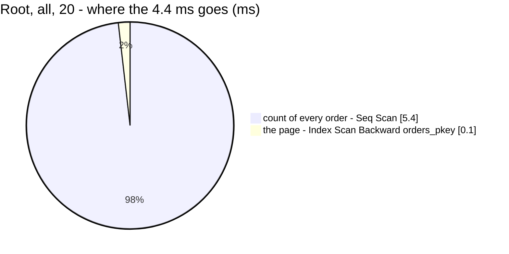

# OrderList — performance audit

**Verdict:** 🟡 heavy by the rule only — for the **root team** (every team's orders, no team clause), the page's total is a `count(*)` that **seq-scans the whole `orders` table**: 5.5 ms at 50 000 rows, and linear in the table. The page itself is 0.04 ms.
**Measured:** 2026-10-21 · `selling_service/selling_v1/order_list.go`, root's path (`readsEveryTeam`) · seed 50 000 rows in `orders` (11 statuses, 5 teams, 3 warehouses) · warm, median of 5

| | all · 20 | all · 200 | one status tab · 20 |
| --- | --- | --- | --- |
| wall | 4.4 ms | 5.0 ms | 5.0 ms |
| in Go (wall − db) | ~0 | ~0 | ~0 |
| queries | 2 | 2 | 2 |

✅ **No N+1** — 2 queries at 20 rows and at 200.



---

## Queries

| # | What | Rows | Time | Plan | Verdict |
| --- | --- | --- | --- | --- | --- |
| 1 | `SELECT count(*) FROM orders` (+ `WHERE status = ?` on a tab) | 1 | 5.5 ms · 4.2 ms on a tab | **Seq Scan** on `orders` — 50 000 rows, or 4 546 kept by the filter | 🟡 grows with the table |
| 2 | `SELECT * FROM orders ORDER BY id DESC LIMIT 20` | 20 / 200 | 0.04 / 0.12 ms | Index Scan Backward `orders_pkey` | ok |

---

## Findings

### 1. Root's total counts the whole table 🟡

A team's list is narrowed by `team_id OR warehouse_id`, both indexed. Root's is not narrowed at all
([readsEveryTeam](../../../../backend/services/selling_service/selling_v1/order_list.go)), so the `TotalItems` in its page info is
a count of every order the system has ever held. No index fixes an unfiltered `count(*)`. An index-only scan would still visit every entry.

```
Aggregate (actual time=5.446..5.446 rows=1)
  -> Seq Scan on orders (actual time=0.430..3.473 rows=50000)
Execution Time: 5.458 ms
```

At 50 000 orders this is 5 ms, about 0.1 µs per row. It reaches the 50 ms threshold near 500 000 orders, and 150 ms near 1.5 million.

**→ Recommend: accept it now, with a trigger.** Root is one person, and the screen says how many pages there are. Revisit when `orders` passes ~500 000 rows. The options then:

| | |
| --- | --- |
| an estimate for root's **unfiltered** view (`pg_class.reltuples`) | instant, but *"about 1.2 million"* rather than exact |
| a "has more" pager for root (fetch `limit + 1`, no total) | instant and exact, but the pager loses its page count ([the-pager-is-always-on-screen](../../../../docs/technical/frontend/context_decision.md#the-pager-is-always-on-screen) would need an exception) |

I would take the estimate for the unfiltered view and keep the exact count once a filter or a tab narrows it.

### 2. A status tab still seq-scans 🟡

There is no index on `status`, so root's tab counts scan the table too (4.2 ms). For a TEAM this is narrowed by `team_id` first and does not matter.

**→ Recommend: nothing yet.** An index on `status` would serve root alone, and the 11 statuses are skewed (most orders end `completed`), so the planner would skip it for the large ones anyway. Same trigger as finding 1.

---

## Not measured

- the team's own path (`team_id OR warehouse_id`). It is unchanged by this pass, and a team's slice is far smaller than the table
- search (`ILIKE '%…%'`), which seq-scans for every caller. It predates this pass and is outside this audit
- production distribution: real orders are not spread evenly over statuses or teams

---

## Open questions

- [ ] At ~500 000 orders: an estimated total for root's unfiltered list, or a "has more" pager? The estimate is my pick (finding 1). Nothing to decide today

---

## History

| Date | Median (root, all, 20) | Queries | Change |
| --- | --- | --- | --- |
| 2026-10-21 | 4.4 ms | 2 | first audit — root reads every team since today |
| 2026-10-21 | 3.7 ms | 2 | the row's `item_quantity` added — a correlated sum per row on `order_items_order_idx`, 0.002 ms a row; the page is still 0.08 ms in Postgres, measured over 100 000 lines |
