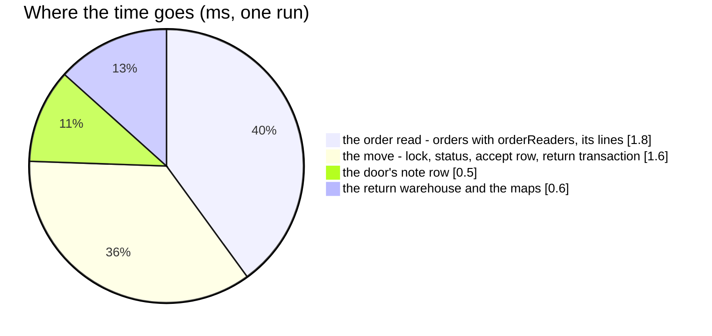

# OrderReturnAccept — performance audit

**Verdict:** 🟡 over the 5-statement line by the count alone — **11 statements**, 3.9 ms median over 50 000 orders (4.8 ms
in an earlier run the same day), every read an index scan, none growing with anything: a return reads the order, checks
who may accept it, moves it and writes its rows. The stock half is a call of its own
([OrderTransactionReturn](../../inventory_service/performances/OrderTransactionReturn.md), 20 statements flat), faked here.
No fix proposed.
**Measured:** 2026-11-09 · `selling_service/selling_v1/order_return_accept.go` · seed 50 000 `orders`, 125 000
`order_items`, 246 206 `order_timeline_logs`; five selling teams with warehouse 900 as their return warehouse; returns
deep in the table, each run a fresh one, one unit of every line broken (so the door's note row is written) and a
courier charge · the stock half and the catalogue faked · warm, 5 runs · `TestPerf_OrderReturnAccept` (`-tags perfaudit`)

| | median | max |
| --- | --- | --- |
| wall | 3.9 ms | 5.6 ms |
| db | 4.0 ms | 6.1 ms |
| in Go (wall − db) | ≈ 0 (the probe's clocks overlap) | 0.5 ms |
| queries | 11 | |

---

## Queries

| # | What | Rows | Time | Plan | Verdict |
| --- | --- | --- | --- | --- | --- |
| 1 | `SELECT * FROM orders WHERE id = ? AND (status = 'return' OR <orderReaders>)` — not locked | 1 | 1.2 ms | `orders_pkey`, 0.03 ms (the readers' subquery never executed) | ok |
| 2 | `SELECT * FROM order_items WHERE order_id = ? ORDER BY id` — the preload | 2 | 0.64 ms | `order_items_order_idx` | ok |
| 3 | `SELECT * FROM team_return_configurations WHERE team_id = ? LIMIT 1` — the return warehouse, read now | 1 | under the probe's clock | Seq Scan on the 5-row seed; one row per team behind `team_return_configurations_team_idx` | ok |
| 4 | `SELECT * FROM product_return_maps WHERE team_id = ? AND shared_product_id IN (…)` | 0 | 0.63 ms | `product_return_maps_team_shared_idx` | ok |
| — | *the catalogue's one call and the stock half — in process, faked here* | | | | |
| 5 | `SAVEPOINT` (BEGIN in production) | | | | ok |
| 6 | `SELECT * FROM orders WHERE id = ? LIMIT 1 FOR UPDATE` | 1 | 0.60 ms | `orders_pkey` | ok |
| 7 | `UPDATE orders SET status = 'return_completed' … WHERE id IN (?)` (`setOrdersStatus`, shared with every move) | 1 | under the probe's clock | `orders_pkey` | ok |
| 8 | `INSERT INTO order_timeline_logs` — the accept row, with the courier's charge and `accepting_warehouse_id` | 1 | 0.75 ms | | ok |
| 9 | `UPDATE orders SET return_transaction_id = ? WHERE id = ?` | 1 | 0.22 ms | `orders_pkey` | 🟡 [finding 1](#1-the-order-row-is-written-twice-) |
| 10 | `INSERT INTO order_timeline_logs` — the door's note row (broken / missing only) | 1 | 0.51 ms | | ok |
| 11 | `SELECT * FROM order_addresses WHERE order_id IN (?)` — the answer's buyer | 1 | under the probe's clock | `order_addresses_order_unique` | ok |

---

## Findings

### 1. The order row is written twice 🟡

The move (row 7) and the return's transaction id (row 9) are two UPDATEs of the same row in one transaction: one more
statement and one more row version per accept, about 0.2 ms.

**→ Recommend:** leave it. Folding the column into row 7 means teaching `setOrdersStatus` — the one save of every status
move, batch moves included — an accept-only column; if it is ever wanted, an optional extra-columns argument does it
without a second save path.

### 2. Heavy by the count only 🟡

11 statements against the 5-statement line, constant: the unlocked read the refusals need (rows 1–4, so a wrong
warehouse or an unmapped line is refused before anything is written or called), the move (5–10), the answer (11).
Rows 8 and 10 could be one multi-row INSERT, but row 10 exists only when something came back broken or missing, and
row 8 is written by the shared move.

**→ Recommend:** no change.

---

## Not measured

- concurrency — `TestRace_OrderReturnAccept_SameParcelAtOnce`, `TestInterleave_OrderReturnAccept_SecondWaitsAndReReads`,
  `TestRace_OrderReturnAccept_TwoWarehousesAtOnce`, and over the real stack `TestRace_OrderReturnAccept_OneReturnTransaction`
  ([lock-order](../concurrency/lock-order.md#per-handler-in-acquisition-order))
- the stock half (faked) — its own audit, [OrderTransactionReturn](../../inventory_service/performances/OrderTransactionReturn.md);
  end to end a 20-line accept is about 4 + 15 ms and 31 statements, plus the catalogue's one in-process read
- the refused paths: a wrong warehouse adds the `TeamNamer` read for the sentence (one in-process `TeamByIds`)
- cache-cold behaviour; a `team_return_configurations` grown past a few rows (its unique `team_id` index then serves row 3)

---

## Open questions

- None.

---

## History

| Date | Median | Queries | Change |
| --- | --- | --- | --- |
| 2026-11-02 | ≈ 3.7 ms | 7 | the accept before its stock half — recorded as not heavy in the state doc, no file |
| 2026-11-09 | 3.9 ms (an earlier run 4.8 ms) | 11 | with the stock half: the return warehouse read, every line counted, the return's transaction id and the door's note row; first file |
