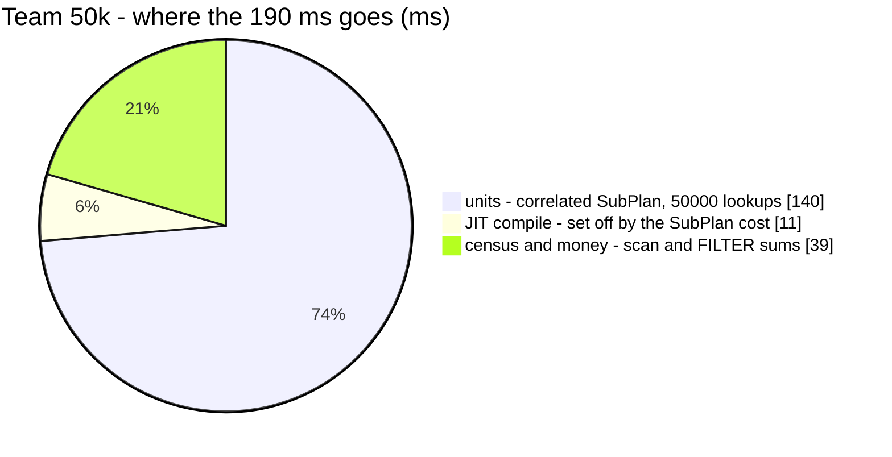
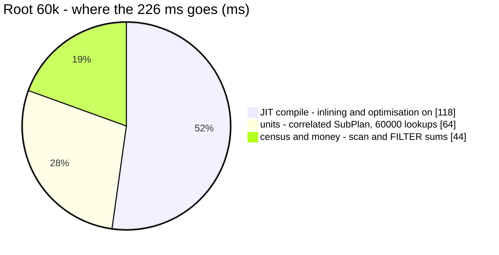

# OrderStat — performance audit

**Verdict:** 🔴 heavy. The units (`item_count`) are a **correlated SubPlan that runs once per order in the team's whole history**. That is 50 000 index lookups every time the header loads, and about 80% of the query. The SubPlan also inflates the planner's cost estimate enough to switch Postgres JIT on, and past ~58 000 orders it switches on JIT's optimiser too: +~120 ms.
**Measured:** 2026-10-22 · `selling_service/selling_v1/order_stat.go` (+ `scopedOrders` in `order_list.go`) · seed **60 000 `orders`** (50 000 for team 2, 10 000 over four other teams; 11 statuses, 3 warehouses, ~40% "measurable") + **150 000 `order_items`** (2–3 per order) · warm, median of 5. The whole test was repeated 7 times, and every figure below is the median of those 7 runs.

| | team 50k (the header as it opens) | root (every team, 60k) |
| --- | --- | --- |
| wall | **190 ms** (7 runs: 100–195) | **252 ms** (218–316) |
| db | = wall | = wall |
| in Go (wall − db) | < 1.5 ms | < 1.5 ms |
| queries | 1 | 1 |

✅ **No N+1 in the query count**: 1 query for 2 500 orders in scope and for 50 000. The N+1 is **inside the plan**: `SubPlan 1 … loops=50000`.





---

## Queries

| # | What | Rows in scope | Time | Plan | Verdict |
| --- | --- | --- | --- | --- | --- |
| 1 | `SELECT status, COUNT(*), SUM(total), SUM((SELECT SUM(oi.quantity) … WHERE oi.order_id = orders.id)), … FILTER (WHERE measurable) … GROUP BY status`, team, no filter | 50 000 | 190 ms | Seq Scan `orders` + **SubPlan ×50 000** on `order_items_order_idx`, JIT on | 🔴 |
| 1 | same, team of 2 500 | 2 500 | 6 ms | BitmapOr `orders_team_idx`/`orders_warehouse_idx` + SubPlan ×2 500 | ok, but ⚠ the generic plan (finding 3) |
| 1 | same, `warehouse_id = 900` (new filter) | 16 667 | 54 ms | Bitmap `orders_warehouse_idx` + SubPlan ×16 667, JIT on | 🟡 > 50 ms |
| 1 | same, search `JX00000123` (now over `receipt` too) | 75 match | 64 ms | **Seq Scan**, 4 × `ILIKE '%…%'`, Rows Removed 59 925 | 🟡 finding 4 |
| 1 | same, root | 60 000 | 252 ms | Seq Scan + SubPlan ×60 000, **JIT inlining + optimisation** | 🔴 |

The measurable FILTERs (`cogs > 0 AND marketplace_total > 0 AND warehouse_fee IS NOT NULL`) cost nothing measurable. They are evaluated on rows the scan already holds, and shape B below includes them.

---

## Findings

### 1. The units are a per-order SubPlan over the WHOLE scope 🔴

A list page runs this subquery 20 times. The stat runs it once for **every order the team has ever had**, because the census has no window. Each loop costs ~3 µs and ~3–6 buffer hits: 151 000–284 000 hits per call, against 1 667–5 617 for the scan itself.

```
GroupAggregate  (cost=7856.88..434828.36 rows=11) (actual time=104.190..211.366 rows=11 loops=1)
  Buffers: shared hit=203982, temp read=415 written=416
  ->  Sort  (actual time=94.778..117.660 rows=50000)   Sort Method: external merge  Disk: 3320kB
        ->  Seq Scan on orders  (actual time=11.477..24.255 rows=50000)
              Filter: ((team_id = 2) OR (warehouse_id = 2))   Rows Removed by Filter: 10000
  SubPlan 1
    ->  Aggregate  (cost=8.48..8.49 rows=1) (actual time=0.001..0.001 rows=1 loops=50000)
          ->  Index Scan using order_items_order_idx on order_items oi  (actual ... rows=2 loops=50000)
                Buffers: shared hit=200926
JIT: Options: Inlining false, Optimization false, Expressions true   Timing: Total 11.760 ms
Execution Time: 217.623 ms
```

The five shapes below were measured on the same transaction. Each units shape was checked to return the **same per-status `item_count`** as the handler:

| shape | team 50k | team 2.5k | root 60k | |
| --- | --- | --- | --- | --- |
| A as built: correlated SubPlan | 189 ms | 6.4 ms | 226 ms | |
| B no units at all: **the floor** | 39 ms | 2.3 ms | 44 ms | |
| C units JOINed, grouped by status, beside the head (CTE) | 86 ms | **18 ms** | 91 ms | ❌ hash-joins EVERY team's lines, so it is slower for a small team |
| D per-order pre-aggregate, LEFT JOINed | 97 ms | 38 ms | 107 ms | ❌ aggregates the whole `order_items` table on every call |
| E **a column on the row** (proxy: `SUM(o.shipping_cost)`) | **41 ms** | **2.7 ms** | **44 ms** | ✅ = the floor at every scope |

C and D only move the cost around. They scale with the WHOLE `order_items` table (every team's lines) rather than with the caller's slice, so they win for the biggest team and lose for everyone else. E is the only shape whose cost is the census itself.

**→ Recommend: denormalise the units onto the order (E).** I'd pick this. Add `orders.item_quantity BIGINT NOT NULL DEFAULT 0` and write it at placement in `order_place.go`, beside `cogs`, from the same `p.items`. The stat then reads `COALESCE(SUM(item_quantity), 0)`. It measured **4.6× faster at 50k, 5× at root, 2.4× at 2.5k**. The estimated cost drops from ~430 000 to ~6 800, which removes findings 2 and 3 as well, and the plan becomes parallel (B and E run as Parallel Seq Scan + Partial HashAggregate, which A never did in 7 runs).
- **Why it cannot drift today:** order lines are written once, by `order_place.go` (OrderCreate and draft promote both go through it), and nothing in the backend updates or deletes an `order_items` row. ⚠ Any future "edit an order's lines" RPC must rewrite the column in the same transaction.
- **It also serves two other readers:** `orderListColumns` (`order_list.go`) and `order_export.go:95` select the same correlated sum per row, and would read the column instead.
- ⚠ **A naming collision to handle in the same change:** the model already has `ItemQuantity int64 gorm:"->;-:migration"`, filled by `… AS item_quantity`. Once the column exists, `SELECT orders.*, (subquery) AS item_quantity` returns **two** `item_quantity` columns. Drop the subquery in the same commit.
- Cost: 8 bytes a row, one back-fill `UPDATE` in the migration, and one more figure the placement path must get right.

### 2. The SubPlan's cost estimate sets off JIT, and at ~58 000 orders JIT's optimiser 🔴

The planner costs each SubPlan loop at ~8.5, so the statement's estimate is ≈ 8.6 × orders in scope. This Postgres runs with the defaults: `jit_above_cost=100000`, `jit_optimize_above_cost=jit_inline_above_cost=500000`.

| scope | estimated cost | JIT | JIT compile | wall, jit on → off |
| --- | --- | --- | --- | --- |
| team 2.5k | ~23 000 | off | 0 | 6.4 → 5.4 ms (noise, no JIT at this cost) |
| team 50k | ~430 000 | expressions | 11–15 ms | 189 → 179 ms |
| root 60k | ~516 000 | **inlining + optimisation** | **143–150 ms** | 226 → **108 ms** |

So a team whose history passes **~58 000 orders** (500 000 ÷ 8.6) gets a step of more than 100 ms added to every header load, on top of the linear growth. JIT is compiled per execution and is never cached. Shapes B and E are estimated at ~6 800 and never reach the JIT threshold.

**→ Recommend: fix finding 1, and this one goes with it.** Do not tune `jit_*` globally for one query: that changes the plan of every other statement in the database.

### 3. One prepared statement serves every team, and the generic plan is 4× slower for a small team 🟡

pgx prepares the statement once per connection, and every team sends the same SQL text. After five executions Postgres may switch to the **generic plan**, and the 50k team's ~430 000 custom plans make the generic plan look cheap. The generic plan estimates 28 000 rows, so it seq-scans the whole table and sets off JIT (estimated cost 240 325):

| team 2.5k through the handler | median |
| --- | --- |
| `plan_cache_mode = force_custom_plan` | **7 ms** |
| `force_generic_plan` | **29 ms**: Seq Scan of all 60 000 (Rows Removed 57 500) + JIT 14.6 ms |
| unforced, the 50k team having used the statement first (runs 1–2) | 25–38 ms |

Which plan a small team gets depends on **who used the pooled connection before it**.

**→ Recommend: nothing separate.** Finding 1 takes the SubPlan out of the estimate, so the generic plan no longer sets off JIT, and the scan that remains is the floor's (~2–4 ms at this volume). Revisit only if the post-fix stat still shows a bimodal latency.

### 4. The search seq-scans four `ILIKE '%…%'` legs, and `receipt` added the fourth 🟡

64 ms for 75 matches. No b-tree can serve `'%term%'`, so every order in the scope is tested on all four columns. With the same statement and the `receipt` leg removed, it runs 52 ms, so **the new leg costs ~12–24 ms (+21–38%)**. The same predicate runs inside OrderList's count.

**→ Recommend: accept for now, with a trigger.** 00018 decided "not indexed", and at 50k orders that still holds. When the search passes ~150 ms (roughly 150 000 orders in one team's history), propose `pg_trgm` GIN indexes over the four searched columns. Those are write-amplifying, and an owner's call.

### 5. The census floor is linear in the team's history 🟡

Even with no units, the stat reads every order the team has ever had (B: 39 ms at 50k, ≈ 0.8 µs an order). That follows from the design, since `OrderStatusCount` is "a live census, not a window". The floor alone reaches 150 ms near ~190 000 orders.

**→ Recommend: nothing today.** If a team gets there, the options are a per-(team, status) counter maintained by the status-change path (exact, one more write per move) or a census that windows the terminal statuses (`completed`, `cancel`, `return_completed`). I would pick the counter.

---

## Proposed migration

A **proposal**, not applied (HARD RULE 3: it belongs to `selling_service`, and it is the owner's call). It pairs with the write in `order_place.go` and the read change in `order_stat.go`, `order_list.go` and `order_export.go` (finding 1).

```sql
-- backend/services/selling_service/db_migrations/000NN_order_item_quantity.sql
-- +goose Up
-- +goose StatementBegin
ALTER TABLE orders ADD COLUMN item_quantity BIGINT NOT NULL DEFAULT 0;

UPDATE orders o
SET    item_quantity = s.qty
FROM  (SELECT order_id, SUM(quantity) AS qty FROM order_items GROUP BY order_id) s
WHERE  s.order_id = o.id;
-- +goose StatementEnd

-- +goose Down
-- +goose StatementBegin
ALTER TABLE orders DROP COLUMN item_quantity;
-- +goose StatementEnd
```

Cost: 8 bytes a row, and a one-time back-fill that rewrites every order row (run it off-peak). No index is needed, because the column is only ever summed over rows the scan already reads.

---

## Not measured

- **the real column.** E is a proxy: a SUM over an int column the row already carries. The placement path's extra write and the back-fill's time were not measured
- **production's JIT settings.** Managed Postgres may ship `jit = off`. Finding 2 then disappears, but finding 1 does not: A with JIT off is still 179 ms at 50k
- **run-to-run variance.** The 50k median moved between 100 and 195 ms across the 7 runs, and the plan flipped between HashAggregate and Sort (spilling 3.3 MB at `work_mem=4MB`) + GroupAggregate. Pinning either strategy did not consistently win, so the spill is not where the time goes. Dead tuples left by earlier rolled-back seeds change the heap size from run to run. Shape B's floor (35–47 ms) and E (38–48 ms) stayed stable throughout
- the environment: Postgres 17 in Docker on Windows, with temp files on a bind mount
- concurrency (single caller), and a cold buffer cache
- production distribution: real statuses are skewed (most orders end `completed`), and lines per order are not a flat 2.5
- the other filters (`product_id` EXISTS, shop, created window, created-by, seller, marketplace, courier)

---

## Open questions

- [ ] **Denormalise `orders.item_quantity` at placement** (finding 1, my pick), or keep the SubPlan and accept ~3 µs per order in the scope, plus the JIT step past ~58 000 orders? This is a schema change in `selling_service`, so it needs your yes
- [ ] At ~190 000 orders per team: a per-(team, status) counter, or a census that windows terminal statuses (finding 5)? Nothing to decide today

---

## History

| Date | Median (team 50k) | Queries | Change |
| --- | --- | --- | --- |
| 2026-10-22 | 190 ms (root 252 ms) | 1 | first written audit: the units (`item_count`, a per-order SubPlan), the measurable FILTERs, the `warehouse_id` filter and the `receipt` search leg. Measured over 60 000 orders / 150 000 lines |
