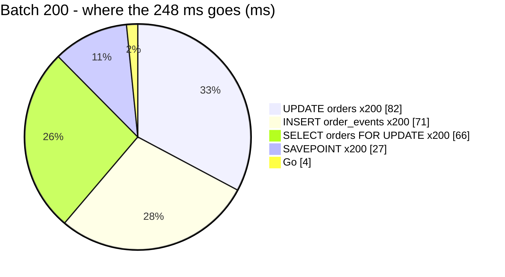

# OrderStatusChange — performance audit

**Verdict:** ✅ **resolved** *(2026-10-21, re-audit)* — the owner took finding 1 ([a-batch-move-saves-in-one-transaction](../../../../docs/technical/frontend/warehouse_order_list_decision.md#a-batch-move-saves-in-one-transaction)). A 200-parcel handover is now **4 queries and 11 ms**, at any batch size. Not heavy. Below is the first audit, kept as the evidence.

**First audit:** 🔴 heavy — the query count grew with the batch: **4 per order**, so a 200-parcel handover was 800 round trips and **248 ms**. Each statement was an index lookup that ran in under 0.1 ms. The time was the round trips.
**Measured:** 2026-10-21 · `selling_service/selling_v1/order_status_change.go` · seed 50 000 rows in `orders` (11 statuses, 3 warehouses, 5 teams) · `processed → picked` by warehouse 900 · warm, median of 5

| | batch 20 | batch 200 |
| --- | --- | --- |
| wall | 22.0 ms | **247.8 ms** |
| db | 21.6 ms | 243.3 ms |
| in Go (wall − db) | ~0.1–1.2 ms | 3–7 ms |
| queries | 80 | **800** |
| per order | 4 · 1.1 ms | 4 · 1.2 ms |



---

## Queries

| # | What | Rows | Time | Plan | Verdict |
| --- | --- | --- | --- | --- | --- |
| 1 | `SAVEPOINT` (in production: `BEGIN` … `COMMIT`, **two** round trips) **×N** | — | 0.13 ms ea | — | 🔴 per order |
| 2 | `SELECT * FROM orders WHERE id = ? AND (team_id = ? OR warehouse_id = ?) … FOR UPDATE` **×N** | 1 | 0.33 ms ea · executes in 0.05 ms | Index Scan `orders_pkey` → LockRows | 🔴 per order |
| 3 | `UPDATE orders SET status, updated_at WHERE id = ?` **×N** | 1 | 0.41 ms ea · executes in 0.08 ms | Index Scan `orders_pkey` | 🔴 per order |
| 4 | `INSERT INTO order_events …` **×N** | 1 | 0.36 ms ea · executes in 0.08 ms | — | 🔴 per order |

✅ Every plan is a primary-key lookup. **No index is missing** and the table size does not matter. What costs is how many statements are sent.

---

## Findings

### 1. One transaction per order 🔴

`moveOneOrder` opens a transaction for each id, so every order costs about 5 round trips in production (`BEGIN`, lock, update, history, `COMMIT`). The cost is linear: 1.1–1.2 ms per order on this machine, and more over a real network. The contract allows 200 ids. A van's handover scan or *select all → Move* on a full tab is the case that reaches the cap.

```
LockRows (actual time=0.031..0.031 rows=1)
  -> Index Scan using orders_pkey on orders (actual time=0.029..0.029 rows=1)
Execution Time: 0.054 ms          ← the statement; the call around it took 0.33 ms
```

It was built this way for isolation: one order's failure never blocks the rest. But the spec only asks for **a result per order**: *"one refusal never blocks the rest"*
([one-status-change-for-every-plain-move](../../../../docs/technical/frontend/warehouse_order_list_decision.md#one-status-change-for-every-plain-move)).
A refusal is decided in Go from the locked row, before anything is written, so a set-based write keeps that guarantee.

**→ Recommend: set-based, in one transaction — 4 statements for any batch.**

| step | statement |
| --- | --- |
| lock | `SELECT … FROM orders WHERE id IN (…) AND (team_id = ? OR warehouse_id = ?) ORDER BY id FOR UPDATE` — **id order**, so two batches over the same orders queue rather than deadlock |
| decide | `refuseMove` per row, in Go. An id that is not returned → *"not one of this team's orders"* |
| write | one `UPDATE orders SET status = ?, updated_at = ? WHERE id IN (movable)` — a call has one `to` |
| history | one multi-row `INSERT INTO order_events` |

| | per-order transactions (today) | set-based (proposed) |
| --- | --- | --- |
| round trips, 200 orders | ~1 000 | 4 + `BEGIN`/`COMMIT` |
| a refusal | that order only | that order only — unchanged |
| a **database** failure mid-batch | the orders before it stay moved | the whole batch fails and the caller retries. Every order reports the same error |
| locks held | one row at a time | up to 200 rows, for the few ms the batch takes, taken in id order |

I would pick **set-based**. A database failure is not a business refusal: retrying the whole scan is the right answer to it, and it is rare. The lock-order rule (id order) is the one [lock-order.md](../concurrency/lock-order.md) already asks of a multi-row lock. ⚠ The [concurrency proofs](../concurrency/lock-order.md) must be re-run on the new shape, the opposite-order batch test above all.

---

## Not measured

- a real network — this is a laptop talking to a Postgres container. A cross-zone round trip multiplies finding 1
- concurrency: the [concurrency audit](../concurrency/lock-order.md) covers it — safe today, single row per transaction
- the frontend's batches: how often a crew actually sends more than ~30 ids (the handover scan accumulates, *select all* takes a page)

---

## Open questions

✅ None. *Set-based, or one transaction per order?* was answered **set-based** (2026-10-21) —
[a-batch-move-saves-in-one-transaction](../../../../docs/technical/frontend/warehouse_order_list_decision.md#a-batch-move-saves-in-one-transaction).

## Re-audit — after the fix (2026-10-21)

| | batch 20 | batch 200 |
| --- | --- | --- |
| wall, median | **2.4 ms** (was 22.0) | **11.4 ms** (was 247.8) |
| queries | **4** (was 80) | **4** (was 800) |

| # | What | Rows | Time at 200 |
| --- | --- | --- | --- |
| 1 | `SELECT … WHERE id IN (…) AND (team_id = ? OR warehouse_id = ?) ORDER BY id FOR UPDATE` | 200 | 1.5 ms |
| 2 | `UPDATE orders SET status, updated_at WHERE id IN (…)` | 200 | 4.3 ms |
| 3 | one multi-row `INSERT INTO order_events` | 200 | 5.1 ms |
| 4 | `SAVEPOINT` (production: `BEGIN` / `COMMIT`) | — | 0.5 ms |

The query count no longer moves with the batch. The concurrency proofs were re-run on the new shape: 80/80 at `-count=20`,
the opposite-order batches included ([lock-order](../concurrency/lock-order.md)).

---

## History

| Date | Median (batch 200) | Queries | Change |
| --- | --- | --- | --- |
| 2026-10-21 | 247.8 ms | 800 | first audit |
| 2026-10-21 | 11.4 ms | 4 | set-based: one transaction for the batch — [a-batch-move-saves-in-one-transaction](../../../../docs/technical/frontend/warehouse_order_list_decision.md#a-batch-move-saves-in-one-transaction) |
