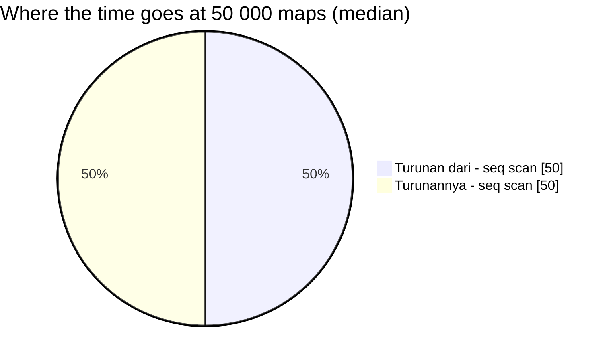

# ProductDerivedList — performance audit

**✅ Fixed 2026-11-27** — selling `00056_product_return_maps_by_product.sql` adds both indexes below
([a-pure-index-is-added-without-asking](../../../../docs/technical/architecture/context_decision.md#a-pure-index-is-added-without-asking):
a pure index, its gain measured). Re-measured with the probe (it now drops them inside its rolled-back transaction for
the before): median wall **2.1–2.4 → 0.52 ms** at 10 000 maps, **7.3–7.9 → 1.0 ms** at 50 000, no Seq Scan in either
plan; the writer 269 → 290 µs at 10 000, 278 → 297 µs at 50 000 (one round trip's noise). The text below is the first
audit, kept as it was.

**Verdict (first audit):** 🟡 heavy by the plan rule — both statements **seq-scan `product_return_maps`**: neither direction can seek on
the table's only index, `(team_id, shared_product_id)`, so each read walks every map. Small today (≈2.5 ms at 10 000
maps, ≈5.5 ms at 50 000), but it grows with every map written, and it runs on every open of a product page and of a
Discover detail.
**Measured:** 2026-11-27 · `selling_service/selling_v1/product_derived_list.go` · seed 10 000 and 50 000 rows in
`product_return_maps` · warm, 5 runs · probe `selling_v1/product_derived_list_perf_test.go`
(`go test -tags perfaudit -run TestPerf_ProductDerivedList -v ./backend/services/selling_service/selling_v1/`)

| @ 50 000 maps | median | max |
| --- | --- | --- |
| wall — Turunannya of a product 25 teams map | 5.6 ms | 7.6 ms |
| wall — Turunan dari of a product 3 land on | 5.2 ms | 6.6 ms |
| wall — a product no map names | 5.1 ms | 6.3 ms |
| in Go (wall − db) | ≈0 ms | 0.3 ms |
| queries | 2 (flat — one per direction, whatever the counts) | |



---

## Queries

| # | What | Rows | Time @50k | Plan | Verdict |
| --- | --- | --- | --- | --- | --- |
| 1 | `SELECT team_id, shared_product_id, own_product_id, created_at, COUNT(*) OVER () … WHERE own_product_id = ? ORDER BY created_at DESC, id DESC LIMIT 200` | 0–3 | ≈2.5 ms | Seq Scan, 50 025 rows removed by the filter | 🟡 seq scan |
| 2 | the same `WHERE shared_product_id = ?` | 0–25 | ≈2.5 ms | Seq Scan, 50 003 rows removed by the filter | 🟡 seq scan |

No N+1 (two statements at any count), bounded result (200 a direction, the cap), no disk sort (quicksort, 25–26 kB).

---

## Findings

### 1. Neither direction has an index to seek on 🟡

`product_return_maps` has one index, the unique `(team_id, shared_product_id)` — the order form's key, read with the
team first. This read has no team: Turunannya filters `shared_product_id` alone (the index's SECOND column) and Turunan
dari filters `own_product_id`, which no index holds. Both walk the table:

```
Limit  (actual time=2.471..2.472 rows=0 loops=1)
  ->  Sort  Sort Key: created_at DESC, id DESC  Sort Method: quicksort  Memory: 25kB
        ->  WindowAgg
              ->  Seq Scan on product_return_maps  (actual time=2.466..2.466 rows=0 loops=1)
                    Filter: (shared_product_id = 999999)
                    Rows Removed by Filter: 50028
Execution Time: 2.492 ms
```

Measured in the same rolled-back transaction with the two single-column indexes added (measure-only — no migration):

| @ maps | direction | today (seq scan) | with the index | plan with it |
| --- | --- | --- | --- | --- |
| 10 000 | Turunannya (25 rows) | 2.5 ms | 0.52 ms | Bitmap Index Scan on `(shared_product_id)`, 0.03 ms execution |
| 10 000 | Turunan dari (3 rows) | 2.6 ms | 0.52 ms | Index Scan on `(own_product_id)`, 0.04 ms execution |
| 50 000 | Turunannya | 5.6 ms | 0.53 ms | Bitmap Index Scan, 0.03 ms execution |
| 50 000 | Turunan dari | 5.2 ms | 0.52 ms | Index Scan, 0.04 ms execution |

With the indexes the wall is the loopback round trip, flat in the table's size. The writer — ProductReturnMapCreate's
`INSERT … ON CONFLICT (team_id, shared_product_id) DO NOTHING`, the table's only one (a map is written once, at the
order form's confirmed pick, and never updated, so no HOT question) — timed over 500 writes in the same process:
**288 → 297 µs** each at 10 000 maps, **274 → 276 µs** at 50 000 — within the noise of one round trip.

**→ Recommend:** A (my pick) — the two single-column indexes below, selling's migration: each direction becomes an index
seek, the writer's cost does not move measurably, and no query or behaviour changes. B — leave it: 5–6 ms at 50 000 maps
is small beside the page's other reads, and the table grows only by one row per (team, borrowed product) ever sold.
C — one composite index on `(shared_product_id, own_product_id)` serves Turunannya only; Turunan dari would still scan.
Not applied by the audit itself (backlog #140's brief); applied after it by the dev bot under
`a-pure-index-is-added-without-asking` — see the top.

---

## Proposed migration

```sql
-- backend/services/selling_service/db_migrations/<next>_product_return_maps_by_product.sql
-- +goose Up
-- Produk Turunan reads a product's maps with no team (produk-turunan-is-the-return-map): every team's map FROM it,
-- and the maps landing ON it. The unique (team_id, shared_product_id) index cannot seek on either.
CREATE INDEX product_return_maps_shared_idx ON product_return_maps (shared_product_id);
CREATE INDEX product_return_maps_own_idx ON product_return_maps (own_product_id);

-- +goose Down
DROP INDEX product_return_maps_own_idx;
DROP INDEX product_return_maps_shared_idx;
```

Cost: two index entries per map written (measured above: no visible change to the write); a map is never updated.
No other read uses them — the order form's ByIds and order create's check keep the unique `(team_id, …)` index.

---

## Not measured

- concurrency (single-caller measurement; the read writes nothing)
- cache-cold behaviour — every run here is warm (`shared hit` only)
- production data distribution — the seed spreads 500 teams over 40 000 borrowed products; a real catalogue is skewed
  (a popular product mapped by many teams is the capped case: at most 200 a direction, each read still one statement)
- the generic plan the server switches to after five runs (`plan_cache_mode = force_generic_plan`) — with a single
  equality filter and no competing index, the seq scan is the only plan today either way

---

## Open questions

- [x] Add the two indexes — settled by the owner's standing `a-pure-index-is-added-without-asking`: selling 00056.

---

## History

| Date | Median @50k | Queries | Change |
| --- | --- | --- | --- |
| 2026-11-27 | 5.2–5.6 ms | 2 | first audit — backlog #140 built the read; indexes measured, not applied |
| 2026-11-27 | 1.0 ms | 2 | selling 00056 — the two single-column indexes (a-pure-index-is-added-without-asking) |
