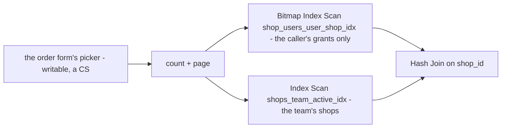

# ShopList — the `writable` filter

**Verdict: ✅ RESOLVED 2026-11-05 — was HEAVY by the plan rule only.** The `Seq Scan` on `shop_users` (a table that grows
with every grant of every team) is gone: selling `00039` adds `shop_users_user_shop_idx (user_id, shop_id)`, and both
statements now probe the caller's grants by index. Re-measured by `TestPerf_ShopListFilters` (`-tags perfaudit`,
`backend/services/selling_service/selling_v1/shop_list_perf_test.go`), case *ShopList writable, a CS*.

| | |
| --- | --- |
| seed | 20 teams × 500 shops (10 000), 3 grants each (30 000 `shop_users`), 40 users — ANALYZEd |
| the call | `ShopList{team 2, filter.writable}` as a CS (no manager role) granted 38 of the team's 500 shops |
| queries | count · page · `loadPrimaries` — 3, not growing with rows |

| | before (no index on `user_id`) | after (`00039`) |
| --- | --- | --- |
| count | `Seq Scan shop_users` (750 kept of 30 000) → Hash Join — **1.89 ms** | `Bitmap Index Scan shop_users_user_shop_idx` (750) → Hash Join — **0.42 ms** |
| page | `Index Scan Backward shop_users_shop_idx`, filtered on `user_id` — **2.41 ms** | `Bitmap Index Scan shop_users_user_shop_idx` → Hash Join — **0.42 ms** |
| median wall, 5 runs | **5.70 ms** | **2.89 ms** |

## Why `(user_id, shop_id)` and not `(user_id)`

The filter reads only those two columns (`EXISTS … su.shop_id = shops.id AND su.user_id = ?`), so a composite index
covers it: on a vacuumed table the planner can answer it index-only, never touching the heap. In the probe it stays a
bitmap heap scan (251 heap blocks) because the seeded rows are in the test's own uncommitted transaction and so not
all-visible — the cost now follows the caller's grants, not every team's. The same index serves the member-removed
listener's `DELETE … WHERE user_id = ?` (leading column), and `shop_users_unique (shop_id, user_id)` still serves every
per-shop read.
