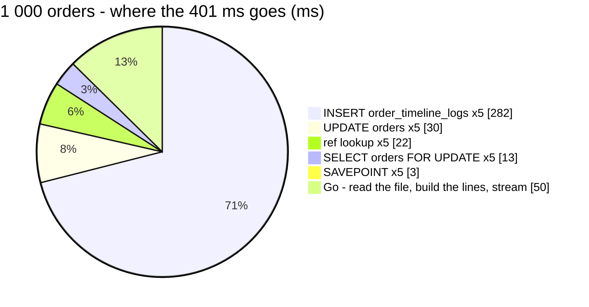

# ShopeeOrderImport — performance audit

Covers **TiktokOrderImport** too: both run `importOrders` ([order_import.go](../../../../backend/services/selling_service/selling_v1/order_import.go)); only the file reader differs.

**Verdict:** 🟡 *(2026-10-30, re-audit)*. [Finding 2](#2-the-ref-lookup-leaves-its-index-past-100-refs-) is fixed. [Finding 1](#1-a-batch-of-timeline-rows-with-a-note-costs-ten-times-one-without-) is traced to **the size of the message on this machine's database connection**, not to the note and not to our code: no code change, and it is to be re-measured on Linux before anything is done. The first audit's verdict follows, kept as the evidence.

**First audit:** 🔴 heavy. The batch timeline INSERT costs **~55 ms per 200 orders** because every import row carries a note. The same INSERT without a note costs ~5 ms, and Postgres executes it in 4.1 ms either way.
**Measured:** 2026-10-30 · seed 50 000 rows in `orders` (10 shops, one holding 10 000) · every order in the file moves `shipping → shipped` (the all-writes worst case) · warm, median of 3 · a CSV export

| | 200 orders | 1 000 orders |
| --- | --- | --- |
| wall | 77.5 ms | **401 ms** |
| db | 66.4 ms | 352 ms |
| in Go (wall − db) | 10.4 ms | 49.6 ms |
| queries | 6 | **26** |



---

## Queries

| # | What | Rows | Time | Plan | Verdict |
| --- | --- | --- | --- | --- | --- |
| 1 | `SELECT * FROM shops WHERE id = ? AND team_id = ? AND deleted = false` | 1 | 1.0 ms | pkey | ok |
| 2 | `SELECT id, … FROM orders WHERE team_id = ? AND shop_id = ? AND status <> 'cancel' AND order_external_ref_id IN (…200)` **×1 per 200** | 200 | 4.2 ms | Bitmap on `orders_shop_idx`, 9 800 removed by filter | 🟡 [finding 2](#2-the-ref-lookup-leaves-its-index-past-100-refs-) |
| 3 | `SAVEPOINT` (production: `BEGIN` / `COMMIT`) **×1 per 200** | — | 0.5 ms | — | ok |
| 4 | `SELECT * FROM orders WHERE id IN (…) … ORDER BY id FOR UPDATE` **×1 per 200** | 200 | 2.0 ms | Index Scan `orders_pkey` | ok |
| 5 | `UPDATE orders SET status, updated_at WHERE id IN (…)` **×1 per 200** | 200 | 5.5 ms | Index Scan `orders_pkey` | ok |
| 6 | `INSERT INTO order_timeline_logs … VALUES (…200 rows)` **×1 per 200** | 200 | **52–57 ms** | executes in 4.1 ms | 🔴 [finding 1](#1-a-batch-of-timeline-rows-with-a-note-costs-ten-times-one-without-) |

---

## Findings

### 1. A batch of timeline rows with a note costs ten times one without 🔴

The import writes `"Shopee order import"` as the note on every move. On the same 50 000-row seed, 200 moves through
`moveOrders` cost:

| | INSERT | the whole move |
| --- | --- | --- |
| `OrderStatusChange`, no note | 4.4–6.0 ms | 12–14 ms |
| `OrderStatusChange` **with** the import's note | **48–54 ms** | 56–64 ms |
| `ShopeeOrderImport` | 52–59 ms | — |

Measured **without the probe** too (a plain `time.Since` around the call), so this is not the probe's SQL formatting. Postgres
executes the statement in 4.1 ms, foreign-key trigger included:

```
Insert on order_timeline_logs  (actual time=0.024..1.733 rows=200 loops=1)
  ->  Values Scan on "*VALUES*"  (actual time=0.004..0.145 rows=200 loops=1)
Trigger for constraint order_timeline_logs_order_id_fkey: time=2.342 calls=200
Execution Time: 4.111 ms
```

So ~45 ms per 200 rows is spent between GORM's `Create` and the server: building, binding or sending a 1 200-parameter
statement whose string values are not empty. **The cause is not pinned.** It is in `recordTimelineLogs`, shared with
every batch move, so it also slows `OrderStatusChange` whenever a batch carries a note (a hand-back to pending, for example).

**→ Recommend:** pin the cause before choosing a fix. One experiment would settle it: run the same 200-row INSERT through
`tx.Exec` with the same arguments. If that is fast, the cost is GORM's `Create`, and `recordTimelineLogs` should write
through `Exec`. That helps every batch move, not only the import. I would not drop the note: it is the only thing on an
order's timeline that says a move came from a file and not from a person's click.

**🔄 Re-audit (2026-10-30), at the owner's *"yes"* to run that experiment.** It is **not GORM, and not the note**. Each line
is one 200-row INSERT into the seeded test database, three runs each:

| how the INSERT is sent | note | rows | time |
| --- | --- | --- | --- |
| GORM `Create` · `tx.Exec` | `""`, `"x"`, `"a b"`, `"abcde"` | 200 | 4–6 ms |
| GORM `Create` · `tx.Exec` | `"xxxxxxxx"`, `"Shopee order import"` | 200 | **48–71 ms** |
| `tx.Exec`, the note written INTO the SQL text, not a parameter | any of the above | 200 | 4–7 ms |
| `tx.Exec` | `"a b"` | **400** | **64–73 ms** |
| `tx.Exec` | `"a b"` | **800** | 55–122 ms |

The slowdown follows **the size of the parameters sent with the statement**, whatever their content. It is a near-fixed
~50–60 ms step once they pass a threshold, and it does not double when the rows do. Postgres executes the statement in
4 ms (the EXPLAIN above). A fixed step triggered by message size is the signature of the transport (TCP delayed
acknowledgement on a hop that buffers), here **Docker's port forward on Windows** to `:5433`, not of the query or the ORM.
⚠ That last step is inferred, not proved: there is no Linux host in this audit to show the step disappear.

**→ Recommend:** no code change. `recordTimelineLogs` stays as it is (switching to `Exec` measured the same). Re-run
`TestPerf_OrderImport` on Linux — CI, or the production-like host — before acting. If the step is still there, the next
place to look is the driver's connection settings, not this handler.

### 2. The ref lookup leaves its index past 100 refs 🟡

`orders_team_external_ref_idx` is partial (`WHERE order_external_ref_id <> ''`). Postgres can prove that an `IN` list
implies `<> ''` only for lists of **up to 100** items. A batch here is 200, so the planner cannot use the index and reads
the whole shop, or the whole table, instead. Measured on the seed:

| refs | plan | time |
| --- | --- | --- |
| 100 | Index Scan `orders_team_external_ref_idx` | 0.14 ms |
| 101 | **Seq Scan on orders** | 10.7 ms |
| 200 | **Seq Scan on orders** | 10.9 ms |
| 200, plus `AND order_external_ref_id <> ''` | Index Scan `orders_team_external_ref_idx` | **0.22 ms** |

It grows with the team's order history, not with the file. `OrderByExternalRefs` already writes the `<> ''`, so it is
unaffected.

**→ Recommend:** add `AND order_external_ref_id <> ''` to `matchImported`'s WHERE. It is one line, needs no migration,
and keeps the lookup on the index at any batch size. (Shrinking the batch to 100 also works, but it doubles the queries.)

**✅ Fixed (2026-10-30)**, at the owner's *"yes"*. The lookup is now `Index Scan using orders_team_external_ref_idx`,
0.29 ms for 200 refs (it was 4.2 ms on the shop index, 10.9 ms when it seq-scanned).

### 3. The query count grows with the file, in batches of 200 🟡

The import runs one lookup per 200 refs, and one `moveOrders` transaction (lock, UPDATE, INSERT) per target status per
200 orders. That is 1 + 5 queries per 200 orders: 26 for 1 000. The number of round trips is fixed per batch, not per
order, so this is not an N+1.

**→ Recommend:** keep it. A batch of 200 holds its row locks for one short transaction; larger batches would trade lock time
for fewer round trips, and an import is already a streamed long task. With findings 1 and 2 fixed, 1 000 orders would be
about 26 queries and ~100 ms.

---

## Not measured

- **TikTok's reader** — same core, so the queries are identical; the file read was not timed separately
- **a large real `.xlsx`** — a CSV was imported; excelize on a multi-thousand-row sheet is Go time this audit did not see
- **a real broker** — events went to `EmptySender`, which validates and drops them. In production `publishMoves` waits for
  each batch's acknowledgements (16 in flight)
- concurrency — see [lock-order](../concurrency/lock-order.md): two races were run, both safe
- cache-cold behaviour, and real data distribution

---

## Open questions

- [ ] **Finding 1:** re-run `go test -tags perfaudit -run TestPerf_OrderImport` on a Linux host. If the ~50 ms step per
  large statement is gone there, close this file; if not, look at the driver's connection settings.

---

## History

| Date | Median @1 000 | Queries | Change |
| --- | --- | --- | --- |
| 2026-10-30 | 401 ms | 26 | first audit |
| 2026-10-30 | 373 ms | 26 | the lookup keeps its index (finding 2). Finding 1 traced to message size on the local connection — no change |
