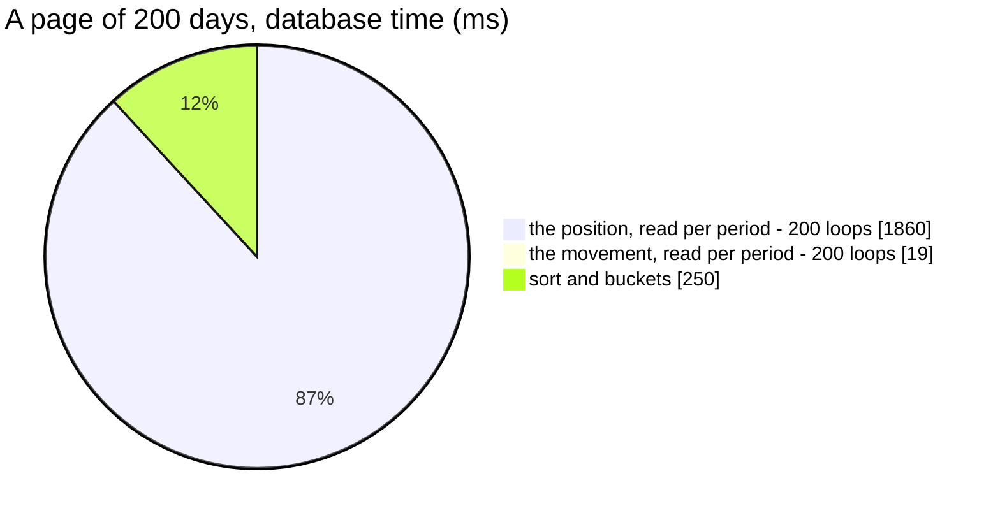

# MetricData — performance audit

**Verdict:** 🔴 heavy — a page of DAILY periods re-reads each period's position from the whole history (285 ms at
20 days, 1 681 ms at 200), and a page of 200 shops spills the team's history to temp (231 ms). Both are the
findings of the reads it replaced, carried over unchanged: [AnalyticTimeSearch finding 1](./AnalyticTimeSearch.md#1-the-position-is-recomputed-per-bucket-over-the-whole-history-)
and [AnalyticGroupSearch finding 1](./AnalyticGroupSearch.md). Nothing got slower in the move; nothing got faster either.
**Measured:** 2026-10-30 · `settlement_service/settlement_v1/metric_data.go` (+ `metric_shared.go`) · seed 100 000 rows
in `shop_settlement_daily_reports` (2 teams × 200 shops × 250 days) + 50 000 in `user_settlement_daily_reports` · warm,
median of 5, on a FRESH `warehouse_test` (a reused one read the same within noise) · [`analytic_perf_test.go`](../../../../backend/services/settlement_service/settlement_v1/analytic_perf_test.go) (`-tags perfaudit`)

Headline case: the Settlement Report's series — a page of 20 days.

| | median | max |
| --- | --- | --- |
| wall | 285 ms | ~290 ms |
| db | 285 ms | |
| in Go (wall − db) | < 0.2 ms | |
| queries | 1 at every key count — no N+1 | |



### Every case

| Case | median | |
| --- | --- | --- |
| SUMMARY · 30 d (the report's default headline) | 17.6 ms | ok |
| SUMMARY · 250 d | 39.7 ms | ok |
| DAILY · 20 days (the report's series page) | **285 ms** | 🔴 |
| DAILY · 200 days | **1 681 ms** | 🔴 |
| MONTHLY · 250 d · 9 months | 101 ms | ok — 9 loops |
| DAILY · one person · 20 days | 0.8 ms | ok |
| SHOP · 30 d · 20 ids | 5.7 ms | ok |
| SHOP · 30 d · 200 ids | **231 ms** | 🔴 |

---

## Queries

| # | What | Rows | Time | Plan | Verdict |
| --- | --- | --- | --- | --- | --- |
| 1 | a period: `unnest(buckets)` ⟕ LATERAL Σ movement ⟕ LATERAL `DISTINCT ON (shop_id, team_id) … day <= bucket_to` | ≤ 200 | 9.3 ms **per period** | Nested Loop, **loops=200** over a Bitmap Heap Scan of **30 100 rows + sort** each | 🔴 plan-level N+1 |
| 1 | an id: `scoped` CTE of `r.*` up to the window's end, `latest` per position, `moves` in the window | ≤ 200 | 5.5 ms @ 20 · 240 ms @ 200 | CTE materialised (read twice) with **temp written=1 135**, Sort 50 000 → Unique | 🔴 at 200 |
| 1 | SUMMARY: the period shape with one bucket | 1 | 19–39 ms | one loop | ok |

---

## Findings

### 1. A period's position is recomputed over the whole history, once per period 🔴

The same plan as [AnalyticTimeSearch finding 1](./AnalyticTimeSearch.md#1-the-position-is-recomputed-per-bucket-over-the-whole-history-),
because it is the same SQL (`timeBase`):

```
->  Aggregate  (actual time=9.330..9.330 rows=1 loops=200)
      ->  Unique  (actual time=7.586..9.319 rows=200 loops=200)
            ->  Sort  (actual time=7.513..8.246 rows=30100 loops=200)
                  ->  Bitmap Heap Scan on shop_settlement_daily_reports r_1  (actual rows=30100 loops=200)
                        Index Cond: ((team_id = 2) AND (day <= t.bucket_to))
Execution Time: 2131.125 ms
```

It grows with **page size × history length**. A month or a year is cheap only because there are few of them.

**→ Recommend: the running sum** that audit proposed, unanswered since 2026-09-14 — `close(D) = Σ change over every row
with day ≤ D` ([the-carry-materialises-the-day-boundary-position](../../../../docs/business/settlement/context_decision.md#the-carry-materialises-the-day-boundary-position)),
summed per day once and carried with `SUM(change) OVER (ORDER BY day)`. One index range, one sort, no loop. The trade
is unchanged: it reads the position from `change` rather than from the stored `close_balance`, and the two disagree
only on a table whose carry has drifted.

### 2. An id page materialises every column of the team's history 🔴 at 200 ids

`idBase`'s `scoped` CTE is `SELECT r.*` up to the window's end, read by both `latest` and `moves`, so Postgres
materialises it — 50 000 rows of 30 columns, spilled to temp (`temp written=1135`, 126 ms of the 144). At 20 ids the
`IN` narrows it to 20 shops' rows and it costs 5.5 ms; at 200 it is the whole team.

**→ Recommend:** the narrowing [AnalyticGroupSearch finding 1](./AnalyticGroupSearch.md) proposed — select only the
columns `latest` and `moves` read (the key, the position columns, `day`, `close_balance`, the 13 type columns) so the
CTE fits in memory, or read `latest` from the running sum of finding 1 and drop the CTE. Either is a handler change, no
schema change.

---

## Proposed migration

None. `shop_settlement_daily_reports_team_day_idx` and the `(shop_id, team_id, day)` unique index are both used; the
cost is the work per period and the width of the CTE, not the access path.

---

## Not measured

- concurrency — single caller
- cache-cold behaviour — every buffer was a `hit`
- production distribution — the seed is uniform, a row per shop per day. Real shops are sparse, which shrinks the
  per-period sort but not the history it reads
- the ROOT-team scope — the same shape over every team's rows, so strictly worse
- WEEKLY — between DAILY and MONTHLY by construction: one loop per week

---

## Open questions

- [ ] Adopt the running sum (finding 1)? It also removes finding 2's `latest`. **I would** — it is the decided
  definition, read once instead of once per period.

---

## History

| Date | Median | Queries | Change |
| --- | --- | --- | --- |
| 2026-10-30 | 285 ms @ 20 days · 1 681 ms @ 200 · 5.7 / 231 ms @ 20 / 200 shops · 17.6 ms headline | 1 | first audit — the reads it replaced, carried over |
