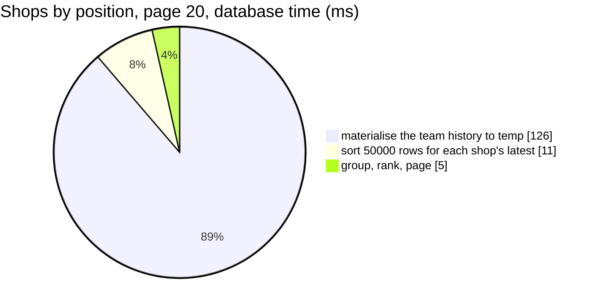

# MetricSearch — performance audit

**Verdict:** 🔴 heavy — ranking the shops or the people of a team reads and sorts its whole history (137 ms), and
ranking DAILY periods — new with the pattern — pays [MetricData finding 1](./MetricData.md#1-a-periods-position-is-recomputed-over-the-whole-history-once-per-period-)
for every period of the window (1 550 ms at 250 days). The id ranking is HALF what it replaced
([AnalyticGroupSearch](./AnalyticGroupSearch.md), 261 ms): the pattern has no COUNT, so the definition is read once.
**Measured:** 2026-10-30 · `settlement_service/settlement_v1/metric_search.go` (+ `metric_shared.go`) · the same seed as
[MetricData.md](./MetricData.md) — 100 000 shop-day rows + 50 000 person-day rows · warm, median of 5, on a FRESH `warehouse_test` ·
[`analytic_perf_test.go`](../../../../backend/services/settlement_service/settlement_v1/analytic_perf_test.go) (`-tags perfaudit`)

Headline case: the Settlement Report's ranking — shops by position, 30-day window, page 20.

| | median | max |
| --- | --- | --- |
| wall | 138 ms | ~141 ms |
| db | 138 ms | |
| in Go (wall − db) | < 0.5 ms | |
| queries | 1 at page 20 and at page 200 — no N+1 | |



### Every case

| Case | median | |
| --- | --- | --- |
| SHOP · 30 d · page 20 | **138 ms** | 🔴 |
| SHOP · 30 d · page 200 | **142 ms** | 🔴 |
| USER · 30 d · page 20 | **143 ms** | 🔴 |
| DAILY · 250 d · page 20 | **1 550 ms** | 🔴 |

---

## Queries

| # | What | Rows | Time | Plan | Verdict |
| --- | --- | --- | --- | --- | --- |
| 1 | an id group: `idBase` … `ORDER BY <field> <dir>, k DESC OFFSET LIMIT n + 1` | ≤ 201 | 144 ms | CTE `scoped` of `r.*`, **temp written=1 135**, Sort 50 000 → Unique → GroupAggregate | 🔴 |
| 1 | a time group: `timeBase` over every period of the window, ordered, paged | ≤ 201 | 2 002 ms (EXPLAIN) | Nested Loop, **loops=250**, Sort of 25 100 rows each | 🔴 plan-level N+1 |

---

## Findings

### 1. An id ranking materialises every column of the team's history 🔴

The same CTE as [MetricData finding 2](./MetricData.md#2-an-id-page-materialises-every-column-of-the-teams-history--at-200-ids),
with no `IN` to narrow it — a ranking needs every key:

```
CTE Scan on scoped  (actual time=1.140..126.047 rows=50000 loops=1)
  Buffers: shared hit=1278, temp written=1135
Sort  (actual rows=50000)  Sort Key: scoped.shop_id, scoped.team_id, scoped.day DESC
Execution Time: 144.087 ms
```

**→ Recommend:** the same fix as MetricData's — narrow the CTE to the columns it is read for, or rank from the running
sum. ✅ Already better than what it replaced: the old search ran this definition twice, once for its COUNT.

### 2. A daily ranking reads a position per period of the window 🔴

New with the pattern: the old reads could not rank periods at all. Every period is a row (a quiet day still holds a
position), so ranking 250 days by `position_to_date` reads 250 positions — MetricData finding 1, × the window. The span
is capped (366 days, 260 weeks, 60 months, 20 years), so it is bounded, but at ~6 ms a period.

**→ Recommend:** the running sum (MetricData finding 1) fixes this too — the whole window's positions come out of one
pass. Until then nothing asks it: the Settlement Report lists its periods newest first and ranks only shops and people;
the Analytic screen ranks a period only when someone sorts a time table by a field.

---

## Proposed migration

None — see [MetricData.md](./MetricData.md#proposed-migration).

---

## Not measured

- concurrency — single caller
- cache-cold behaviour — every buffer was a `hit`
- the ROOT-team scope — every team's history, so strictly worse
- WEEKLY / MONTHLY / YEARLY rankings — fewer periods, the same per-period cost

---

## Open questions

- [ ] The running sum — one question for both RPCs, asked in [MetricData.md](./MetricData.md#open-questions).

---

## History

| Date | Median | Queries | Change |
| --- | --- | --- | --- |
| 2026-10-30 | 138 ms @ shops, page 20 · 142 ms @ page 200 · 1 550 ms @ 250 days | 1 | first audit |
