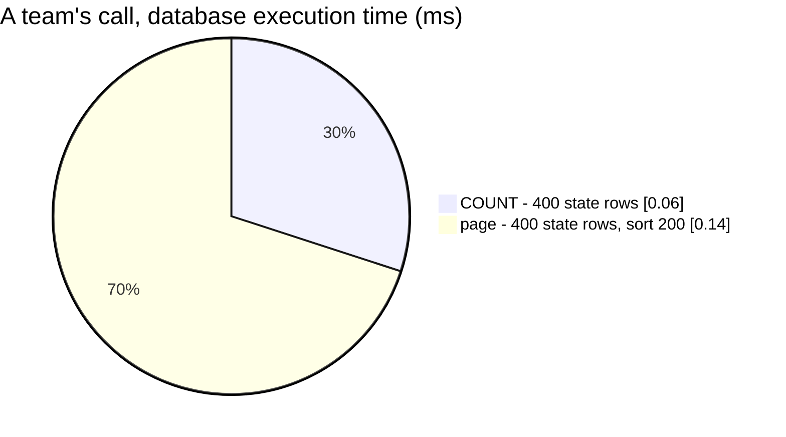

# SettlementPersonList — performance audit

**Verdict:** 🟢 resolved — both queries read `user_settlement_reports`, one row per (person, team), never the daily rows.
1.06 ms team, 1.04 ms root at 100 000 person-day rows (was 28 / 31 ms, a seq scan of `user_settlement_daily_reports`);
it no longer grows with the team's history, only with its number of people.
**Measured:** 2026-11-04 (re-measured after
[the-person-list-reads-the-last-day-from-the-user-report](../../../../docs/business/settlement/context_decision.md#the-person-list-reads-the-last-day-from-the-user-report),
migration `00008`) · `settlement_service/settlement_v1/settlement_person_list.go` · two teams × 200 people × 250 days =
100 000 person-day rows, half another team's, plus their 400 person state rows · warm, median of 5 ·
[`settlement_person_list_perf_test.go`](../../../../backend/services/settlement_service/settlement_v1/settlement_person_list_perf_test.go) (`-tags perfaudit`)

| Case | before (daily scan) | after (`last_day`) | queries | |
| --- | --- | --- | --- | --- |
| a selling team, page 1 × 200 | 28 ms | 1.06 ms | 2 | 🟢 |
| the root team, page 1 × 200 | 31 ms | 1.04 ms | 2 | 🟢 |

No N+1 (2 queries at any page), no Go time (wall ≈ db), the page is bounded (`CommonPagination`, ≤ 200). Of the ≈ 1 ms
wall, the database executes ≈ 0.2 ms (EXPLAIN below); the rest is the local Docker loopback's ≈ 0.5 ms per round trip.

## Queries

| # | SQL | rows read | plan |
| --- | --- | --- | --- |
| 1 | `SELECT COUNT(*) FROM user_settlement_reports WHERE user_id <> 0 AND last_day IS NOT NULL AND team_id = ?` | 400 | Seq Scan (5 pages) → Aggregate, 0.06 ms |
| 2 | `SELECT user_id, last_day … ORDER BY last_day DESC, user_id DESC LIMIT 200` | 400 | Seq Scan (5 pages) → Sort, 0.14 ms |
| 1 root | `SELECT COUNT(DISTINCT user_id) … WHERE user_id <> 0 AND last_day IS NOT NULL` | 400 | Seq Scan → Sort → Aggregate, 0.10 ms |
| 2 root | `SELECT user_id, MAX(last_day) … GROUP BY user_id ORDER BY last_day DESC, user_id DESC LIMIT 200` | 400 | Seq Scan → HashAggregate → Sort, 0.19 ms |

At 400 rows (5 pages) the planner rightly seq-scans. With many teams, a team's page is answered by
`user_settlement_reports_team_last_day_idx (team_id, last_day, user_id)` — read backwards for `DESC`, already in order,
stopping at the limit. The root team's read is a scan of the state table by design: it lists every team's people, a
person once at their latest day, so it is bounded by people × teams, not by days.

## Findings

### 1. The last day per person was recomputed from every daily row ✅ resolved

`user_settlement_reports.last_day` (`00008`, backfilled from the daily table) is raised by the fold with `GREATEST` from
the newest daily row it already derives `close_balance` from, and recomputed as `MAX(day)` by `AnalyticReplayCompute`
for the rows its cut reached. The list reads it directly.

### 2. The COUNT read the same rows a second time ✅ resolved

It is now a count of the same ≤ people-per-team state rows (0.06 ms); no window needed.

Nothing further to apply.
