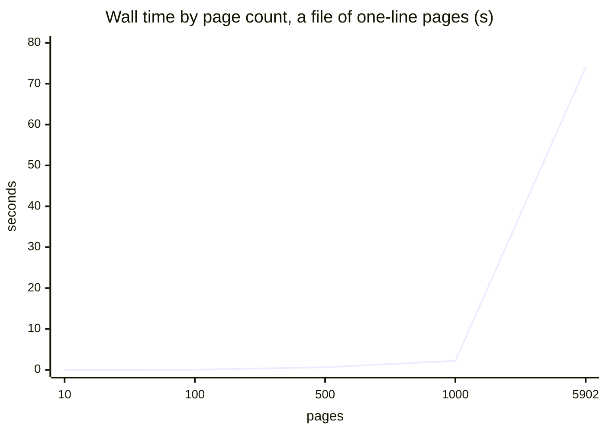
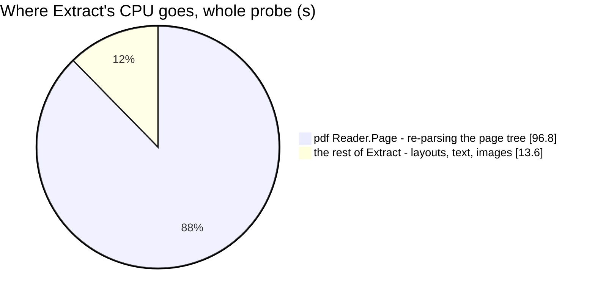

# ReceiptCheck — performance audit

**Verdict:** 🔴 heavy — not on a real label (median **5.5 ms**, slowest 54 ms), but on the worst file the contract
admits: **2 MB of PDF pages costs 9.6 s to 74 s of CPU per call**, growing with the SQUARE of the page count, and any
signed-in user may send it.
**Measured:** 2026-10-23 · `shipment_service/shipment_v1/receipt_check.go` → `san_receipt_readers.Extract` · no table
(0 queries, proved through the probe) · the 41 label samples in `examples/receipt_file_samples/`, then synthetic PDFs
up to `max_len` · warm, 5 runs (a call over a second: once, cold) · probe `receipt_check_perf_test.go` (tag `perfaudit`)

| file | pages | size | result | median wall |
| --- | --- | --- | --- | --- |
| the 41 real samples | 1–2 | 23–244 KB | 38 READ, 3 NOT_SHIPPING_LABEL | **5.5 ms** (slowest `shopee_std_01.pdf` 54 ms) |
| 2 MB, a header and zeros | — | 2 MB | UNREADABLE | 1.0 ms |
| a bulk print of J&T labels | 100 | 99 KB | UNKNOWN_LABEL | 38 ms |
| | 1 000 | 995 KB | UNKNOWN_LABEL | 2.2 s |
| | **2 105** | **2 MB** | UNKNOWN_LABEL | 🔴 **9.6 s** |
| pages no layout reads | 100 | 35 KB | NOT_SHIPPING_LABEL | 27 ms |
| | 1 000 | 353 KB | NOT_SHIPPING_LABEL | 2.2 s |
| | **5 902** | **2 MB** | NOT_SHIPPING_LABEL | 🔴 **74 s** |

Garbage collection ran another **131 s** on the other cores during the same 110 s of `Extract` — the re-parsed objects
are allocated afresh each time.

---

## Findings

### the-page-lookup-is-quadratic

🔴 `Extract` reads page `i` with the PDF library's `Reader.Page(i)` for every `i` up to the page count. That call walks
the page tree's `Kids` from the root and **re-parses each kid object** to read its `/Type` — the library caches no
object — so reading N pages parses about N²⁄2 objects. Ten times the pages is 60–80× the time (100 → 1 000 pages:
38 ms → 2.2 s for labels, 27 ms → 2.2 s for one-line pages). The profile puts 96.8 s of `Extract`'s 110.4 s under `Reader.Page` → `Value.Index` → `resolve` →
`readObject`.

**→ Recommend:** a **page cap in the reader, before the page loop** — `reader.NumPage()` is read from the root's
`/Count`, which is also exactly how many pages `Extract` would visit, so the check bounds the work it guards. Every
sample whose page tree is readable without decompressing (27 of the 41) has 1 or 2 pages; a cap of **10** leaves room
for a label with a packing slip and refuses a bulk print almost free. It is a change to `san_receipt_readers` (the
owner's submodule), so it is not made here. Walking the page tree once instead of calling `Page(i)` would remove the
square too, but it means not using the library's own page accessor — the cap is smaller and enough.

**→ Decided (2026-10-23):** declined — no page limit. See [Open questions](#open-questions).

### a-signed-in-caller-can-pin-a-core

🔴 [receipt-check-needs-a-login](../../../../docs/business/shipment/context_decision.md#receipt-check-needs-a-login)
closed the door to an ANONYMOUS loop for exactly this reason, and it holds — but every signed-in user can still send a
2 MB file of 5 902 pages, and each call holds a core for over a minute (and the GC a second one). `Extract` takes no
context, so a cancelled request does not stop it: a client that gives up and retries starts a second one. Ten such
requests in flight is ten cores, whatever the 3 MB body cap says
([receipt-check-caps-the-body-before-reading](../../../../docs/business/shipment/context_decision.md#receipt-check-caps-the-body-before-reading)
bounds MEMORY, not CPU).

**→ Recommend:** the page cap above removes it at the root. Until it lands, a **concurrency limit on the handler** (a
small semaphore, e.g. 2–4 checks at once, the rest answered `ResourceExhausted` at once) keeps it to those cores — the
order form already treats a failed check as "no check" (`checkLabel` returns `null`), so a refused check costs the
person nothing but the autofill. I would take the cap and skip the semaphore: one is a fix, the other a fence around it.

**→ Decided (2026-10-23):** the other way round — the fence, 2 at once, and no cap. See [Open questions](#open-questions).

### a-bulk-print-is-read-to-its-last-page

🟡 A file of several labels is refused (it is never read as page 1), but only after **every** page has been laid out
and matched — the bulk print of 2 105 labels knows it is a bulk print at page 2 and reads 2 103 more. With the cap this
costs at most ten pages; without it, it is half of the worst case above.

**→ Recommend:** let `Extract` stop at the second label found — it is the same refusal, decided as soon as it is true.
A one-line change in the reader, independent of the cap.

**→ Decided (2026-10-23):** not taken — it is the reader's. See [Open questions](#open-questions).

---

## Not measured

- concurrency — single caller; the CPU-per-call figures above are what a concurrent load multiplies
- a real label PRINTED AS A PICTURE at scale — barcode decoding costs a few ms an image, and a 2 MB file of image-only
  pages was not built (the synthetic pages are text)
- PDFs whose objects sit in compressed object streams (14 of the 41 samples): their page tree is parsed through
  decompression, which can only make the per-object re-parse dearer
- the network: base64 JSON decoding of a 2 MB body before the handler runs (sub-millisecond next to the above)

---

## Open questions

Answered by the owner on 2026-10-23 —
[an-attached-file-is-up-to-15-mb-and-two-checks-run-at-once](../../../../docs/business/shipment/context_decision.md#an-attached-file-is-up-to-15-mb-and-two-checks-run-at-once):

- [x] **The page cap** — ❌ **declined.** *"we dont care about page count"*: no page limit, anywhere. A file is never
  counted or refused for its pages, so one call's worst case stands.
- [x] **A concurrency limit on the handler** — ✅ **taken, 2 at once.** A third check is `ResourceExhausted` at once,
  never queued, and the order form answers it as "no check". Built in `shipment_v1/receipt_check.go`.
- [x] **Stop at the second label** — ❌ **not taken.** It lives in the reader (`san_receipt_readers`), and the decision
  keeps this work inside this repository.
- [x] **Raise the check to 15 MB** — ❌ **not taken** (2026-10-26,
  [the-label-check-stays-at-2-mb](../../../../docs/business/shipment/context_decision.md#the-label-check-stays-at-2-mb)).
  The check reads up to 2 MB, so the worst case above is a 2 MB file, not a 15 MB one.

---

## History

| Date | Real labels (median) | Worst admitted file | Queries | Change |
| --- | --- | --- | --- | --- |
| 2026-10-23 | 5.5 ms | 74 s (5 902 pages, 2 MB) | 0 | first audit |
| 2026-10-23 | 5.5 ms | 74 s (5 902 pages, 2 MB) — unchanged | 0 | two checks at once, the rest `ResourceExhausted` ([an-attached-file-is-up-to-15-mb-and-two-checks-run-at-once](../../../../docs/business/shipment/context_decision.md#an-attached-file-is-up-to-15-mb-and-two-checks-run-at-once)). The page cap was declined, so ONE call's worst case is the same 74 s — what changed is how many run: two at most, each a core plus its garbage collection, where before it was as many as callers sent. Not re-measured: nothing on the call path changed |
