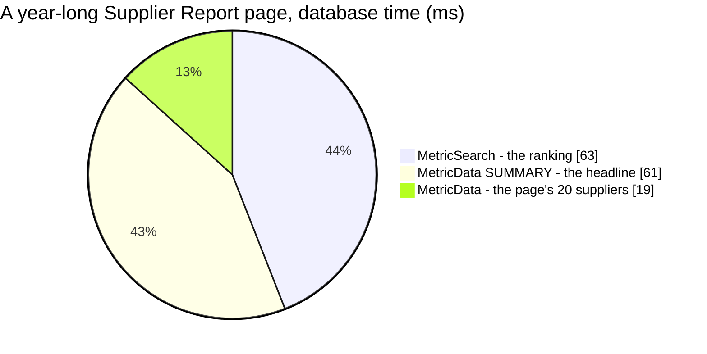

# MetricData — performance audit

> ⚠ **2026-10-28:** the keyword filter is gone ([the-generic-keyword-is-removed](../../../../docs/business/analytic/rpc_provide_decision.md#the-generic-keyword-is-removed)),
> so the `keyword` rows below measure a read that no longer exists. The verdict stands — a year without a keyword is
> still over 50 ms.

**Verdict:** 🟡 heavy by one threshold only — a **year-long** headline (SUMMARY) or a page of 200 suppliers is one 61–70 ms
statement (> 50 ms). Everything the Statistics tab asks is under 13 ms. New with the pattern: the Supplier Report's
headline is now its OWN scan of the window, beside the ranking's — the replaced read computed both in one statement.
✅ **Finding 1's page-turn half fixed the same day** — the headline is its own query, keyed without the page; the two
scans per question remain, by design.
**Measured:** 2026-10-27 · `supplier_service/supplier_v1/metric_data.go` (+ `metric_shared.go`) · the same seed as
[MetricSearch.md](./MetricSearch.md) — **522 070** report rows · warm, median of 5, a FRESH `warehouse_test` ·
[`analytic_perf_test.go`](../../../../backend/services/supplier_service/supplier_v1/analytic_perf_test.go) (`-tags perfaudit`)

Headline case: the Supplier Report's headline, 366 days.

| | median | max |
| --- | --- | --- |
| wall | 61 ms | ~65 ms |
| db | 61 ms | |
| in Go (wall − db) | < 1 ms | |
| queries | 1 at every key count — no N+1 | |

### Every case

| Case | median | |
| --- | --- | --- |
| suppliers · 30 d · 20 / 200 ids | 2.2 / 6.1 ms | ok |
| suppliers · 366 d · 20 / 200 ids | 19.2 / **62.6** ms | 🟡 at 200 |
| suppliers · 366 d · one team · 200 ids | 26.8 ms | ok |
| products of the top supplier · 366 d · 20 / 200 ids | 6.2 / 9.7 ms | ok |
| days of the top supplier · 30 d · 10 keys (the Statistics tab) | 0.6 ms | ok |
| days of the top supplier · 366 d · 200 keys | 4.1 ms | ok |
| months of the top supplier · 366 d · 12 keys | 12.2 ms | ok |
| SUMMARY · 30 d (the report's default headline) | 8.0 ms | ok |
| SUMMARY · 366 d / all history | **61.3** / 61.8 ms | 🟡 |
| SUMMARY · 366 d · keyword `lestari` / `batik` | **70.3** / **55.1** ms | 🟡 |
| SUMMARY · one supplier · 366 d (the Statistics tab's headline) | 7.0 ms | ok |

---

## Queries

| # | What | Rows | Time (366 d) | Plan | Verdict |
| --- | --- | --- | --- | --- | --- |
| 1 | SUMMARY: `SELECT SUM(…)×6 FROM reports r WHERE r.day BETWEEN DATE … [AND keyword]` | 1 | 61 ms | every row of the window | 🟡 the window |
| 1 | by id: `SELECT key, SUM(…)×6 … AND key IN (…) GROUP BY key` | ≤ 200 | 19 ms @ 20 · 63 ms @ 200 | `supplier_day_idx` per id | 🟡 at 200 |
| 1 | by day: `SELECT date_trunc(…)::date AS key, SUM(…)×6 … AND key IN (…) GROUP BY key` | ≤ 200 | 0.6–12 ms | `supplier_day_idx` (one supplier) | ok |

---

## Findings

### 1. A year-long Supplier Report page scans the year twice, and a page turn scans it again 🟡

The replaced `AnalyticGroupSearch` returned the page and the headline from one grouped statement (90 ms for a year). The
pattern splits them by design ([the-headline-is-the-metric-grouped-by-summary](../../../../docs/business/analytic/rpc_provide_decision.md#the-headline-is-the-metric-grouped-by-summary)):
`MetricSearch` (63 ms) and the SUMMARY (61 ms) run side by side, so the person waits about as long as before (~63 ms,
then the 19 ms fill), but **the database does ~143 ms of work where it did 90**. And `useSupplierRanking` keys the
headline with the page, so turning a page re-reads a headline that did not change.

**→ Recommend:** move the headline into its own query in `features/suppliers/analytics.ts`, keyed by the window, the
team and the keyword but **not the page**. Turning a page then costs one scan, not two, and the contract is untouched.

✅ **Applied 2026-10-27** — `useSupplierHeadline`, read by both screens. Fixed rather than discussed because the same
pass wrote the code, and it decides nothing: the same figures, the same contract. The Statistics tab also stopped
reading its series on the By Product view, which it did only to carry the headline. The remaining cost — two scans for
a new question — is the pattern's split of ranking and headline, and only the window limit shrinks it.

### 2. A page of 200 suppliers over a year costs 63 ms 🟡

The ids are the ranking's biggest suppliers, so the most rows to sum — 200 per-supplier index probes over a year. The
screens ask for 20 (19 ms); 200 is the most the contract allows.

**→ Recommend:** nothing beyond [MetricSearch finding 1](./MetricSearch.md#1-a-year-long-ranking-reads-every-row-of-the-year-)'s
window limit, which caps this too.

---

## Proposed migration

None.

---

## Not measured

- concurrency (one caller at a time)
- **a bloated table**: on a database holding two rolled-back 500k seeds, the 30-day SUMMARY flipped to a parallel
  seq scan of the WHOLE table and took 226–350 ms (the 30-day ranking stayed on the index at 11 ms). The fold's upserts
  leave dead rows in production too, so a plain window SUM is the read most exposed if autovacuum falls behind
- a table that outgrows the cache (the 3-year run was not repeated)

---

## Open questions

- [x] Split the headline into its own query, keyed without the page (finding 1)? **Done** — frontend only.
- [ ] Limit the window to 366 days? → [supplier Q19](../../../../docs/business/supplier/context_clarify.md#question).

---

## History

| Date | Median | Queries | Change |
| --- | --- | --- | --- |
| 2026-10-27 | SUMMARY 61 ms @ 366 d · 8 ms @ 30 d · 20 suppliers 19 ms @ 366 d | 1 | first audit — replaced `AnalyticGroupMetric`, `AnalyticTimeSearch` and the replaced ranking's headline |
| 2026-10-27 | unchanged per call | 1 | ✅ finding 1: the headline keyed without the page — a page turn is one scan, not two |
