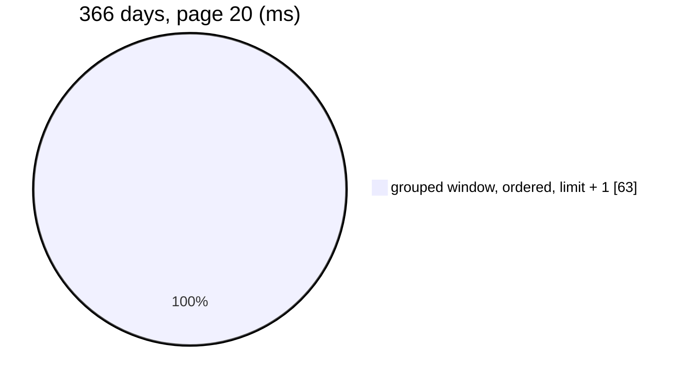

# MetricSearch — performance audit

> ⚠ **2026-10-28:** the keyword filter is gone ([the-generic-keyword-is-removed](../../../../docs/business/analytic/rpc_provide_decision.md#the-generic-keyword-is-removed)),
> so the `keyword` rows below measure a read that no longer exists. The verdict stands — a year without a keyword is
> still over 50 ms.

**Verdict:** 🟡 heavy by one threshold only — a **year-long** ranking is one 63–71 ms statement (> 50 ms). Thirty days,
the screen's default, is 9–11 ms; one supplier's products 0.5–6.5 ms. It is the window's own cost, carried over from the
reads this replaced ([AnalyticGroupSearch finding 3](./AnalyticGroupSearch.md#3-the-cost-is-every-row-in-the-window-and-no-limit-is-placed-on-the-window-)),
still open as [supplier Q19](../../../../docs/business/supplier/context_clarify.md#question).
**Measured:** 2026-10-27 · `supplier_service/supplier_v1/metric_search.go` (+ `metric_shared.go`) · seed **522 070** rows in
`supplier_product_daily_reports` (365 days, 2 000 suppliers, 10 000 products, 8 teams), 2 000 `suppliers`, 6 000
`supplier_channels` · warm, median of 5, a FRESH `warehouse_test` per test · [`analytic_perf_test.go`](../../../../backend/services/supplier_service/supplier_v1/analytic_perf_test.go) (`-tags perfaudit`)

Headline case: the Supplier Report by restocked value, 366 days, page 20.

| | median | max |
| --- | --- | --- |
| wall | 63 ms | ~70 ms |
| db | 63 ms | |
| in Go (wall − db) | < 1 ms | |
| queries | 1 (also 1 at page 200 — no N+1) | |

### Every case

| Case | median | |
| --- | --- | --- |
| suppliers · value · 30 d · page 20 / 200 (the screen's default) | 9.0 / 10.0 ms | ok |
| suppliers · value · 366 d · page 20 / 200 / offset 180 | 63.1 / 63.2 / 63.8 ms | 🟡 |
| suppliers · value · 366 d · one restocking team | 47.6 ms | ok |
| suppliers · broken rate · 30 d / 366 d | 11.2 / 70.5 ms | 🟡 at 366 d |
| suppliers · keyword `lestari` · 30 d / 366 d / by rate 366 d | 10.6 / 64.2 / 65.9 ms | 🟡 at 366 d |
| suppliers · keyword `batik` (stores only) · 366 d | 51.9 ms | 🟡 |
| products of the top supplier (11 661 rows) · 366 d · page 20 / 200 | 6.3 / 6.5 ms | ok |
| products of the top supplier · 30 d / with a team | 1.1 / 5.5 ms | ok |
| products of the median supplier · 366 d | 0.5 ms | ok |

---

## Queries

| # | What | Rows | Time (366 d) | Plan | Verdict |
| --- | --- | --- | --- | --- | --- |
| 1 | `SELECT g.key FROM (SELECT r.supplier_id AS key, SUM(…)×7 FROM reports r WHERE r.day BETWEEN DATE … GROUP BY …) g ORDER BY … , g.key DESC LIMIT 21` | 21 | 63 ms | every row of the window, aggregated per supplier, then a top-N sort | 🟡 the window |

The rate sort is `(g.units >= 50) DESC, CASE WHEN g.units >= 50 THEN rate END DESC NULLS LAST, g.key DESC` — one more
term, 7 ms more than by value.

---

## Findings

### 1. A year-long ranking reads every row of the year 🟡

The same finding as the replaced read, unchanged in kind: 63–71 ms for a year at this seed, growing with every day of
history the window spans. The metric's window still has no limit.

**→ Recommend:** what [AnalyticGroupSearch finding 3](./AnalyticGroupSearch.md#3-the-cost-is-every-row-in-the-window-and-no-limit-is-placed-on-the-window-)
recommended, now for the metric — limit `metrics/suppliers`' window to 366 days, and build the monthly rollup only when
someone asks for more. It waits on [supplier Q19](../../../../docs/business/supplier/context_clarify.md#question).

---

## Proposed migration

None.

---

## Not measured

- concurrency (one caller at a time)
- a table that outgrows the cache — the 3-year growth run was not repeated; the replaced read's took ~370 ms a year
- **a bloated table**: on a database that had held two rolled-back 500k seeds, the same cases ran 2–3× slower (366 d:
  137–169 ms). Production has no rolled-back seeds, but the fold's upserts do leave dead rows for autovacuum
- the frontend's follow-up reads (`MetricData`, `SupplierByIds`, team names)

---

## Open questions

- [ ] Limit the window to 366 days? → [supplier Q19](../../../../docs/business/supplier/context_clarify.md#question), unchanged.

---

## History

| Date | Median | Queries | Change |
| --- | --- | --- | --- |
| 2026-10-27 | 63 ms @ 366 d · 9 ms @ 30 d · products 6 ms | 1 | first audit — replaced `AnalyticGroupSearch` and `AnalyticProductSearch` |
