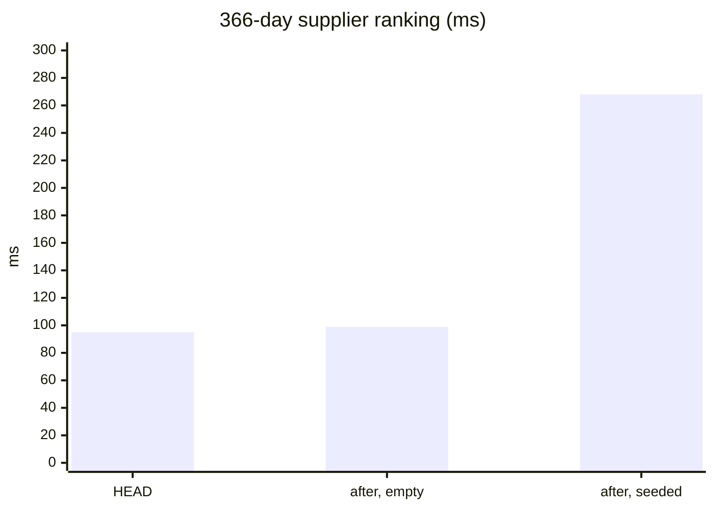

# Penjualan — performance audit (the sales fold, and the figures' reads with it)

**Verdict:** ✅ the fold — **≈ 2 ms, 6 statements whatever the parts**. 🟡 the reads grow with Penjualan's rows: on the
worst-case seed (a sale row for EVERY restock row — twice the rows) the 366-day reads double, the 30-day ones stay
under 30 ms.
**Measured:** 2026-11-07 · `supplier_v1/sales_fold.go`, `metric_data.go`, `metric_search.go`, `analytic_shared.go` ·
the figures book (`analytic_perf_test.go`): 1 year, 2 000 suppliers, 10 000 products, 522 070 restock day rows; the
sales table seeded with the SAME 522 070 keys (`PERF_FIG_SALES=0` leaves it empty) · each case its own process after
`VACUUM FULL ANALYZE` of both tables (a rolled-back seed leaves dead tuples that flip plans) · warm-up + 5 runs

## The fold — `TestPerf_SalesFold` (`sales_fold_perf_test.go`)

The top supplier's products on the book's last day, so the day rows exist and are UPDATED. inventory's take is a fake
here (its own read is `OrderTakeSuppliers`, one indexed statement on `batch_logs_transaction_idx`).

| case | median wall | statements |
| --- | --- | --- |
| OrderPlaced, 1 part | 1.8 ms | 6 |
| OrderPlaced, 5 parts | 1.8 ms | 6 |
| OrderPlaced, 20 parts | 2.7 ms | 6 |
| OrderCancelled, 1 part | 1.9 ms | 6 |
| OrderCancelled, 5 parts | 1.7 ms | 6 |
| OrderCancelled, 20 parts | 2.2 ms | 6 |

The six: BEGIN-side claim `INSERT … ON CONFLICT DO NOTHING`, the row `FOR UPDATE`, its `UPDATE`, the parts' one
multi-row `INSERT` (the cancel: their one `SELECT`), one `INSERT … SELECT … ORDER BY key ON CONFLICT DO UPDATE` for every
day row, COMMIT. Flat in the parts.

## The reads — before (HEAD, no sales) · after, sales table empty · after, sales seeded

| case | HEAD | after, empty | after, seeded |
| --- | --- | --- | --- |
| MetricData summary 30 d | 8.8 ms | 8.5 ms | 16.6 ms |
| MetricData summary 366 d | 79 ms | 66 ms | 168 ms |
| MetricData suppliers 366 d, 200 ids | 90 ms | 68 ms | 192 ms |
| MetricData days top 366 d, 200 keys | 6.5 ms | 6.4 ms | 11.0 ms |
| MetricSearch suppliers by value 30 d, 20 | 17 ms | 17 ms | 28 ms |
| MetricSearch suppliers by value 366 d, 20 | 95 ms | 99 ms | 268 ms |
| MetricSearch suppliers by value 366 d, 200 | 90 ms | 101 ms | 236 ms |

## Findings

### 1. Never a UNION ALL of the raw rows (fixed)

The first cut read the two tables as one derived `r` (UNION ALL of their rows) under every aggregate. Postgres planned it
as a Parallel Append, and the workers' start-up alone took the 30-day headline from 8.8 to 38 ms with the sales table
EMPTY. Now each table is narrowed and grouped on its own — `MetricData` sums the two grouped reads in Go (2 statements),
`MetricSearch` takes one UNION ALL of the two GROUPED reads — and an empty sales table costs nothing (column 2).

### 2. The seeded cost is the rows, not the shape

The seeded column doubles the rows a 366-day read aggregates, and the time roughly follows (≈ 2.1–2.8×). Real sales
rows are fewer than restock rows — a sale row exists only for a (day, supplier, product, team) that sold, and the take
spreads an order over at most its lines' batches — so this is the ceiling. A 366-day ranking at ≈ 250 ms is the
Supplier Report over a year.

**→ Recommend (not applied):** a monthly roll-up of both tables for windows over ~90 days, the same lever the restock
figures already have open in `MetricSearch.md`.
