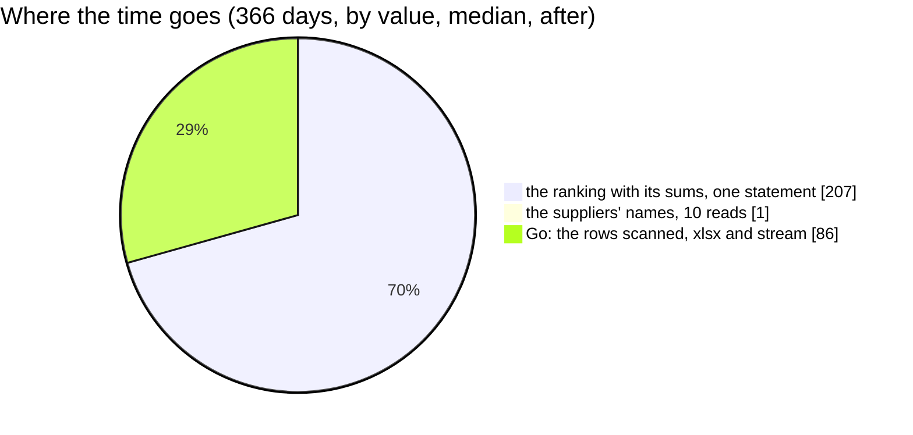

# SupplierReportExport — performance audit

**Verdict:** 🟡 — finding 1 applied 2026-11-14: the file is ONE statement (the ranking, ≈ 210 ms over a year — MetricSearch's own, audited in [MetricSearch.md](MetricSearch.md)) plus a names read per 200 suppliers; ≈ 0,3–0,4 s for 2 000 suppliers at a year (was ≈ 1,15 s), ≈ 0,6–0,7 s with a search (was ≈ 2,1 s). Still over the 150 ms line — by the ranking statement alone
**Measured:** 2026-11-14 · `supplier_service/supplier_v1/supplier_report_export.go` · seed of `TestPerf_MetricSearch` (2 000 suppliers, 10 000 products, 8 teams, a product restocked ~1 day in 7 → 522 070 rows in `supplier_product_daily_reports` and in `supplier_sale_daily_reports` over 366 days) · warm, 5 runs · the old export (HEAD 7b5d6ce1) and the new one timed on ONE seed in one process, each case old-then-new and new-then-old, the seeded tables vacuumed before each process (a rolled-back seed leaves its 1 M rows dead, and the next probe reads them) · probe `supplier_report_export_perf_test.go`

| case | before — a MetricData fill per 200 | after — the ranking's own sums | queries |
| --- | --- | --- | --- |
| by value, 30 days | 300–319 ms | 301–319 ms | 31 → 11 |
| by value, 366 days | 1 139–1 171 ms | 294–362 ms | 31 → 11 |
| by broken rate, 366 days | 1 339–1 361 ms | 304–305 ms | 31 → 11 |
| by value, 366 days, one team | 684–697 ms | 181–184 ms | 16 → 6 |
| by value, 366 days, a search (`1`, 1 788 suppliers) | 2 066–2 094 ms | 683–722 ms | 28 → 10 |

A range is the two orders' medians. The committed probe alone after the change (one process per case, vacuumed): 294 /
403 / 409 / 248 / 596 ms. At 30 days nothing is gained: the fill was ≈ 6 ms a step there, and on this run the ranking
statement seq-scanned both tables (≈ 210 ms) for 30 days as for 366 — MetricSearch's plan.



---

## Queries

| # | What | Rows | Time | Plan | Verdict |
| --- | --- | --- | --- | --- | --- |
| 1 | the ranking — `metricScope.rows` and `salesRows` grouped by supplier, `UNION ALL`, summed, ordered (MetricSearch's own statement, `ranking()`), read whole as `g.key` + the eight sums | 1 934 | 205–220 ms | Parallel Seq Scan on both daily-report tables, HashAggregate | 🔴 > 50 ms — the same statement a MetricSearch page runs (MetricSearch.md) |
| 2–11 | `suppliers WHERE id IN (200 ids)` **×10** | 200 | < 1 ms ea | Index Scan `suppliers_pkey` | ok |

Before 2026-11-07 the ranking was read a page of 200 at a time through `MetricSearch` (40 statements, 2,6 s at 366 days,
6,3 s with a search). Until 2026-11-14 each step of 200 was then filled by MetricData — two grouped reads of the window,
30–45 ms each, ≈ 760 ms of the 1 093 (finding 1).

---

## Findings

### 1. The fill re-reads the window once per 200 suppliers 🔴 → ✅ applied 2026-11-14

Each step asked MetricData for its 200 ids — two grouped reads of the year, filtered by the ids. Ten steps cost ≈ 760 ms of
the 1 093 ms. The ranking statement (#1) had already summed every supplier's figures in its subquery `g`, and threw
them away (it selected `g.key`).

```
PLAN #0 | -> Parallel Seq Scan on supplier_product_daily_reports r (rows=174023 loops=3)
PLAN #0 | -> Parallel Seq Scan on supplier_sale_daily_reports r_1 (rows=174023 loops=3)
PLAN #0 | Execution Time: 191.864 ms
```

**→ Recommended:** read the figures from the ranking statement itself — `SELECT g.*` instead of `g.key`, scanned into
`SupplierFigureSums` and mapped by `metricToProto`, as MetricData maps its own — so the export is ONE statement plus the
names. The sums are the same aggregates over the same rows (equal by construction).

**Applied** (on request, 2026-11-14): `rankedSuppliers` selects `g.key` and the eight sums the statement already holds
into `rankedSupplier{Key, SupplierFigureSums}`, and each row's cells are `figureCells(metricToProto(sums))` — what
MetricData's fill fed them. `MetricSearch` is untouched (it still plucks `g.key` from `ranking()`). ≈ 3–4× at a year (the
estimate said ≈ 5×: the Go side — 1 934 rows of eight sums scanned, the .xlsx, the stream, ≈ 85 ms — now weighs more).

The proof the file is the same: the old export (kept verbatim in a throwaway test) and the new one wrote their files from
one seed and were compared byte for byte. On the export test's fixture — 214 suppliers, Penjualan in fractional rupiah on
three days for 40 of them; by value, by sales value, by broken rate, ascending, a search, one team — the whole .xlsx is
byte-identical in all six, and a 1e-9 change to one figure fails the comparison. On the 522 070-row seed every cell is
identical but Penjualan (Rp)'s last binary digit (finding 3). The kept tests (`supplier_report_export_test.go`) still
compare every row of the file with the report's own MetricSearch + MetricData.

### 2. A search scans every supplier's stores on every read 🟡

With a search the keyword subquery (suppliers × supplier_channels, a Seq Scan on both) ran inside every statement — the
ranking and each fill. The screen pays it per page too (MetricSearch.md).

**→ Recommend:** finding 1 removed the repeats — it runs once now, inside the ranking (≈ 520–930 ms of the search case);
the keyword match itself is MetricSearch's, audited there.

### 3. A fractional sum's last binary digit follows the plan 🟢

Penjualan (Rp) sums doubles (a line's share of its order's platform total — fractional rupiah), and Postgres adds doubles
in the order its plan meets the rows: a parallel aggregate combines its workers' partial sums differently run to run. So
two reads of the same rows can differ in the last binary digit — at most 3e-15 of the value, e.g. `650369922.8000009` vs
`650369922.7999997`, both Rp 650.369.922,80 on screen. On the seed (366 days) the OLD export already differed from itself
between two runs in 83–199 cells a file; the new one, whose sums come from the parallel ranking, in 314–944; old vs new in
469–1 566 (of 825–1 934 rows). Restocked, lost and broken values (whole rupiah in the seed), every count and every rate never differ, nor does
any cell when the plan is not parallel (the fixture, a search).

**→ Recommend:** nothing. A byte-stable sum needs an ordered aggregate (it gives up the parallel plan) or exact numeric
money (a migration of both report tables).

---

## Not measured

- concurrency (single caller)
- cache-cold behaviour
- the document upload (the probe's store is a fake) — the file is ≈ 2 000 rows, a few hundred KB
- production distribution: the seed's suppliers are uniform; a real ranking is a long tail of small suppliers

---

## Open questions

- [x] Fill the file from the ranking statement (finding 1: one statement) — or keep MetricData's fill per step (the
  screen's literal read)? → the ranking statement's sums, applied 2026-11-14.

---

## History

| Date | Median (366 d, by value) | Queries | Change |
| --- | --- | --- | --- |
| 2026-11-07 | 2 624 ms | 40 | first build — the ranking a MetricSearch page of 200 at a time |
| 2026-11-07 | 1 093 ms | 31 | the ranking read whole through MetricSearch's statement (`ranking()`) |
| 2026-11-14 | 1 139–1 171 ms | 31 | re-measured before the change: the old code on today's seed, the old and new export on ONE seed, both orders, the seeded tables vacuumed first (the reports carry `warehouse_id` since 00006) |
| 2026-11-14 | 294–362 ms | 11 | finding 1 applied — the figures are the ranking statement's own sums (`rankedSuppliers`); the file byte-identical to the old one on the export test's fixture; the committed probe alone reads 403 ms |
