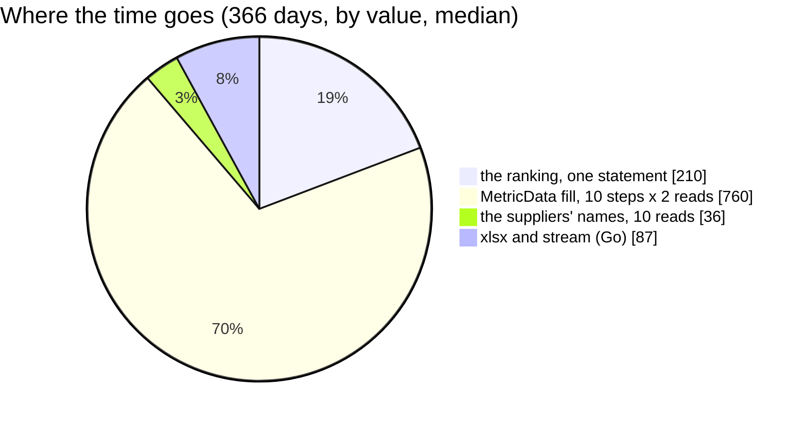

# SupplierReportExport — performance audit

**Verdict:** 🔴 heavy — the whole ranking over a year is one window-wide aggregate (≈ 200 ms) plus a MetricData fill of the window per 200 suppliers; ≈ 1,1 s for 2 000 suppliers, ≈ 1,7 s with a search
**Measured:** 2026-11-07 · `supplier_service/supplier_v1/supplier_report_export.go` · seed of `TestPerf_MetricSearch` (2 000 suppliers, 10 000 products, 8 teams, a product restocked ~1 day in 7 → 522 069 rows in `supplier_product_daily_reports` and in `supplier_sale_daily_reports` over 366 days) · warm, 5 runs · probe `supplier_report_export_perf_test.go`

| case | median | max | db | queries |
| --- | --- | --- | --- | --- |
| by value, 30 days | 187 ms | 204 ms | 105 ms | 31 |
| by value, 366 days | 1 093 ms | 1 141 ms | 1 006 ms | 31 |
| by broken rate, 366 days | 1 296 ms | 1 343 ms | 1 211 ms | 31 |
| by value, 366 days, one team | 478 ms | 495 ms | 439 ms | 16 |
| by value, 366 days, a search (`1`, 1 854 suppliers) | 1 716 ms | 1 733 ms | 1 631 ms | 28 |



---

## Queries

| # | What | Rows | Time | Plan | Verdict |
| --- | --- | --- | --- | --- | --- |
| 1 | the ranking — `metricScope.rows` and `salesRows` grouped by supplier, `UNION ALL`, summed, ordered (MetricSearch's own statement, `ranking()`), read whole | 2 000 | 190–212 ms | Parallel Seq Scan on both daily-report tables (174 k rows a worker), HashAggregate | 🔴 > 50 ms — the same statement a MetricSearch page runs (MetricSearch.md) |
| 2–21 | MetricData's fill by ids — each table `WHERE supplier_id IN (200 ids)` grouped **×10 steps × 2 tables** | 200 | 30–45 ms ea | index range per id over the window | 🟡 grows with the ranking, a step per 200 rows |
| 22–31 | `suppliers WHERE id IN (200 ids)` **×10** | 200 | < 4 ms ea | Index Scan `suppliers_pkey` | ok |

Before this build the ranking was read a page of 200 at a time through `MetricSearch` (40 statements, 2,6 s at 366 days, 6,3 s with a search): the ranking now runs once, whole, through the statement `MetricSearch` cuts its pages from (`ranking()` in metric_search.go).

---

## Findings

### 1. The fill re-reads the window once per 200 suppliers 🔴

Each step asks MetricData for its 200 ids — two grouped reads of the year, filtered by the ids. Ten steps cost ≈ 760 ms of
the 1 093 ms. The ranking statement (#1) has already summed every supplier's figures in its subquery `g`, and throws
them away (it selects `g.key`).

```
PLAN #0 | -> Parallel Seq Scan on supplier_product_daily_reports r (rows=174023 loops=3)
PLAN #0 | -> Parallel Seq Scan on supplier_sale_daily_reports r_1 (rows=174023 loops=3)
PLAN #0 | Execution Time: 191.864 ms
```

**→ Recommend:** read the figures from the ranking statement itself — `SELECT g.*` instead of `g.key`, scanned into
`SupplierFigureSums` and mapped by `metricToProto`, as MetricData maps its own — so the export is ONE statement
(≈ 210 ms at 366 days) plus the names. The sums are the same aggregates over the same rows; the trade-off is that the
file's figures then come from the search's sums rather than from MetricData's own fill (equal by construction, but no
longer the literal "same read" the screen's two-step page makes). I would pick it.

### 2. A search scans every supplier's stores on every read 🟡

With a search the keyword subquery (suppliers × supplier_channels, a Seq Scan on both) runs inside every statement — the
ranking and each fill — 511 ms for the ranking alone. The screen pays it per page too (MetricSearch.md).

**→ Recommend:** finding 1 removes the repeats (one statement); the keyword match itself is MetricSearch's, audited there.

---

## Not measured

- concurrency (single caller)
- cache-cold behaviour
- the document upload (the probe's store is a fake) — the file is ≈ 2 000 rows, a few hundred KB
- production distribution: the seed's suppliers are uniform; a real ranking is a long tail of small suppliers

---

## Open questions

- [ ] Fill the file from the ranking statement (finding 1: ≈ 5× faster, one statement) — or keep MetricData's fill per step (the
  screen's literal read)? I would take the ranking statement's sums.

---

## History

| Date | Median (366 d, by value) | Queries | Change |
| --- | --- | --- | --- |
| 2026-11-07 | 2 624 ms | 40 | first build — the ranking a MetricSearch page of 200 at a time |
| 2026-11-07 | 1 093 ms | 31 | the ranking read whole through MetricSearch's statement (`ranking()`) |
